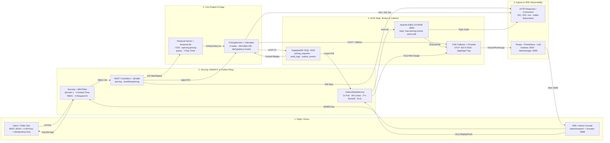
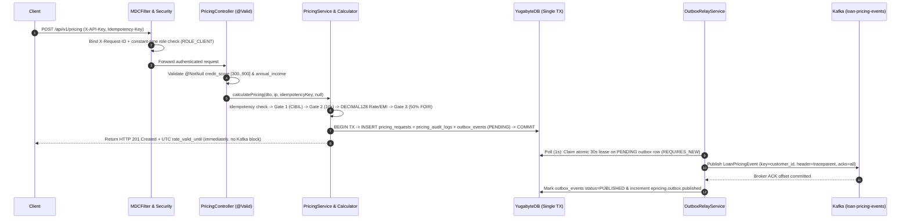
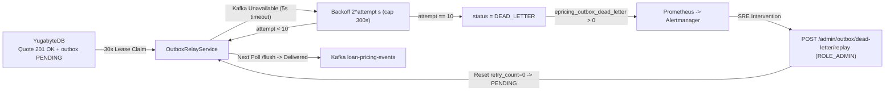

# ePricing Service — Interactive Architecture & End-to-End Data Flow Guide

Companion technical reference to the interactive **Architecture Data Flow** canvas in [`showcase/index.html`](../showcase/index.html).  
Every swimlane, node, wire, HTTP boundary, database transaction, Kafka relay loop, and telemetry signal in this guide maps 1-to-1 to the hardened production implementation.

---

## 1. System Blueprint (5 Swimlanes × 12 Components)

Data flows left-to-right from ingress actors through stateless security/validation, domain execution, distributed ACID persistence / orchestration, and async streaming & SRE observability sinks:

---

## 2. Architecture Nodes Reference (`12 Nodes`)

| Lane | Component | Implementation & Ports | Primary Responsibility & Safety Controls |
| :--- | :--- | :--- | :--- |
| **1. Edge** | `Client / Traffic Gen` | External callers / `traffic-generator` -> `:8080/api/v1` | Sends JSON loan requests with `X-API-Key` (or `Authorization: Bearer`) and `Idempotency-Key` (`<= 128` chars). |
| **1. Ops** | `SRE / Admin Console` | On-call operators / Grafana (`:3000`) / Alertmanager (`:9093`) | Audits `/admin/outbox/summary`, triggers manual `/flush` (`OPERATOR`/`ADMIN`), or replays DLQ (`/dead-letter/replay`, `ADMIN`). |
| **2. Filter** | `Security + MDCFilter` | `MDCFilter` (`@Order(1)`), `ApiKeyAuthenticationFilter`, `SecurityConfig` | Binds `X-Request-ID`, performs constant-time `MessageDigest.isEqual()` role checks (`CLIENT` < `OPERATOR` < `ADMIN`), clears MDC in `finally`. |
| **2. WebMVC** | `REST Controllers` | `PricingController`, `TemporalPricingController`, `OutboxAdminController` | Thin HTTP boundary enforcing Jakarta `@Valid` (`@NotNull credit_score`, `@NotNull annual_income`) before any DB or calculation call. |
| **2. Relay** | `OutboxRelayService` | `@Scheduled(fixedDelayString="1000")` + `OutboxEventRepository` | Claims batch leases (`batchSize=25`, `leaseSeconds=30`) in `REQUIRES_NEW` TX, awaits Kafka (5s timeout), applies bounded backoff -> `DEAD_LETTER`. |
| **3. Domain** | `PricingService + Math` | `PricingService`, `PricingCalculator`, `PricingAuditService` | Enforces `Idempotency-Key` deduplication + tamper guard, 3 statutory gates (CIBIL `>= 650`, LTI `<= 10x`, FOIR `<= 50%`), and `MathContext.DECIMAL128` EMI math. |
| **3. Saga** | `Temporal Server + DB` | `TemporalConfig`, `LoanPricingWorkflowImpl`, `PricingActivitiesImpl` | Runs 7-day durable rate locks (`Workflow.await`) on zero idle JVM threads; deduplicates activity retries via `"temporal:" + workflowId`. |
| **4. YSQL** | `YugabyteDB (V1..V9)` | YSQL `:5433`, Hikari `epricing-pool`, `PostgresTimeoutBeanPostProcessor` | Stores `pricing_requests`, `pricing_audit_logs`, `outbox_events`; enforces `UNIQUE idx_pricing_idempotency_key`, `@Version`, `lock_timeout=5s`, `statement_timeout=15s`. |
| **4. Broker** | `Apache Kafka 3.8` | KRaft `:29092` (Docker) / `:9092`, `KafkaPricingEventProducer` | Topic `loan-pricing-events` (`acks=all`, `enable.idempotence=true`, `max.block.ms=3000`, configurable partitions & `replicas`). |
| **4. Telemetry** | `OTel + Promtail` | `otel-collector` (`:4317/:4318`), `promtail`, Actuator (`:8081/:8089`) | Streams OTLP trace spans + metrics (`OpenTelemetryConfig`, `PricingMetrics`) and ships rolling masked JSON logs (`StructuredLogger`). |
| **5. Egress** | `Response / Consumers` | HTTP caller & downstream CRM / origination Kafka subscribers | Receives sub-5ms `201 Created`, `202 Accepted`, `4xx` envelopes, or `LoanPricingEvent` messages with W3C `traceparent`. |
| **5. SRE UI** | `Tempo • Prom • Loki` | Grafana `:3000`, Prometheus `:9090`, Loki `:3100`, Tempo `:3200`, Alertmanager `:9093` | Unifies 5s PromQL metrics, W3C trace waterfalls, Loki LogQL streams, read-only YSQL KPIs (`V6`), and Slack/webhook alerts. |

---

## 3. The 7 Runtime Data Flows (First Hop -> Terminal Output)

### Flow 1 — Sync Instant Quote (`POST /api/v1/pricing` -> `HTTP 201` -> Outbox -> Kafka)

### Flow 2 — Security Gate Short-Circuit (`HTTP 401 UNAUTHORIZED` / `403 FORBIDDEN`)
1. **Ingress (`client`)**: Caller sends a request missing `X-API-Key` / `Authorization: Bearer`, presenting an invalid key, or presenting a `CLIENT` key to an `OPERATOR`/`ADMIN` route (`/admin/**`, `/actuator/**`, unfiltered `GET /pricing`).
2. **FilterChain Decision (`sec-mdc`)**: `ApiKeyAuthenticationFilter` runs constant-time `MessageDigest.isEqual()`. Either `authenticationEntryPoint` (`401`) or `accessDeniedHandler` (`403`) fires inside `SecurityConfig`.
3. **Edge Response (`client`)**: Stateless JSON (`status`, `error_code`, `message`, `path`, `timestamp`) is returned immediately. `MDC.clear()` cleans thread locals. **Controllers, YugabyteDB, Temporal, and Kafka are bypassed cleanly.**

### Flow 3 — RBI Underwriting Policy Rejection (`HTTP 422` + Compliance Audit)
1. **Ingress & Validation (`client` -> `sec-mdc` -> `controller`)**: Caller passes auth and DTO schema checks (e.g. `credit_score: 580` satisfies `@Min(300)`).
2. **Eligibility / FOIR Fail (`service`)**: `PricingCalculator.validateEligibility()` (CIBIL `< 650`, loan `> 10× income`) or `validateFoir()` (EMI `> 50%` monthly income) throws `PricingException`.
3. **Compliance Audit (`yugabyte`)**: `PricingService` catches the business rejection, marks the OTel validation span `ERROR`, and calls `PricingAuditService.recordRejection()` (`REQUIRES_NEW` TX) writing a `REJECTED` row and `PRICING_REJECTED` audit row — with **0 rows inserted into `outbox_events`** (Kafka bypassed).
4. **Error Response (`response`)**: `GlobalExceptionHandler` serializes `HTTP 422 Unprocessable Entity` (`trace_id`, zero stacktrace) and increments `pricing.errors.total`.

### Flow 4 — Idempotent Replay & Tamper Guard (`Idempotency-Key` Replay / `409 Conflict`)
1. **Retry Arrival (`client` -> `sec-mdc` -> `controller`)**: Retried request carries the same `Idempotency-Key` header (checked `<= 128` chars).
2. **Unique Index Lookup (`service` -> `yugabyte`)**: `PricingService.resolveIdempotencyKey()` queries `findByIdempotencyKey()`, backed by `UNIQUE INDEX idx_pricing_idempotency_key` (`V9`). Concurrent insert races are also caught on `DataIntegrityViolationException` and resolved cleanly.
3. **Payload Comparison (`validateIdempotentReplay`)**:
   - **Matching payload**: Returns the previously committed quote (`201 Created`) without recalculating or emitting duplicate Kafka events.
   - **Modified financial parameters**: Throws `409 Conflict` (`DUPLICATE_IDEMPOTENCY_KEY`) to protect against key reuse attacks.

### Flow 5 — Durable 7-Day Temporal Rate Lock Saga (`POST /start` -> `202` -> Signal / Timeout)
1. **Async Start (`client` -> `controller`)**: `POST /api/v1/workflow/pricing/start` hashes `customer_id` into a PII-safe `workflow_id` (`pricing-<sha256_12>-<hash>`), applies `WorkflowIdReusePolicy.WORKFLOW_ID_REUSE_POLICY_REJECT_DUPLICATE` when `Idempotency-Key` is passed, and returns `202 Accepted` (`status: PROCESSING`).
2. **Temporal Scheduling (`temporal`)**: Temporal Server (`:7233`, backed by `temporal-db`) schedules `calculateAndPersistPricing` on `epricing-pricing-queue`.
3. **Deduplicated Activity (`service` -> `yugabyte`)**: `PricingActivitiesImpl` (5 retry attempts `1s..10s`; fails fast on business `PricingException`) invokes `PricingService.calculatePricing(..., "temporal:" + workflowId, workflowId)`. All 3 tables (`pricing_requests`, `pricing_audit_logs`, `outbox_events`) commit atomically.
4. **7-Day Zero-Thread Wait (`temporal`)**: `LoanPricingWorkflowImpl` checks `Workflow.getVersion("accept-early-decision-signal", ...)` and suspends in `Workflow.await(Duration.ofDays(rateValidDays), () -> approved || rejected)`.
5. **Terminal Transition (`yugabyte` -> `outbox-relay` -> `kafka`)**: `POST /approve`, `POST /reject` (`{}` defaults safely to `"Customer rejected offer"`), or 7-day timeout invokes `@Transactional` activity with JPA `@Version` optimistic locking + terminal-state guard, persisting `APPROVED`/`REJECTED`/`EXPIRED` audit + `OutboxEvent` for Kafka delivery.

### Flow 6 — Kafka Outage, Backoff Quarantine & Admin DLQ Recovery

### Flow 7 — Full-Stack SRE Observability Mesh
- **Traces (`OpenTelemetryConfig` -> `otel-collector:4318` -> `Tempo:3200`)**: Parent HTTP server spans wrap child `calculatePricing`, `validateEligibility`, `computeInterestRate`, `PricingRepository.save`, and Kafka producer spans with identical 128-bit `traceId`.
- **Metrics (`PricingMetrics`, `OutboxRelayService` -> `:8089/actuator/prometheus` -> `Prometheus:9090`)**: 5s scrape covering HTTP P50/P90/P95/P99 latency & SLA buckets, HikariCP connection counts, `epricing.outbox.pending` / `dead_letter` / `published`, plus host/container stats from `node-exporter:9100` & `cadvisor:8085`.
- **Logs (`MDCFilter` + `StructuredLogger` -> `promtail` -> `Loki:3100`)**: Structured JSON logs masking `customerId` (`CUST****-001`) and correlating every log entry by `requestId` and `traceId` in Grafana (`:3000`).

---

## 4. Production Infrastructure Controls Summary

| Domain | Status in Repository | Cluster / Org Prerequisites Before External Go-Live |
| :--- | :--- | :--- |
| **Profile Safety & Ports** | `MetricsDemoController` gated `@Profile("!prod & !k8s")`; no hardcoded Grafana password | Ensure `SPRING_PROFILES_ACTIVE=prod` or `k8s` in deployment pipeline |
| **Database Timeouts & Schema** | `V1..V9` pure DDL, `PostgresTimeoutBeanPostProcessor` (`5s` lock / `15s` stmt), `ddl-auto=validate` | Provision TLS CA cert (`sslmode=verify-full`) for YugabyteDB YSQL |
| **Kafka Durability** | Externalized `KAFKA_TOPIC_PARTITIONS` (`3`), `KAFKA_TOPIC_REPLICAS` (`3` in `k8s/02-configmap.yml`), `min.insync.replicas` (`2`) | Run `>= 3` Kafka brokers matching replication settings |
| **Kubernetes Network Isolation** | `k8s/08-networkpolicy.yml` enforces namespace selectors (`ingress` -> `:8080`, `monitoring` -> `:8081`, egress to `database`/`streaming`/`temporal`/`monitoring`/`kube-system`) | Ensure cluster namespaces carry `kubernetes.io/metadata.name` labels matching your gateway/monitoring namespaces |
| **OTel Collector Overhead** | `debug` exporter removed from high-volume `traces` & `metrics` pipelines in `otel-collector-config.yml` | Configure TLS (`insecure: false` + certs) between OTel Collector and Tempo in multi-node deployments |
| **Auth / PII / Log Archival** | Stateless RBAC API keys + masked telemetry tags in place | Wire OAuth2/JWT customer claims (`jwt.sub`), Temporal `PayloadCodec` KMS encryption, Alertmanager Slack/PagerDuty secrets, and S3/GCS storage in Loki/Tempo for multi-year banking retention |
