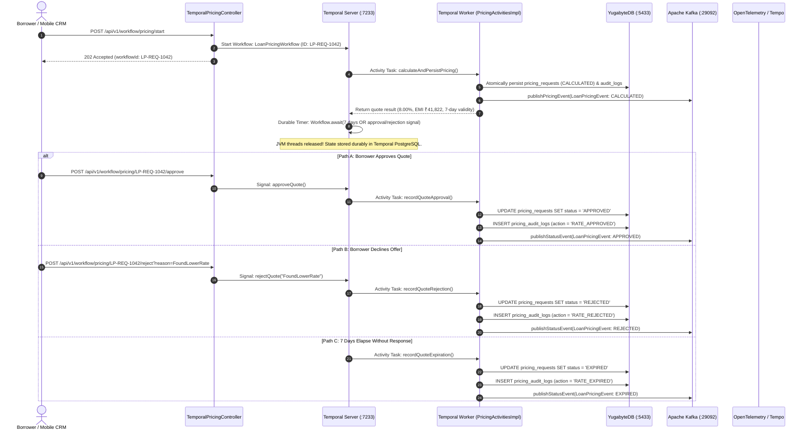

# ePricing Observability & Distributed Streaming — Project Flow Guide
## How a Pricing Decision Flows Across HTTP, Database, Kafka, Temporal, and Observability

---

## 1. THE SYNCHRONOUS REQUEST LIFECYCLE (From Client to Grafana & Kafka)

### PHASE 1: HTTP Request Ingress & Context Initialization

```http
POST /api/v1/pricing HTTP/1.1
Host: localhost:8080
Content-Type: application/json
X-Customer-ID: CUST****1234
X-Request-ID: REQ-ABC123DEF456

{
  "productType": "HOME_LOAN",
  "loanAmount": 5000000.00,
  "loanTenureMonths": 240,
  "creditScore": 780,
  "annualIncome": 2400000.00,
  "customerId": "CUST****1234"
}
```

1. **Tomcat Engine** accepts the TCP connection on port `8080`.
2. **`MDCFilter`** (Servlet Filter, Order=1) intercepts before controller dispatch:
   - Extracts or generates `X-Request-ID` → `requestId = "REQ-ABC123DEF456"`.
   - Reads `X-Customer-ID` and sanitizes it via `StructuredLogger.maskCustomerId()` → `customerId = "CUST****1234"`.
   - Populates SLF4J MDC: `{requestId, customerId="CUST****1234", httpMethod="POST", requestUri="/api/v1/pricing"}`.
   - Logs: `INFO Incoming request | method=POST | uri=/api/v1/pricing`.
3. **OpenTelemetry Spring MVC Instrumentation** creates the ROOT TRACE SPAN:
   - Generates W3C `traceId = "4bf92f3577b34da6a3ce929d0e0e4736"` (32 hex characters).
   - Generates `spanId = "00f067aa0ba902b7"` (16 hex characters).
   - Bridges `traceId` and `spanId` into MDC so all subsequent log appenders include trace coordinates automatically.
4. **`PricingController.calculatePricing()`** receives the deserialized `PricingRequestDto`.
5. **Hibernate Validator (`@Valid`)** validates input bounds (e.g. loan amount > 0, credit score between 300 and 900). If validation fails, `MethodArgumentNotValidException` routes immediately to `GlobalExceptionHandler`.

---

### PHASE 2: Core Pricing Engine Execution & Persistence

6. **Controller** delegates to **`PricingService.calculatePricing(requestDto, clientIp)`**.
7. **Micrometer Metrics** record ingress signals:
   - `pricing_requests_total{type="all"}` incremented.
   - `pricing_requests_active` gauge incremented (0 → 1).
   - `pricing.loan.amount` distribution summary updated (`5000000.0`).
8. **`Tracer.spanBuilder("calculatePricing")`** creates child span under the root trace.
9. **`PricingCalculator.validateEligibility()`**:
   - Evaluates credit score against product thresholds (e.g., minimum 650).
   - Computes Fixed Obligation to Income Ratio (FOIR ≤ 50%).
   - Child span: `validateEligibility`.
10. **`PricingCalculator.calculateInterestRate()`**:
    - Computes: `BASE_RATE (8.50%) + Product Margin + Credit Score Adjustment (-1.00%) + Volume Discount (-0.25%) = 8.00%`.
    - Child span: `computeInterestRate`.
11. **`PricingCalculator.calculateEmi()`**:
    - Evaluates reducing balance amortization formula using exact `BigDecimal` rounding (`HALF_EVEN`).
    - Produces monthly EMI: ₹41,822.00; Total Interest: ₹50,37,280.00.
12. **`auditService.savePricingWithAudit()`**:
    - Confines the atomic database write to `PricingAuditService` via `@Transactional(rollbackFor = Exception.class)` against **YugabyteDB** (or in-memory H2 during local tests). Note that `PricingService.calculatePricing()` is intentionally non-transactional to avoid HikariCP connection-pool starvation deadlocks.
    - `pricingRepository.save(entity)`: Inserts pricing record with status `CALCULATED`.
    - `auditRepository.save(auditLog)`: Inserts immutable audit entry with action `PRICING_CALCULATED`.
    - Child span: `PricingRepository.save`.
13. **`StructuredLogger.logPricingCompleted()`**:
    - Emits structured JSON log containing masked customer ID (`CUST****1234`), coarse bracket (`"10L-1Cr"`), and duration.
14. **Metrics Completion**:
    - `pricing_requests_total{type="success"}` incremented.
    - `pricing_requests_active` gauge decremented (1 → 0).
    - `pricing_calculation_duration_seconds` timer records latency.

---

### PHASE 2.5: Asynchronous Kafka Domain Event Publishing

15. **Event Construction (`LoanPricingEvent`)**:
    - Constructs strongly-typed domain event `LoanPricingEvent` containing calculation snapshot, status `CALCULATED`, and active `traceId`.
16. **Fail-Fast Producer Dispatch (`KafkaPricingEventProducer`)**:
    - Starts OTel producer span: `kafka.publish.loan-pricing-events`.
    - Injects W3C `traceparent` (`00-4bf92f3577b34da6a3ce929d0e0e4736-00f067aa0ba902b7-01`) into Kafka `ProducerRecord` headers.
    - Assigns message key = `customerId` (`"CUST****1234"`), ensuring partition affinity across 3 partitions.
    - If executed within an active transaction, dispatch is registered via `TransactionSynchronizationManager.registerSynchronization(afterCommit)` to guarantee events are only published post-commit. If outside a transaction, dispatches immediately.
    - Publishes to Kafka broker on `kafka:29092` with **3000ms fail-fast timeout** (`max.block.ms: 3000`).
    - **Error Decoupling**: If Kafka is partitioned or degraded, the 3-second timeout triggers an asynchronous error log and span exception without failing the database transaction or aborting the HTTP 201 response.

---

### PHASE 3: HTTP Response Delivery

17. **Controller** returns `ResponseEntity.status(HttpStatus.CREATED).body(responseDto)`:
    ```json
    {
      "request_id": 1042,
      "customer_id": "CUST****1234",
      "product_type": "HOME_LOAN",
      "loan_amount": 5000000.00,
      "interest_rate_pa": 8.00,
      "emi_amount": 41822.00,
      "loan_tenure_months": 240,
      "total_payable_amount": 10037280.00,
      "total_interest_payable": 5037280.00,
      "risk_category": "LOW_MEDIUM",
      "pricing_status": "CALCULATED",
      "rate_valid_until": "2026-11-26T10:30:00"
    }
    ```
18. **MDCFilter Completion**:
    - Logs: `INFO Request completed | status=201 | durationMs=142`.
    - Invokes `MDC.clear()` in a `finally` block to prevent MDC leakage across pooled Tomcat threads.
    - Closes root trace span.

---

## 2. THE DURABLE WORKFLOW LIFECYCLE (Temporal Orchestration)

When a borrower requests a quote with guaranteed rate locking, the request flows through **Temporal Durable Orchestration**:



---

## 3. TELEMETRY PIPELINE (Metrics, Logs, and Distributed Tracing)

### 3.1 Metrics Pipeline (Prometheus & Actuator)
- Every 15 seconds, Prometheus scrapes `http://epricing-service:8081/actuator/prometheus` (mapped to host port `8089`).
- Exposes JVM memory, HikariCP pool saturation, HTTP request durations, and custom business metrics (`pricing_requests_total`, `pricing_calculation_duration_seconds`).
- Grafana renders real-time P95 latency and throughput panels from these PromQL queries.

### 3.2 Logs Pipeline (Loki & Promtail with PII Hygiene)
The application writes JSON-formatted log lines to the shared volume `/app/logs/epricing-service.log`:

```json
{
  "@timestamp": "2026-11-19T10:30:00.142Z",
  "level": "INFO",
  "thread_name": "http-nio-8080-exec-3",
  "logger_name": "com.bank.epricing.service.PricingService",
  "message": "Pricing calculation completed | event_type=PRICING_COMPLETED | customerId=CUST****1234 | productType=HOME_LOAN | rate=8.00% | emi=41822.00 | durationMs=142",
  "traceId": "4bf92f3577b34da6a3ce929d0e0e4736",
  "spanId": "00f067aa0ba902b7",
  "customerId": "CUST****1234",
  "requestId": "REQ-ABC123DEF456",
  "application": "epricing-service",
  "environment": "docker"
}
```

- Promtail tails `/var/log/epricing/*.log`, parses JSON labels, and pushes to Loki on port `3100`.
- All customer identifiers are strictly masked (`CUST****1234`), ensuring compliance with RBI and data privacy regulations.

### 3.3 Distributed Traces Pipeline (Tempo & OpenTelemetry)
- Application spans are collected by the OpenTelemetry SDK BatchSpanProcessor and exported via OTLP HTTP to `http://otel-collector:4318/v1/traces`.
- The OpenTelemetry Collector batches and forwards traces to **Grafana Tempo** on port `3200`.
- Grafana correlates logs to traces in a single click: clicking `traceId` in Loki opens the Tempo waterfall view displaying root HTTP spans, internal calculation spans, database statements, and `kafka.publish.loan-pricing-events`.

---

### 3.4 Downstream Analytics Lakehouse & Streaming Pipeline (Kafka & CDC to BigQuery / Iceberg)

Analytical queries must never run directly against operational OLTP instances to prevent table lock contention. Transactional data flows to the analytical Lakehouse via two decoupled streams:

```
┌────────────────────────────────────────────────────────────────────────────────────────────────────────┐
│                              DOWNSTREAM ANALYTICS STREAMING FLOW                                      │
└────────────────────────────────────────────────────────────────────────────────────────────────────────┘

  Transactional OLTP (YugabyteDB)             Real-Time Domain Events (Apache Kafka KRaft)
     pricing_requests (:5433)                    Topic: loan-pricing-events (:29092)
     pricing_audit_logs (:5433)                  Key = customerId (3 Partitions)
               │                                                    │
               ▼                                                    ▼
    Debezium CDC Connector / Batch                        Apache Beam / Spark Streaming
               │                                                    │
               └───────────────────────────┬────────────────────────┘
                                           │
                                           ▼
                    ┌──────────────────────────────────────────────┐
                    │ Bronze Layer (Raw Ingestion Tables)          │
                    │ - Append-only Kafka messages & CDC changelogs│
                    └──────────────────────┬───────────────────────┘
                                           │
                                           ▼ Data Quality & PII Cleaning
                    ┌──────────────────────────────────────────────┐
                    │ Silver Layer (Sanitized & Standardized)      │
                    │ - RBI Masking: CUST****1234                  │
                    │ - Salted HMAC-SHA256 Token for joins         │
                    │ - UTC Temporal Alignment & Deduplication     │
                    └──────────────────────┬───────────────────────┘
                                           │
                                           ▼ Star Schema Dimensional Modeling
                    ┌──────────────────────────────────────────────┐
                    │ Gold Layer: Analytics Star Schema (BigQuery) │
                    ├──────────────────────────────────────────────┤
                    │ Dimensions:                                  │
                    │ ├─ dim_customer (SCD Type 2, credit tiers)   │
                    │ ├─ dim_loan_product (risk multipliers)       │
                    │ └─ dim_date (fiscal quarters, banking days)  │
                    │ Facts:                                       │
                    │ ├─ fact_pricing_decisions (EMIs, rates, FOIR)│
                    │ └─ fact_audit_events (actions, durations)    │
                    └──────────────────────────────────────────────┘
```

1. **Kafka Stream Ingestion**:
   - `LoanPricingEvent` JSON payloads emitted by `KafkaPricingEventProducer` are consumed by streaming engines (Apache Beam / Google Cloud Dataflow or Spark Streaming).
   - Ingestion preserves causal ordering per customer by partitioning on `customerId`.
2. **PII Sanitization & Pseudonymization (RBI & DPDP Act 2023)**:
   - Plaintext customer identifiers are masked (`CUST****1234`) for regulatory reporting.
   - A cryptographic salted HMAC SHA-256 token (`customer_hash_token`) is generated for cross-table analytics without exposing PII.
3. **Kimball Star Schema Materialization**:
   - Populates `fact_pricing_decisions` (grain: 1 row per calculation, partitioned by `DATE(created_timestamp)`, clustered by `product_key`, `status_code`).
   - Populates `fact_audit_events` (grain: 1 row per state transition/audit event).
   - Enriches `dim_customer` (SCD Type 2) and `dim_loan_product`.
   > Full field mapping details and SQL transformation logic are specified in [`docs/mapping-manifesto.md`](mapping-manifesto.md).

---

## 4. COMPLETE TECHNOLOGY INTERACTION MAP

```
                         pom.xml (Spring Boot 3.3.4 / Java 21)
                                      │
                         application.yml (Multi-tier config)
                                      │
         ┌────────────────────────────┼────────────────────────────┐
         │                            │                            │
   EpricingServiceApplication      MDCFilter               OpenTelemetryConfig
   (App Bootstrap & DI)      (PII Sanitized Logging)     (W3C Tracing Bridge)
         │                            │                            │
         ▼                            ▼                            ▼
  [HTTP Layer :8080]          [MDC Thread-Local]          [Active Trace Context]
  PricingController           (customerId=CUST****1234)    (traceId & spanId)
  TemporalPricingController                  │                     │
         │                                   └──────────┬──────────┘
         ▼                                              │
  PricingService ─────────────────────────────→ PricingMetrics (Micrometer)
         │                                              │
         ├────────────────────────────────────→ StructuredLogger (Logback JSON)
         │                                              │
         ├────────────────────────────────────→ PricingCalculator (Reducing EMI)
         │                                              │
         ├────────────────────────────────────→ YugabyteDB (:5433 / YSQL)
         │                                      (pricing_requests & audit_logs)
         │
         ├────────────────────────────────────→ KafkaPricingEventProducer
         │                                      (loan-pricing-events :29092)
         │                                      Fail-fast 3000ms | Traceparent
         │
         └────────────────────────────────────→ Temporal Engine (:7233)
                                                (7-day durable rate lock)
         │
         ▼
  ┌────────────────────────────────────────────────────────────────────────┐
  │                           TELEMETRY SIGNALS                            │
  ├────────────────────────────────────────────────────────────────────────┤
  │ METRICS :8081/actuator/prometheus ──► Prometheus (:9090)               │
  │ LOGS    /app/logs/*.log           ──► Promtail ──► Loki (:3100)        │
  │ TRACES  OTLP HTTP :4318           ──► OTel Col ──► Tempo (:3200)       │
  │ EVENTS  Kafka Topic :29092        ──► Kafka ──► Lakehouse Star Schema  │
  └────────────────────────────────────────────────────────────────────────┘
                                      │
                                      ▼
                        Grafana Unified UI (:3000)
             ┌───────────────────────────────────────────────┐
             │ Dashboards: Metrics + Logs + Traces + DB      │
             └───────────────────────────────────────────────┘
```
