# Bank ePricing Service — Technical Documentation

> **Version:** 1.0.0-SNAPSHOT | **Java:** 21 (LTS) | **Spring Boot:** 3.3.4 | **Platform Containers:** 17

---

## Overview

The **Bank ePricing Service** is a production-grade Spring Boot banking microservice that calculates loan pricing (interest rate, EMI, eligibility, and risk categories) across retail banking loan products (Home Loan, Auto Loan, Personal Loan, Education Loan). Beyond its core pricing engine, it operates as an enterprise reference implementation combining **Durable Workflow Orchestration (Temporal)**, **Real-Time Event Streaming (Apache Kafka in KRaft mode)**, **Distributed SQL (YugabyteDB)**, and a **Full-Stack Observability Platform (LGTM + Prometheus)**:

- **Metrics** → Micrometer → Prometheus → Grafana Unified UI
- **Logs** → Logback JSON (Sanitized PII) → Promtail → Loki → Grafana
- **Traces** → OpenTelemetry SDK (W3C Traceparent) → OTel Collector → Grafana Tempo
- **Workflows** → Temporal Server → Durable 7-Day Rate Lock State Machines
- **Event Streaming** → Apache Kafka (KRaft mode) → `loan-pricing-events` → Analytics Lakehouse Star Schema

---

## 5-Tier Platform Architecture

```mermaid
flowchart TB
    %% ================= CLIENT TIER =================
    subgraph Tier1 [" 🌐 1. Client & Ingress Tier "]
        direction LR
        Browser["🖥️ Banking Web / CRM Portal\n(CRMNXT / React)"]
        MobileApp["📱 Mobile Banking App\n(Loan Origination)"]
        ShowcaseUI["✨ Interactive Showcase\n(showcase/index.html)"]
        TrafficGen["🤖 Traffic Generator\n(cURL Load Simulator)"]
    end

    %% ================= APPLICATION TIER =================
    subgraph Tier2 [" ⚙️ 2. Microservice Application Tier (Spring Boot 3.3.4 / Java 21) "]
        direction TB
        subgraph Ports [" Network Endpoints "]
            BizPort["Port 8080 : /api/v1/pricing\n& /api/v1/workflow/pricing\n(Business API)"]
            MgmtPort["Port 8089 (host) / 8081 (container)\n: /actuator/prometheus\n(Observability Port)"]
        end
        AppCore["epricing-service\n(Spring Boot Microservice Engine)"]
        TempWorker["Temporal Worker\n(PricingActivitiesImpl)"]
        KafkaProd["Kafka Producer\n(KafkaPricingEventProducer)"]
        LocalLogs["📁 /app/logs/*.log\n(JSON Structured Logs)"]

        AppCore --> TempWorker
        AppCore --> KafkaProd
        AppCore -.->|Writes logs| LocalLogs
    end

    %% ================= WORKFLOW ORCHESTRATION TIER =================
    subgraph Tier3 [" ⏳ 3. Durable Workflow Orchestration Tier "]
        TempServer["⚡ Temporal Server (:7233)\n(Durable State Machine Engine)"]
        TempUI["🖥️ Temporal Web UI (:8233)\n(Workflow Inspector)"]
        TempDB[("🐘 Temporal PostgreSQL (:5432)\nDatabase: temporal")]
        
        TempServer --- TempUI
        TempServer --> TempDB
    end

    %% ================= EVENT STREAMING & DATA TIER =================
    subgraph Tier4 [" 🗄️ 4. Event Streaming & Distributed Database Tier "]
        YugabyteDB[("🐘 YugabyteDB (YSQL :5433)\nDistributed SQL (PostgreSQL Wire-Compatible)\nDatabase: epricingdb\nTables: pricing_requests, pricing_audit_logs")]
        KafkaBroker["📨 Apache Kafka 3.8.0 (KRaft :9092/:29092)\nCluster ID / Node ID 1 (No ZooKeeper)\nTopic: loan-pricing-events (3 Partitions)"]
        Lakehouse[("🏛️ Analytics Lakehouse\n(BigQuery / Iceberg Star Schema)\nFacts: fact_pricing_decisions, fact_audit_events\nDims: dim_customer, dim_loan_product, dim_date")]

        KafkaBroker -.->|ETL/ELT Stream Ingestion| Lakehouse
        YugabyteDB -.->|CDC / Batch Ingestion| Lakehouse
    end

    %% ================= FULL-STACK OBSERVABILITY PLATFORM =================
    subgraph Tier5 [" 🔭 5. Full-Stack Observability Platform (LGTM + Prometheus) "]
        direction TB
        Promtail["🚚 Promtail (Log Tailer)"]
        OTelCol["🛰️ OpenTelemetry Collector (:4317/:4318)"]
        NodeExp["💻 Node Exporter (:9100)"]
        cAdvisor["🐳 cAdvisor (:8085)"]
        Prometheus["📈 Prometheus (:9090)"]
        Loki["📜 Grafana Loki (:3100)"]
        Tempo["🧭 Grafana Tempo (:3200)"]
        Alertmanager["🚨 Alertmanager (:9093)"]
        WebhookLog["🔔 Webhook Logger (:5001)"]
        Grafana["📊 Grafana Unified UI (:3000)\n(L1 Ops, L2 Complete, L3 Logs, L4 Infra)"]

        LocalLogs --> Promtail --> Loki
        OTelCol --> Tempo
        OTelCol --> Prometheus
        Prometheus --> Alertmanager --> WebhookLog
        Prometheus -.->|Scrapes| MgmtPort
        Prometheus -.->|Scrapes| NodeExp
        Prometheus -.->|Scrapes| cAdvisor
        Grafana --> Prometheus & Loki & Tempo & YugabyteDB
    end

    %% Flow Connections
    Browser & MobileApp & ShowcaseUI & TrafficGen --> BizPort --> AppCore
    AppCore -->|HikariCP YSQL :5433| YugabyteDB
    AppCore <-->|gRPC :7233| TempServer
    KafkaProd -->|Publish :29092| KafkaBroker
    AppCore -->|OTLP Traces :4318| OTelCol
```



---

## Tech Stack

| Layer | Technology | Version | Purpose & Architectural Role |
|---|---|---|---|
| **Runtime** | Java | 21 (LTS) | Core programming language runtime |
| **Framework** | Spring Boot | 3.3.4 | Application framework & dependency injection container |
| **Build** | Maven | 3.9+ | Build and dependency management tool |
| **Distributed SQL** | **YugabyteDB (YSQL)** / PostgreSQL | 2.20+ | Multi-master distributed ACID database (PostgreSQL wire-compatible) |
| **Database Migrations**| DatabaseMigrationInitializer | V1..V8 | Custom sequential DDL migration runner |
| **JDBC Driver** | `jdbc-yugabytedb` | 42.3.5-yb-4 | Cluster-aware smart JDBC connection pooling |
| **Workflow Engine** | **Temporal Server** | 1.24.1 | Durable state machines, 7-day rate-lock timers, and signals |
| **Event Streaming** | **Apache Kafka (KRaft mode)** | 3.8.0 | Single-node ZooKeeper-less event broker, `loan-pricing-events` |
| **Tracing SDK** | OpenTelemetry Java SDK | 1.40.0 | W3C distributed trace propagation across HTTP & Kafka |
| **Metrics Registry** | Micrometer | Managed | Dimensional application, JVM, and business metrics |
| **Logging** | Logback + LogstashEncoder | 7.4 | JSON structured logging with PII masking and MDC propagation |
| **Metrics TSDB** | Prometheus | 2.53.0 | Time-series metrics collection and evaluation engine |
| **Log Store** | Grafana Loki | 3.1.0 | Label-indexed log aggregation system |
| **Log Shipper** | Grafana Promtail | 3.1.0 | High-performance log file tailer and shipper |
| **Trace Backend** | **Grafana Tempo** | 2.5.0 | Massive-scale distributed trace storage and TraceQL engine |
| **Telemetry Router** | OpenTelemetry Collector Contrib | 0.107.0 | Ingests OTLP HTTP/gRPC traces and exports to Tempo & Prometheus |
| **Dashboards** | Grafana | 11.1.0 | Single-pane-of-glass visualization (L1 to L4 dashboards) |
| **Alert Routing** | Alertmanager | 0.27.0 | Alert routing, grouping, silencing, and webhook dispatch |
| **Container Metrics**| cAdvisor | v0.61.1 | Container CPU, memory working set, and throttling exporter |
| **Host Metrics** | Node Exporter | v1.8.1 | Host operating system and hardware metrics exporter |
| **Containers** | Docker & Docker Compose | 17 Containers | Complete orchestration of application, databases, and telemetry |

---

## End-to-End Data Flow

The ePricing platform coordinates data across four discrete lifecycles: synchronous HTTP decisioning, durable workflow state machines, asynchronous Kafka event streaming with downstream Lakehouse dimensional modeling, and full-stack telemetry collection.

```mermaid
flowchart TD
    %% ================= 1. SYNCHRONOUS INGRESS & PERSISTENCE =================
    subgraph S1 [" 1. Synchronous Online Decisioning "]
        Client["Client / CRM / App"] -->|1. POST /api/v1/pricing\nX-Customer-ID: CUST001234\nX-Request-ID: REQ-1042| MDC["MDCFilter\n- Mask PII (CUST****1234)\n- Trace ID in MDC"]
        MDC -->|2. Deserialized PricingRequestDto| Ctrl["PricingController"]
        Ctrl -->|3. Validated Request| Svc["PricingService\n(Math & Orchestration)"]
        Svc -->|4. Business Rules & Math| Calc["PricingCalculator\n- Credit Score Bounds\n- FOIR ≤ 50% Rule\n- Reducing Balance EMI"]
        Svc -->|5. Atomically Persist Quote & Audit| AuditSvc["PricingAuditService\n@Transactional(REQUIRED)"]
        AuditSvc -->|JDBC HikariCP| YB[("YugabyteDB (YSQL :5433)\n- pricing_requests (CALCULATED)\n- pricing_audit_logs")]
        Svc -->|6. Async Fail-Fast (3s timeout)\nPost-Commit Dispatch| KProd["KafkaPricingEventProducer\n- Key: customerId\n- Header: traceparent\n- Topic: loan-pricing-events"]
        Ctrl -->|7. HTTP 201 Created| Client
    end

    %% ================= 2. DURABLE WORKFLOW ORCHESTRATION =================
    subgraph S2 [" 2. Durable Workflow State Machine "]
        Borrower["Borrower / CRM"] -->|Start Quote| TCtrl["TemporalPricingController\nPOST /api/v1/workflow/pricing/start"]
        TCtrl -->|Launch Workflow| TServer["Temporal Server (:7233)\nWorkflow: LoanPricingWorkflow"]
        TServer -->|Activity Task| TWorker["PricingActivitiesImpl\n- calculateAndPersistPricing()\n- Atomically saves to YugabyteDB\n- Publishes Kafka Event"]
        TServer -->|Durable Sleep 7 Days| TSleep["Durable State Timer\n(JVM thread released)"]
        Borrower -->|Approve / Reject Signal| TCtrl
        TCtrl -->|Send Signal| TServer
        TServer -->|Signal Trigger| TWorkerUpdate["PricingActivitiesImpl\n- Updates Status (APPROVED/REJECTED)\n- Publishes Kafka Status Event"]
        TWorker -->|Save Quote & Audit| YB
        TWorker -->|Publish CALCULATED Event| KTopic["Kafka Topic: loan-pricing-events\n(3 Partitions, Key=customerId)"]
        TWorkerUpdate -->|UPDATE status & INSERT audit| YB
        TWorkerUpdate -->|Publish Status Event| KTopic
    end

    %% ================= 3. DOWNSTREAM ANALYTICS LAKEHOUSE =================
    subgraph S3 [" 3. Downstream Analytics Lakehouse "]
        KProd -.->|Domain Events| KTopic
        YB -.->|CDC Stream| CDCPipe["Debezium / CDC Pipeline"]
        KTopic & CDCPipe -->|ETL / ELT Streaming| Lakehouse["Google Cloud BigQuery / Iceberg Lakehouse"]
        Lakehouse --> DimCust["dim_customer (SCD Type 2)\n- customer_id_masked\n- customer_hash_token (Salted SHA256)\n- credit_score_tier\n- income_bracket"]
        Lakehouse --> DimProd["dim_loan_product\n- product_key\n- risk_multiplier\n- base_rate"]
        Lakehouse --> DimDate["dim_date\n- date_key (YYYYMMDD)"]
        Lakehouse --> FactDecision["fact_pricing_decisions\n- loan_amount, calculated_rate_pa\n- emi_amount, foir_ratio\n- trace_id, status_code"]
        Lakehouse --> FactAudit["fact_audit_events\n- action_code, outcome_code\n- duration_ms, trace_id"]
    end

    %% ================= 4. TELEMETRY & OBSERVABILITY =================
    subgraph S4 [" 4. Telemetry & Observability Pipeline "]
        Svc -.->|Counters, Timers, Gauges| Actuator["Micrometer Actuator (:8081/8089)"]
        Actuator -.->|Pull every 15s| Prom["Prometheus (:9090)"]
        Svc -.->|Structured JSON Logs| LogFiles["/app/logs/epricing-service.log"]
        LogFiles -.->|Tails file| Promtail["Promtail"]
        Promtail -.->|Pushes logs| Loki["Grafana Loki (:3100)"]
        Svc -.->|W3C Spans OTLP HTTP| OTel["OTel Collector (:4318)"]
        OTel -.->|Pushes traces| Tempo["Grafana Tempo (:3200)"]
        Prom & Loki & Tempo --> Grafana["Grafana Unified UI (:3000)\nL1 Ops, L2 Observability, L3 Logs, L4 Infra"]
        Grafana -.->|Direct SQL Queries (grafana_reader)| YB
    end
```

### Data Flow Breakdown by Channel

| Flow Stage | Source Component | Target Component | Transport / Protocol | Key Invariants & Transformations |
|---|---|---|---|---|
| **Ingress Sanitization** | Client / Gateway | `MDCFilter` | HTTP/1.1 (JSON) | Extracts `X-Request-ID`, sanitizes `X-Customer-ID` to `CUST****1234`, binds W3C `traceId` into SLF4J MDC. |
| **Validation & Math** | `PricingController` | `PricingCalculator` | In-Memory (Java 21) | Enforces credit score bounds [300, 900], rejects FOIR > 50%, computes reducing-balance EMI with `BigDecimal` half-even rounding. |
| **Transactional OLTP** | `PricingAuditService` | YugabyteDB (`epricingdb`) | JDBC (HikariCP / YSQL :5433) | Single atomic `@Transactional` boundary saving `pricing_requests` and `pricing_audit_logs`; avoids HikariCP starvation; dedicated `grafana_reader` role. |
| **Domain Event Outbox** | `PricingService` / Activities | Apache Kafka (`epricing-kafka`) | Kafka Protocol (:29092) | Topic `loan-pricing-events`, key = `customerId` for partition ordering; post-commit dispatch; `max.block.ms: 3000` fail-fast timeout. |
| **Durable State Lock** | `TemporalPricingController` | Temporal Server | gRPC (:7233) | 7-day rate guarantee state machine; workers sleep durably without consuming memory; responds to signals (`approveQuote`/`rejectQuote`). |
| **Lakehouse Ingestion** | Kafka & YugabyteDB | BigQuery / Iceberg | Stream Ingestion (Apache Beam / Spark) | Bronze raw ingestion $\to$ Silver cleaning (salted HMAC-SHA256 tokens) $\to$ Gold Kimball dimensional star schema. |
| **Metrics Pipeline** | `epricing-service` | Prometheus | HTTP GET (:8089/actuator/prometheus) | Scraped every 15s; JVM memory, Hikari pool stats, calculation latency, and throughput counters. |
| **Log Analytics** | Logback Appender | Loki | Promtail File Tailer (:3100) | Formatted JSON logs written to `/app/logs/*.log`; PII masked; indexed by level, thread, and traceId. |
| **Distributed Traces** | OTel Tracer Bridge | Grafana Tempo | OTLP HTTP (:4318) | Propagates W3C `traceparent` through HTTP, internal service spans, and Kafka producer records; correlates logs to traces in Grafana. |

> For the comprehensive step-by-step walkthrough, see **[Project Flow Guide (`PROJECT_FLOW.md`)](./PROJECT_FLOW.md)** and the **[Enterprise Lakehouse Schema Mapping Manifesto (`mapping-manifesto.md`)](./mapping-manifesto.md)**.

---

## Repository Folder Structure

```
epricing-service/
├── src/main/java/com/bank/epricing/
│   ├── EpricingServiceApplication.java      # Application bootstrap entry point
│   ├── config/                               # Spring configuration (Kafka, OTel, Web)
│   ├── controller/                           # Synchronous REST controllers
│   ├── dto/                                  # Request, response, and event DTOs
│   ├── entity/                               # JPA entities (PricingRequest, PricingAuditLog)
│   ├── event/                                # Domain events (LoanPricingEvent)
│   ├── exception/                            # Custom business exceptions & GlobalExceptionHandler
│   ├── logging/                              # MDC filter, StructuredLogger, and PII masking
│   ├── metrics/                              # Custom Micrometer metric instruments
│   ├── repository/                           # Spring Data JPA repositories
│   ├── service/                              # Core PricingService & KafkaPricingEventProducer
│   ├── temporal/                             # Temporal orchestration tier
│   │   ├── activity/                         # PricingActivities & PricingActivitiesImpl
│   │   ├── config/                           # TemporalClient & Worker configuration
│   │   ├── controller/                       # TemporalPricingController
│   │   ├── service/                          # TemporalPricingService
│   │   └── workflow/                         # LoanPricingWorkflow & LoanPricingWorkflowImpl
│   └── util/                                 # Pure PricingCalculator math formulas
├── showcase/                                 # Interactive UI Showcase
│   ├── index.html                            # Main interactive pricing sandbox
│   └── glassmorphism.html                    # Glassmorphism design system gallery
├── docs/                                     # Complete technical documentation suite
│   ├── messaging/                            # Kafka KRaft, event schemas, fail-fast producer
│   ├── showcase/                             # Interactive showcase documentation
│   ├── workflows/                            # Temporal durable workflow documentation
│   ├── docker/                               # Docker Compose & 17-container deep-dive
│   ├── testing/                              # Test strategy & verification architecture
│   ├── architectural-audit.md                # 35.6 KB Official Architectural Audit Report
│   ├── mapping-manifesto.md                  # Lakehouse Dimensional Star-Schema Mapping
│   └── PRODUCTION_READINESS_AUDIT.md         # Production readiness latent trap audit
├── k8s/                                      # Production Kubernetes manifests (00-07)
├── grafana/                                  # Dashboards (L1-L4) & datasource provisioning
├── prometheus/alerts/                        # Prometheus alerting rules (7 core rules)
├── docker-compose.yml                        # 17-container platform orchestration
└── pom.xml                                   # Maven build specification (Java 21 LTS)
```

---

## Quick Start & Verification

### 1. Execute Automated Test Suite (19 Test Classes)
On Windows PowerShell:
```powershell
mvn clean test
```
*Executes all test classes across 7 functional categories, including `@SpringBootTest` context bootstrap tests (`ApplicationContextBootstrapTest`, `KafkaContextBootstrapTest`), H2 migration tests (`DatabaseMigrationInitializerTest`), in-memory Temporal tests (`LoanPricingWorkflowTest`), Kafka producer tests (`PricingEventProducerTest`), and live integration suites.*

### 2. Launch Complete 17-Container Platform via Docker
```powershell
docker-compose up --build -d
```

### 3. Service Access Matrix

| Service | Endpoint / URL | Default Credentials | Purpose |
|---|---|:---:|---|
| **ePricing Business API** | `http://localhost:8080/api/v1/pricing` | None | Primary synchronous loan pricing endpoint |
| **Temporal Workflow API** | `http://localhost:8080/api/v1/workflow/pricing` | None | Durable loan quote & rate-lock endpoints |
| **Actuator & Prometheus Scrape** | `http://localhost:8089/actuator/prometheus` | None | Observability port (mapped to internal 8081) |
| **Grafana Unified UI** | `http://localhost:3000` | `admin` / `Bank@grafana123` | L1–L4 Operations & Infrastructure Dashboards |
| **Temporal Management Web UI** | `http://localhost:8233` | None | Visual inspector for active durable workflows |
| **Prometheus TSDB UI** | `http://localhost:9090` | None | Metric query console and scrape target status |
| **Grafana Tempo (Traces)** | `http://localhost:3200` | Query via Grafana | Distributed trace storage and TraceQL backend |
| **Grafana Loki (Logs)** | `http://localhost:3100` | Query via Grafana | Label-indexed log aggregation push/query |
| **Alertmanager** | `http://localhost:9093` | None | Active alert routing, grouping, and silences |
| **Apache Kafka (Host Access)** | `localhost:9092` | None | KRaft broker port for external tools & tests |
| **YugabyteDB Master UI** | `http://localhost:7000` | None | Distributed tablet replication status |

---

## Key REST API Endpoints

### Synchronous Pricing API (`/api/v1/pricing`)
| Method | Endpoint | Description |
|:---:|---|---|
| `POST` | `/api/v1/pricing` | Calculate interest rate, EMI, eligibility; persists to DB and publishes `LoanPricingEvent` to Kafka. |
| `GET` | `/api/v1/pricing` | Retrieve recent calculations (optional `?customerId=CUST001234`). |
| `GET` | `/api/v1/pricing/{id}` | Retrieve calculation record and audit log by ID. |
| `GET` | `/api/v1/health` | Application and database health check probe. |

### Temporal Durable Workflow API (`/api/v1/workflow/pricing`)
| Method | Endpoint | Description |
|:---:|---|---|
| `POST` | `/api/v1/workflow/pricing/start` | Start durable `LoanPricingWorkflow` with 7-day rate lock. Returns HTTP 202 with `workflowId`. |
| `GET` | `/api/v1/workflow/pricing/{workflowId}` | Query complete workflow state snapshot and execution outcome. |
| `GET` | `/api/v1/workflow/pricing/{workflowId}/status` | Fast status query returning simple JSON `{ "workflowId": "...", "status": "..." }`. |
| `POST` | `/api/v1/workflow/pricing/{workflowId}/approve` | Send customer approval signal; sets status `APPROVED` and emits Kafka event. |
| `POST` | `/api/v1/workflow/pricing/{workflowId}/reject` | Send customer rejection signal; sets status `REJECTED` and emits Kafka event. |

---

## Master Documentation Index

| Category | Document Link | Description |
|---|---|---|
| **Production Hardening Walkthrough** | **[`walkthrough.md`](./walkthrough.md)** | R1–R5 implementation & verification walkthrough: Temporal concurrency guard, bounded 217/260-thread sizing, customer ID regex, portable Docker/K8s hardening |
| **Production Readiness Audit** | **[`PRODUCTION_READINESS_AUDIT.md`](./PRODUCTION_READINESS_AUDIT.md)** | Exhaustive audit of latent bugs, race conditions, memory leaks, and production traps with RCA and fixes |
| **Architectural Hardening Audit** | **[`architectural-audit.md`](./architectural-audit.md)** | Official 35.6 KB architectural verification assessing 5 dimensions, 7 risk vulnerabilities, and roadmap |
| **Lakehouse Star-Schema Manifesto** | **[`mapping-manifesto.md`](./mapping-manifesto.md)** | High-fidelity dimensional star-schema mapping OLTP records & Kafka events into BigQuery / Iceberg |
| **Kafka KRaft Broker** | **[`messaging/KafkaKRaftBroker.md`](./messaging/KafkaKRaftBroker.md)** | Apache Kafka 3.8.0 KRaft mode architecture, listener configuration, volumes, and CLI runbook |
| **Domain Event Streaming** | **[`messaging/LoanPricingEventStreaming.md`](./messaging/LoanPricingEventStreaming.md)** | `LoanPricingEvent` JSON schema, Jackson mapping, W3C traceparent injection, and consumer contracts |
| **Fail-Fast Producer Resilience** | **[`messaging/ProducerFailFast.md`](./messaging/ProducerFailFast.md)** | 3000ms fail-fast timeout, idempotency, decoupled error handling, and Transactional Outbox pattern |
| **Interactive UI Showcase** | **[`showcase/InteractiveShowcase.md`](./showcase/InteractiveShowcase.md)** | User guide for browser-based interactive pricing calculator, rate-lock simulator, and glassmorphism UI |
| **Master Study Guide** | **[`STUDY_GUIDE.md`](./STUDY_GUIDE.md)** | Comprehensive master study material covering the entire banking microservice and observability stack |
| **High-Level & Low-Level Diagrams**| **[`architecture/ARCHITECTURE_DIAGRAMS_HLD_LLD.md`](./architecture/ARCHITECTURE_DIAGRAMS_HLD_LLD.md)** | Complete 5-tier Mermaid HLD, LLD class diagrams, and sequence flows |
| **Architecture Explained** | **[`ARCHITECTURE_EXPLAINED.md`](./ARCHITECTURE_EXPLAINED.md)** | Layer-by-layer architectural decisions justified for enterprise banking operations |
| **Project Flow Guide** | **[`PROJECT_FLOW.md`](./PROJECT_FLOW.md)** | Step-by-step lifecycle of pricing decisions across HTTP, DB, Kafka, Temporal, and Observability |
| **Durable Workflows** | **[`workflows/TemporalWorkflows.md`](./workflows/TemporalWorkflows.md)** | Temporal state machines, 7-day rate locks, activity retry policies, and Kafka event triggers |
| **Docker Containers Guide** | **[`docker/CONTAINERS_GUIDE.md`](./docker/CONTAINERS_GUIDE.md)** | Exhaustive deep-dive into all 17 platform containers, port mappings, volumes, and healthchecks |
| **Docker Compose Reference** | **[`docker/DockerCompose.md`](./docker/DockerCompose.md)** | Declarative orchestration guide for running the complete multi-tier platform in one command |
| **Test Strategy & Verification** | **[`testing/TestStrategy.md`](./testing/TestStrategy.md)** | Verification architecture across 19 test classes, 7 categories, and `@SpringBootTest` bootstrap suites |
| **Logging & PII Sanitization** | **[`logging/LoggingStrategy.md`](./logging/LoggingStrategy.md)** | JSON logging, MDC propagation, `maskCustomerId()`, and coarse amount bracketing |
| **Security Standards** | **[`security/Security.md`](./security/Security.md)** | Actuator lockdown, fail-fast secrets, proxy-aware IP extraction, and threat evaluation |
| **Database Design** | **[`database/DatabaseDesign.md`](./database/DatabaseDesign.md)** | YugabyteDB schema, Flyway migrations (V1..V8), constraints, and analytical lakehouse linkage |
| **Hands-On Observability Lab** | **[`HANDS_ON_OBSERVABILITY_LAB.md`](./HANDS_ON_OBSERVABILITY_LAB.md)** | Real-world incident triage drills: high latency, DB locks, Kafka outages, and alert handling |
| **AI in Prometheus & Grafana** | **[`monitoring/AI_IN_PROMETHEUS_AND_GRAFANA.md`](./monitoring/AI_IN_PROMETHEUS_AND_GRAFANA.md)** | Architectural guide on AI/ML in Prometheus & Grafana: PromQL forecasting, Grafana LLM plugin, and AIOps |
| **Compliance Hardening Guide** | **[`compliance/COMPLIANCE_FIXES.md`](./compliance/COMPLIANCE_FIXES.md)** | Comprehensive audit of fixed banking compliance vulnerabilities and data hygiene standards |
