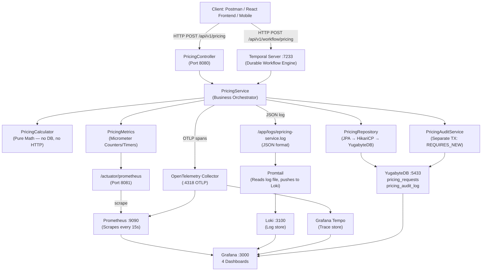

# ePricing Service — Complete Study Guide
### How Everything Works, Why It's Designed This Way, and How to Explain It

> **Who this is for:** Someone who built or maintains this project but wants to deeply understand the *why*
> behind every design decision, how data flows through the system end-to-end, and what each dashboard tier
> does and why it's different from the others.
>
> **How to read this:** Top to bottom, in order. Each part builds on the previous. Real examples and
> numbers are used throughout. Expect to spend 2–3 hours studying this fully.

> [!IMPORTANT]
> **This is a study document, not a reference doc.** It is intentionally detailed and repetitive in key
> places. Reading it teaches; skimming it misses the point. Take notes as you go.

---

## Table of Contents

1. [The Problem This Project Solves](#part-1-the-problem-this-project-solves)
2. [The Complete System at a Glance](#part-2-the-complete-system-at-a-glance)
3. [A Loan Request — Step by Step, Line by Line](#part-3-a-loan-request--step-by-step-line-by-line)
4. [The Pricing Calculation — The Actual Math](#part-4-the-pricing-calculation--the-actual-math)
5. [Where the Data Goes — Database Deep Dive](#part-5-where-the-data-goes--database-deep-dive)
6. [The Temporal Workflow — Durable Rate Lock](#part-6-the-temporal-workflow--durable-rate-lock)
7. [The Observability Pipeline — How Monitoring Works](#part-7-the-observability-pipeline--how-monitoring-works)
8. [The 4 Grafana Dashboards — Who, What, and Why](#part-8-the-4-grafana-dashboards--who-what-and-why)
9. [Banking Compliance — What Makes This Bank-Grade](#part-9-banking-compliance--what-makes-this-bank-grade)
10. [What to Study Next — Learning Path](#part-10-what-to-study-next--learning-path)

---

## PART 1: The Problem This Project Solves

### What is Loan Pricing?

When you walk into a bank and say "I want a home loan of ₹50 lakhs", the bank officer does not give you a random interest rate. They assess your risk:

- **Who are you?** (Credit score — did you repay past loans?)
- **What do you want to borrow?** (Loan amount — bigger risk for the bank)
- **For how long?** (Tenure — longer = more uncertainty = higher risk)
- **Why do you need it?** (Product type — home loans are safer than personal loans)
- **Can you afford the monthly payment?** (FOIR check — Fixed Obligation to Income Ratio)

This risk assessment produces a personalized interest rate. In the old days, a bank officer did this in 30–60 minutes using manual tables and calculators. The goal of this project is to make it happen in **under 150ms**, automatically, every time, with a full audit trail.

### Why Can't a Simple Calculator Do It?

A simple calculator can do the math. But a bank system needs much more:

| Requirement | Why |
|---|---|
| Audit trail of every decision | RBI (Reserve Bank of India) mandates it. Banks must prove what rate was given to whom, when, and why. |
| Immutable records | Audit logs cannot be edited. If a rate was later found to be incorrect, you need the original record to investigate. |
| Performance monitoring | At peak hours (9 AM, 1 PM), thousands of customers apply simultaneously. The system must stay fast under load. |
| Error alerting | If the database connection pool is exhausted, support needs to know *now*, not when customers start complaining. |
| Rate lock durability | A customer who gets a quote at 8.00% must be guaranteed that rate for 7 days, even if the system restarts. |

This project solves all five. The Spring Boot app handles the math and audit. The observability stack (Prometheus, Grafana, Loki, Tempo) handles the monitoring. Temporal handles the durable rate lock.

---

## PART 2: The Complete System at a Glance

Before going deep, here is the full architecture as one diagram:



### The Three Layers

This project has three distinct layers that work independently but share data:

**Layer 1 — The Application Layer** (Spring Boot)
> The actual business logic. Receives requests, calculates rates, saves to database, returns responses. This is what customers interact with.

**Layer 2 — The Observability Layer** (Prometheus + Loki + Tempo + Grafana)
> The monitoring system. Completely separate from the business logic. Even if Prometheus crashes, the pricing service keeps working. Observability is "watching" the application, not "part of" it.

**Layer 3 — The Workflow Layer** (Temporal)
> The durable state machine for long-running processes. Manages the 7-day rate lock lifecycle. Even if the Spring Boot app restarts 10 times during those 7 days, the workflow remembers its state.

---

## PART 3: A Loan Request — Step by Step, Line by Line

Let's trace a single loan request completely. We'll follow **Ravi Sharma** applying for a Home Loan of ₹50 lakhs.

**Request:**
```json
POST http://localhost:8080/api/v1/pricing
{
  "customerId": "CUST001234",
  "productType": "HOME_LOAN",
  "loanAmount": 5000000,
  "loanTenureMonths": 240,
  "creditScore": 780,
  "annualIncome": 2400000
}
```

### Step 1: Tomcat Receives the HTTP Request

Tomcat (the web server embedded in Spring Boot) receives the TCP connection on port 8080. It assigns this request to one of its thread pool threads (e.g., `http-nio-8080-exec-3`).

> [!NOTE]
> Tomcat maintains a pool of ~200 threads. When all threads are busy processing requests, new incoming requests wait in a queue. If the queue fills up too, Tomcat rejects with 503. This is why latency monitoring matters.

### Step 2: MDCFilter Runs First (Servlet Filter, Order=1)

Before ANY controller code runs, `MDCFilter` intercepts the request:

```java
// MDCFilter.java — what happens before PricingController sees the request
String requestId = extractOrGenerate(request.getHeader("X-Request-ID")); // e.g. "REQ-ABC123"
String customerId = request.getHeader("X-Customer-ID");                  // e.g. "CUST001234"

MDC.put("requestId", requestId);
MDC.put("customerId", customerId);
MDC.put("httpMethod", request.getMethod());                              // "POST"
MDC.put("requestUri", request.getRequestURI());                          // "/api/v1/pricing"
```

**What is MDC?** MDC stands for Mapped Diagnostic Context. It's a thread-local key-value store (think: a small dictionary attached to the current thread). Every time you call `log.info("something")` from this point forward, Logback automatically appends ALL MDC values to the JSON log line. So every log line knows which customer it belongs to, without passing `customerId` as a method parameter through every class.

**Why Order=1?** It must run before Spring Security, before OpenTelemetry, before anything. If it ran after Spring Security, security log messages wouldn't have the customer context.

### Step 3: OpenTelemetry Auto-Instrumentation Adds Tracing

Spring Boot's OTel instrumentation automatically creates the **root span** for this HTTP request:

```
Trace ID: 4bf92f3577b34da6a3ce929d0e0e4736  (unique 32-hex-char ID for THIS request)
Span ID:  00f067aa0ba902b7                  (unique 16-hex-char ID for the HTTP step)
Operation: POST /api/v1/pricing
```

The OTel bridge also adds `traceId` and `spanId` to MDC automatically. Now every log line also carries the trace ID, connecting logs to traces.

> [!TIP]
> **The key insight**: After steps 2 and 3, every log line written for Ravi's request will automatically contain:
> `{"requestId":"REQ-ABC123","customerId":"CUST001234","traceId":"4bf92f3577b34da6a3ce929d0e0e4736"}`
> This means in Grafana, you can search for ANY of these three values to find all logs related to this request.

### Step 4: Bean Validation (@Valid)

Before `PricingController.calculatePricing()` even runs, Spring's `@Valid` annotation triggers Bean Validation on the incoming `PricingRequestDto`:

- `loanAmount` must be between ₹10,000 and ₹10 crore
- `creditScore` must be between 300 and 900
- `productType` must be one of the enum values
- All required fields must be present

If validation fails → `MethodArgumentNotValidException` → `GlobalExceptionHandler` returns HTTP 400 with field-level error messages. The request never reaches the service layer.

### Step 5: PricingController Delegates

```java
// PricingController.java
@PostMapping("/pricing")
public ResponseEntity<PricingResponseDto> calculatePricing(
        @Valid @RequestBody PricingRequestDto request,
        @RequestHeader(value = "X-Customer-ID", required = false) String customerId) {

    // Controller does NOTHING except delegate. All logic is in PricingService.
    PricingResponseDto response = pricingService.calculatePricing(request, customerId);
    return ResponseEntity.status(HttpStatus.CREATED).body(response);
}
```

**Why does the controller do so little?** This is the Single Responsibility Principle. The controller's only job is HTTP: deserialize request, call service, serialize response. Business logic in controllers makes testing hard (you'd have to mock HTTP layer to test business rules).

### Step 6: PricingService — The Orchestrator

`PricingService.calculatePricing()` is annotated with `@Transactional`. This means:
- Hibernate opens a database transaction at the start of the method
- ALL database operations inside the method (save pricing request, etc.) are part of ONE transaction
- If ANY exception is thrown: ALL database changes are automatically rolled back
- If the method completes normally: ALL database changes are committed

Inside PricingService, in order:

```java
// Step 6a: Record that a request arrived (counter goes up by 1 in Prometheus)
pricingMetrics.recordPricingRequestReceived();
pricingMetrics.incrementActiveRequests();         // gauge: "1 request is being processed now"
pricingMetrics.recordLoanAmount(loanAmount);       // distribution: loan was for ₹50L

// Step 6b: Create a child span for tracing
Span pricingSpan = tracer.spanBuilder("calculatePricing")
    .setAttribute("customer.id", maskedCustomerId)
    .setAttribute("product.type", productType)
    .startSpan();

// Step 6c: Validate eligibility (child span: "validateEligibility")
PricingCalculator.validateEligibility(creditScore, loanAmount, annualIncome, productType);

// Step 6d: Calculate rate (child span: "computeInterestRate")
BigDecimal interestRate = PricingCalculator.calculateInterestRate(productType, creditScore, loanAmount);

// Step 6e: Calculate EMI (pure math, no DB)
BigDecimal emi = PricingCalculator.calculateEmi(loanAmount, interestRate, tenureMonths);

// Step 6f: Save to YugabyteDB (child span: "persistPricingRequest")
PricingRequest entity = buildEntity(request, interestRate, emi, traceId);
pricingRepository.save(entity);  // JPA INSERT into pricing_requests table

// Step 6g: Record audit (SEPARATE transaction — survives main transaction failure)
pricingAuditService.recordSuccess(entity);  // runs in REQUIRES_NEW transaction

// Step 6h: Update metrics
pricingMetrics.recordPricingSuccess();
pricingMetrics.decrementActiveRequests();  // gauge back to 0
```

### Step 7: Response Returned

```json
HTTP 201 Created
{
  "pricingId": 42,
  "customerId": "CUST001234",
  "productType": "HOME_LOAN",
  "loanAmount": 5000000,
  "calculatedRate": 8.00,
  "emiAmount": 41822.45,
  "totalPayableAmount": 10037388.00,
  "totalInterestPayable": 5037388.00,
  "riskCategory": "LOW",
  "traceId": "4bf92f3577b34da6a3ce929d0e0e4736",
  "rateValidUntil": "2026-11-25T00:16:00"
}
```

### Step 8: MDCFilter Cleans Up

After the response is sent, the `MDCFilter` finally block runs:
```java
MDC.clear();  // CRITICAL — Tomcat reuses threads. Next request must start with clean MDC.
```

Without `MDC.clear()`, the next request handled by the same Tomcat thread would inherit Ravi's `customerId`, `requestId`, and `traceId` — a serious security and correctness bug.

---

## PART 4: The Pricing Calculation — The Actual Math

`PricingCalculator.java` is a **stateless utility class** — no Spring annotations, no database calls, no HTTP calls. Pure math. This makes it trivially testable.

### Why Stateless?

If PricingCalculator had `@Autowired` dependencies, you'd need a Spring context to test it. By being a plain class, you can test it like:
```java
BigDecimal rate = PricingCalculator.calculateInterestRate("HOME_LOAN", 780, new BigDecimal("5000000"));
assertEquals(new BigDecimal("8.00"), rate);
```
No mocks. No Spring. Just math.

### The Interest Rate Formula

```
Final Rate = Base Rate  +  Credit Score Adjustment  +  LTV Adjustment
```

**Step 1 — Base Rate by Product Type:**

| Product | Base Rate | Why This Rate? |
|---|---|---|
| `HOME_LOAN` | 8.50% | Secured by property (collateral). Low risk → low rate. |
| `EDUCATION_LOAN` | 9.00% | No hard collateral. Borrower is a student with no income yet. |
| `AUTO_LOAN` | 9.35% | Car depreciates quickly. Collateral value falls fast. |
| `BUSINESS_LOAN` | 11.00% | Business cash flows are unpredictable. High risk. |
| `PERSONAL_LOAN` | 13.25% | Fully unsecured. No collateral at all. Highest risk. |

**Step 2 — Credit Score Adjustment:**

The credit score reflects your credit history. Higher score = more trustworthy = lower rate.

| Credit Score Range | Category | Rate Adjustment | Explanation |
|---|---|---|---|
| ≥ 750 | Excellent | **−0.50%** (discount) | Proven reliable borrower. Bank rewards them. |
| 700–749 | Good | **0.00%** (no change) | Average risk. Standard rate. |
| 650–699 | Fair | **+0.75%** (surcharge) | Some past issues. Bank charges for the risk. |
| < 650 | Poor | **REJECTED** | Too risky. Bank refuses to lend. |

**Step 3 — LTV (Loan-to-Value) Adjustment:**

LTV = `Loan Amount ÷ Property Value × 100`
> (For non-property loans, loan amount vs. income ratio is used as a proxy)

| LTV % | Adjustment | Why |
|---|---|---|
| > 90% | +0.50% | Borrowing almost the full value. If you default, bank may not recover all from asset sale. |
| 80–90% | +0.25% | Moderate risk. |
| ≤ 80% | 0.00% | Strong equity cushion. Safe for the bank. |

### Worked Example: Ravi's Home Loan

```
Customer: Ravi Sharma
Product: HOME_LOAN
Loan Amount: ₹50,00,000 (₹50 lakhs)
Credit Score: 780
Annual Income: ₹24,00,000

Step 1: Base Rate for HOME_LOAN = 8.50%

Step 2: Credit Score 780 → Excellent → Adjustment = −0.50%
        Rate after credit adjustment = 8.50% − 0.50% = 8.00%

Step 3: LTV check → loan ₹50L on assumed property ₹70L → 71% → ≤ 80% → 0.00% adjustment
        Final Rate = 8.00% + 0.00% = 8.00% per annum

Step 4: EMI Calculation
        P = 50,00,000
        r = 8.00% / 12 = 0.6667% = 0.006667 (monthly rate)
        n = 240 months (20 years)

        EMI = P × r × (1+r)^n / ((1+r)^n − 1)
            = 50,00,000 × 0.006667 × (1.006667)^240 / ((1.006667)^240 − 1)
            = 50,00,000 × 0.006667 × 4.9268 / (4.9268 − 1)
            = 50,00,000 × 0.03285 / 3.9268
            = 1,64,221 / 3.9268
            = ₹41,822.45 per month
```

> [!NOTE]
> **Why BigDecimal?** `double` cannot represent 0.1 exactly in binary floating point.
> `0.1 + 0.2 = 0.30000000000000004` in Java with `double`.
> For banking: `new BigDecimal("8.50").subtract(new BigDecimal("0.50"))` = exactly `8.00`.
> This is not optional — it's a regulatory requirement.

### Worked Example: A Rejected Application

```
Customer: Ramesh (ID: CUST999)
Credit Score: 620 (below minimum 650)

Step 1: validateEligibility() checks creditScore < 650
Step 2: Throws InsufficientCreditScoreException("Credit score 620 below minimum 650")
Step 3: PricingService catch block:
        - Records metric: pricing_requests_total{type="rejected"} += 1
        - Writes WARN log: {"event_type":"PRICING_REJECTED","creditScore":620}
        - Saves audit log with status=REJECTED
Step 4: HTTP 422 Unprocessable Entity returned
        {"error_code":"PRICING_INSUFFICIENT_CREDIT_SCORE","message":"...","trace_id":"..."}
```

### FOIR Check (Fixed Obligation to Income Ratio)

Before calculating the rate, the system also validates that the customer can afford the loan:

```
Monthly Income = annualIncome / 12 = 24,00,000 / 12 = ₹2,00,000

Estimated EMI = calculateEmi(loanAmount, baseRate, tenure) = ₹41,822

FOIR = existingObligations + estimatedEMI / monthlyIncome
     = 0 + 41,822 / 2,00,000
     = 0.209 (20.9%)

Maximum allowed FOIR = 50%  (RBI guideline)
20.9% < 50% → PASS
```

If FOIR > 50%, the application is rejected: the customer's income is not enough to cover the monthly payment.

---

## PART 5: Where the Data Goes — Database Deep Dive

### Why YugabyteDB (Not MySQL or PostgreSQL)?

The old version used H2 (in-memory, disappears on restart). The current version uses **YugabyteDB** — a distributed SQL database that is PostgreSQL-compatible (same SQL syntax, same JDBC driver) but designed for:
- **High availability**: Data is replicated across multiple nodes. If one node crashes, the others serve requests.
- **Horizontal scale**: Can add nodes to handle more load without schema changes.
- **Banking reliability**: Used in production by banks for transaction systems.

> [!NOTE]
> From the application's perspective, YugabyteDB looks exactly like PostgreSQL. The JDBC URL uses
> `postgresql` protocol. Hibernate uses PostgreSQL dialect. You can run any standard SQL query.
> The distribution is handled internally by YugabyteDB — your Java code is unaware of it.

### Table 1: `pricing_requests`

This is the main business table. Every successful, rejected, or errored pricing request creates one row here.

```sql
CREATE TABLE pricing_requests (
    id                   BIGSERIAL PRIMARY KEY,
    customer_id          VARCHAR(50)    NOT NULL,         -- "CUST001234"
    product_type         VARCHAR(30)    NOT NULL,         -- "HOME_LOAN"
    loan_amount          DECIMAL(15,2)  NOT NULL,         -- 5000000.00
    loan_tenure_months   INTEGER        NOT NULL,         -- 240
    credit_score         INTEGER        NOT NULL,         -- 780
    annual_income        DECIMAL(15,2),                   -- 2400000.00
    calculated_rate      DECIMAL(8,4),                    -- 8.0000
    emi_amount           DECIMAL(12,2),                   -- 41822.45
    total_payable_amount DECIMAL(15,2),                   -- 10037388.00
    total_interest       DECIMAL(15,2),                   -- 5037388.00
    risk_category        VARCHAR(20),                     -- "LOW"
    status               VARCHAR(20)    NOT NULL,         -- "CALCULATED" / "REJECTED" / "ERROR"
    error_message        TEXT,                            -- NULL for success; exception message for failures
    processing_time_ms   BIGINT,                          -- 142
    trace_id             VARCHAR(64),                     -- "4bf92f3577b34da6a3ce929d0e0e4736"
    created_at           TIMESTAMP      DEFAULT NOW()
);
```

**When is this row written?**
- For a successful request: `status=CALCULATED`, all rate/EMI columns populated, `error_message=NULL`
- For a rejected request (credit score < 650): `status=REJECTED`, rate/EMI are NULL, `error_message` has the reason
- For a technical error (DB connection failed, etc.): `status=ERROR`, `error_message` has the exception

**Key Database Indexes:**
```sql
CREATE INDEX idx_pricing_customer ON pricing_requests(customer_id);  -- fast lookup by customer
CREATE INDEX idx_pricing_trace    ON pricing_requests(trace_id);     -- fast debug by trace ID
CREATE INDEX idx_pricing_status   ON pricing_requests(status);       -- fast filter for dashboard
```

Without indexes, `SELECT * FROM pricing_requests WHERE customer_id = 'CUST001234'` would scan every row in the table. With the index, YugabyteDB jumps directly to the matching rows in microseconds.

### Table 2: `pricing_audit_log`

This table is **append-only**. Rows are never updated or deleted. It records every significant event in the pricing lifecycle.

```sql
CREATE TABLE pricing_audit_log (
    id                 BIGSERIAL PRIMARY KEY,
    pricing_request_id BIGINT         NOT NULL,  -- FK to pricing_requests.id
    event_type         VARCHAR(50)    NOT NULL,  -- "PRICING_CALCULATED", "REJECTED", "WORKFLOW_APPROVED"
    customer_id        VARCHAR(50)    NOT NULL,
    product_type       VARCHAR(30),
    old_status         VARCHAR(20),              -- status before this event
    new_status         VARCHAR(20),              -- status after this event
    description        TEXT,                     -- human-readable what happened
    actor              VARCHAR(100),             -- who/what caused this event
    metadata           TEXT,                     -- JSON with extra context
    created_at         TIMESTAMP      DEFAULT NOW()
);
```

**When is this table written?**
- After a successful pricing: `event_type=PRICING_CALCULATED`
- After a rejection: `event_type=PRICING_REJECTED`
- After a Temporal workflow approves a quote: `event_type=WORKFLOW_APPROVED`
- After a technical failure: `event_type=TECHNICAL_FAILURE`

### Why REQUIRES_NEW for the Audit Log?

This is one of the most important design decisions. Here's why:

**Scenario:** Ravi's pricing request is calculated successfully (rate = 8.00%, EMI = ₹41,822). The result is saved to `pricing_requests`. Then, the main transaction tries to do something else and fails. With normal `@Transactional`, the ENTIRE transaction rolls back — including the `pricing_requests` row. What about the audit log?

```java
// PricingService.java — The main transaction
@Transactional  // ← Opens Transaction A
public PricingResponseDto calculatePricing(...) {
    
    pricingRepository.save(entity);         // INSERT into pricing_requests (in Transaction A)
    pricingAuditService.recordSuccess(entity); // runs in Transaction B (REQUIRES_NEW)
    
    // If something throws here → Transaction A rolls back
    // But Transaction B already committed (audit log is permanent)
}
```

```java
// PricingAuditService.java
@Transactional(propagation = Propagation.REQUIRES_NEW)  // ← Opens Transaction B
public void recordSuccess(PricingRequest entity) {
    // This runs in its OWN transaction, completely independent of Transaction A
    auditRepository.save(auditLog);  // commits immediately when this method returns
}
```

**Result:** Even if the main pricing transaction rolls back, the audit record survives. This is an RBI compliance requirement: every *attempt* to price a loan must be logged, even unsuccessful attempts.

### The `grafana_reader` Role

```sql
-- Flyway V6: Creates a read-only database user for Grafana
CREATE ROLE grafana_reader WITH LOGIN PASSWORD 'grafana_readonly_pass';
GRANT CONNECT ON DATABASE epricingdb TO grafana_reader;
GRANT SELECT ON pricing_requests, pricing_audit_log TO grafana_reader;
-- NOT granted: INSERT, UPDATE, DELETE, DROP, CREATE
```

Grafana queries the database using this read-only user. If Grafana were compromised (SQL injection via dashboard), the attacker could only read data — they cannot modify or delete anything. Principle of Least Privilege.

---

## PART 6: The Temporal Workflow — Durable Rate Lock

### What is Temporal and Why Do We Need It?

When a customer gets a pricing quote, the rate is locked for **7 days**. The customer has 7 days to:
1. Review the offer
2. Accept it (approve the quote)
3. Or let it expire

What if the Spring Boot server restarts during those 7 days? In a traditional system, the in-memory timer would be lost. The customer's rate lock would disappear silently.

**Temporal solves this.** It is a durable workflow engine. It persists workflow state to its own database (PostgreSQL, backed by the `temporal-db` Docker service). Even if the Spring Boot app restarts 10 times, the workflow picks up exactly where it left off.

### The Temporal Architecture

```
Client → POST /api/v1/workflow/pricing/start
           ↓
TemporalPricingController
           ↓
  Temporal Server (:7233) ← This is the durable part
  [Stores workflow state in temporal-db]
           ↓
  LoanPricingWorkflowImpl (registered as a Worker in Spring Boot)
  [Executes activities, waits for signals]
           ↓
  PricingActivities → PricingService → YugabyteDB
```

### The 7-Day Rate Lock — A Customer Story

Let's follow Priya who wants a Business Loan:

**Day 0, 10:00 AM — Workflow Starts**
```
POST /api/v1/workflow/pricing/start
Body: { customerId: "CUST5678", productType: "BUSINESS_LOAN", ... }

TemporalPricingController creates workflowId: "BUSINESS_LOAN_CUST5678_1234567890"
Temporal Server stores this workflow in its DB.
```

**Day 0, 10:00 AM — Activity 1: Calculate and Persist**
```
LoanPricingWorkflow runs Activity: calculateAndPersistPricing()
  → PricingService.calculatePricing() → rate = 11.75%
  → Saves to pricing_requests table: status = CALCULATED
  → Saves to pricing_audit_log: event_type = WORKFLOW_PRICING_CALCULATED

Workflow now WAITS (Workflow.await with 7-day timeout)
Priya's status is "Quote given, waiting for decision"
```

**Day 3, 2:00 PM — Priya Accepts**
```
POST /api/v1/workflow/pricing/BUSINESS_LOAN_CUST5678_1234567890/approve
Body: { approvedBy: "PRIYA_SELF_SERVICE", notes: "Accepting at 11.75%" }

Temporal receives a SIGNAL (approveQuote signal)
Workflow wakes up from its await()
Runs: recordQuoteApproval(workflowId, notes)
  → Saves to pricing_audit_log: event_type = QUOTE_APPROVED
  → pricing_requests status updated to APPROVED
  → Workflow completes
```

**Alternative — Day 7, 10:00 AM — Timer Expires Without Decision**
```
Temporal's timer fires (7 days elapsed)
Workflow.await() returns false (timeout, not signal)
Runs: recordQuoteExpiration(workflowId)
  → Saves to pricing_audit_log: event_type = QUOTE_EXPIRED
  → pricing_requests status updated to EXPIRED
  → Workflow completes
```

### What Happens if Spring Boot Crashes on Day 2?

This is the key advantage of Temporal:

```
Day 1: Workflow is running. App crashes. Docker restarts it.
Day 2: Spring Boot starts fresh. Worker reconnects to Temporal Server.
       Temporal Server still has the workflow state in its database.
       Worker says: "I'm back, any pending work?" 
       Temporal Server: "Yes, workflow BUSINESS_LOAN_CUST5678_1234567890 is waiting for a signal."
       Worker registers itself, picks up where it left off.
       No data lost. No timer reset. Priya's 7-day clock continues from Day 1.
```

This is called **workflow durability**. Without Temporal, you'd need:
- Database timers (unreliable, hard to cancel)
- Scheduled batch jobs (imprecise, adds latency)
- Complex state machines with manual checkpoint logic

Temporal handles all of this automatically.

### Temporal Web UI

Access: `http://localhost:8233`

You can see:
- All running workflows (waiting for signals)
- All completed workflows (approved/rejected/expired)
- Full event history for each workflow (every step it executed)
- Ability to signal a workflow directly from the UI (useful for testing)

---

## PART 7: The Observability Pipeline — How Monitoring Works

### The Three Pillars of Observability

Observability means being able to answer "what is happening in my system right now?" without guessing. It has three data types:

| Pillar | Question it answers | Technology | Storage |
|---|---|---|---|
| **Metrics** | How many? How fast? How much? | Micrometer → Prometheus | Time-series DB (TSDB) |
| **Logs** | What exact text was written? | Logback → Loki | Compressed log chunks |
| **Traces** | Which path did this request take? | OpenTelemetry → Tempo | Span data with parent-child relationships |

All three share the `traceId` — the bridge that connects them. If you know the traceId of a failing request, you can find its logs, its metrics impact, and its full trace waterfall.

### Pipeline 1: Metrics Flow (Prometheus Pull Model)

```
1. Code: pricingMetrics.recordPricingSuccess()
         → Micrometer Counter.increment()
         → Counter value in memory: pricing_requests_total{type="success"} = 142

2. Every 15 seconds: Prometheus makes HTTP GET to:
   http://epricing-service:8081/actuator/prometheus

3. App responds with Prometheus text format:
   # HELP pricing_requests_total Total pricing requests processed
   # TYPE pricing_requests_total counter
   pricing_requests_total{application="epricing-service",type="all"} 251.0
   pricing_requests_total{application="epricing-service",type="success"} 247.0
   pricing_requests_total{application="epricing-service",type="rejected"} 4.0

4. Prometheus stores each line as a time-series data point:
   (metric_name + labels) → (timestamp, value)
   At 10:45:00 → 251.0
   At 10:45:15 → 253.0  (2 more requests in 15 seconds)
   At 10:45:30 → 255.0

5. Grafana queries Prometheus using PromQL:
   rate(pricing_requests_total{type="success"}[5m])
   = "how many success requests per second, averaged over the last 5 minutes"
   = (255 - 230) / 300 seconds = 0.083 req/sec = ~5 req/min
```

**Why PULL instead of PUSH?** Prometheus pulls from the app. If the app crashes, Prometheus immediately knows — the scrape fails, and the "up" metric goes to 0. If the app were pushing, Prometheus wouldn't know when the app died.

### The Four Micrometer Metric Types (with Real Examples)

**Counter:** Only goes up. Used for events you want to count over time.
```
pricing_requests_total{type="success"} = 1,247
(In Grafana: use rate() to convert to "per second": rate(pricing_requests_total[5m]))
```

**Gauge:** Current state. Can go up or down.
```
pricing_requests_active = 7
(7 requests are currently being processed. If this stays high for minutes → possible deadlock)
```

**Timer:** Records both duration and count. Used for latency.
```
pricing_calculation_duration_seconds_count = 1,247  (how many calculations)
pricing_calculation_duration_seconds_sum   = 18.705  (total seconds spent)
pricing_calculation_duration_seconds_bucket{le="0.05"} = 1,100  (1,100 took < 50ms)
pricing_calculation_duration_seconds_bucket{le="0.1"}  = 1,200  (1,200 took < 100ms)
pricing_calculation_duration_seconds_bucket{le="0.2"}  = 1,247  (all 1,247 took < 200ms)

(In Grafana: histogram_quantile(0.95, rate(pricing_calculation_duration_seconds_bucket[5m]))
 = "what time does 95% of requests complete within?" = 0.047 seconds = 47ms)
```

**DistributionSummary:** Like Timer but for non-time measurements.
```
pricing_loan_amount_requested_rupees_bucket{le="1000000"}  = 350   (350 loans < ₹10L)
pricing_loan_amount_requested_rupees_bucket{le="5000000"}  = 900   (900 loans < ₹50L)
pricing_loan_amount_requested_rupees_bucket{le="10000000"} = 1,100 (1,100 loans < ₹1 crore)
```

> [!WARNING]
> **Cardinality is a critical concept.** A label must have a small, bounded set of values.
> 
> `product_type="HOME_LOAN"` → 5 possible values ✅ Safe.
> `customer_id="CUST001234"` → millions of possible values ❌ **NEVER do this.**
> 
> High-cardinality labels cause Prometheus to create millions of time series in memory, eventually
> causing an OOM (Out of Memory) crash. This is a production incident waiting to happen.

### Pipeline 2: Logs Flow (Loki)

```
1. Code: log.info("Pricing completed | rate={} | emi={}", rate, emi)
         ↓
2. Logback + LogstashEncoder converts to JSON:
   {
     "@timestamp": "2026-11-18T00:16:00.142Z",
     "level": "INFO",
     "logger_name": "com.bank.epricing.service.PricingService",
     "message": "Pricing completed | rate=8.00 | emi=41822.45",
     "traceId": "4bf92f3577b34da6a3ce929d0e0e4736",
     "spanId": "00f067aa0ba902b7",
     "customerId": "CUST001234",
     "requestId": "REQ-ABC123",
     "application": "epricing-service"
   }
         ↓
3. AsyncAppender writes to: /app/logs/epricing-service.log
   (async = background thread, so disk I/O doesn't slow down request processing)
         ↓
4. Promtail reads the file (tail -f equivalent):
   - Stage 1 (json): Parses JSON, extracts all fields
   - Stage 2 (labels): Sets Loki index labels: {level, application, traceId}
   - Stage 3 (timestamp): Uses @timestamp as the log entry time
   - Stage 4 (output): The "message" field becomes the searchable log line
         ↓
5. Promtail HTTP pushes to Loki:
   POST http://loki:3100/loki/api/v1/push
         ↓
6. Loki stores it in its compressed chunk store. Indexed by labels only.
         ↓
7. Grafana queries Loki using LogQL:
   {application="epricing-service"} | json | level="ERROR"
   = "show me all ERROR logs from epricing-service, parsed as JSON"
```

**Why Loki instead of Elasticsearch?**
Loki indexes only labels (small set: application, level, traceId). The log *content* is not indexed.
Elasticsearch indexes every word of every log line. This makes Elasticsearch fast for full-text search but requires 10–50x more disk and memory. For structured JSON logs where you search by label (not full-text), Loki is far more efficient.

### Pipeline 3: Traces Flow (OpenTelemetry)

**What is a Span?** A span represents one unit of work: "this method ran from time A to time B". Each span has:
- A unique `spanId`
- A `traceId` (shared with all other spans in the same request)
- A parent `spanId` (for child spans)
- Attributes (key-value pairs describing what the span did)
- Status (OK or ERROR)
- Events (timestamped messages within the span)

**What is a Trace?** A trace is a tree of spans for one request:

```
Trace: 4bf92f3577b34da6a3ce929d0e0e4736
├── Span: POST /api/v1/pricing         (0ms → 142ms)   ← auto-created by OTel
│   Attributes: http.method=POST, http.status_code=201
│   │
│   └── Span: calculatePricing         (2ms → 140ms)   ← created in PricingService
│       Attributes: customer.id=CUST*234, product.type=HOME_LOAN
│       │
│       ├── Span: validateEligibility  (2ms → 7ms)     ← child span
│       │   Attributes: credit.score=780
│       │   Events: "Eligibility validation passed"
│       │
│       ├── Span: computeInterestRate  (7ms → 17ms)    ← child span
│       │   Attributes: calculated.rate=8.00
│       │
│       └── Span: persistPricingRequest (17ms → 140ms) ← DB is the bottleneck!
│           Attributes: db.operation=INSERT, db.table=pricing_requests
```

This waterfall shows you exactly why the request took 142ms: 123ms was spent writing to the database. Without tracing, you'd just know it was slow — you wouldn't know where.

**How spans get to Tempo:**
```
OTel SDK batches finished spans in memory every 5 seconds
  → OTLP HTTP exporter: POST http://otel-collector:4318/v1/traces
  → OTel Collector: memory_limiter → batch → resource processor
  → Tempo exporter: POST http://tempo:4317
  → Grafana Tempo stores the trace (searchable by traceId)
```

---

## PART 8: The 4 Grafana Dashboards — Who, What, and Why

The 4 dashboards are designed for 4 completely different audiences with 4 completely different questions. This is not arbitrary — it follows the **L1→L4 support escalation model** used in enterprise banking operations.

### Understanding Support Tiers (L1 to L4)

| Level | Team | Background | Question they ask |
|---|---|---|---|
| L1 | Support Agents | Non-technical, process-focused | "Is it working? What's the customer facing?" |
| L2 | Senior Support | Some technical, log-reading ability | "What exactly went wrong? Find the error." |
| L3 | Developers | Java, SQL, Spring knowledge | "What's the root technical cause? JVM? DB?" |
| L4 | Architects/SREs | Infrastructure, capacity planning | "Will the servers hold? Do we need more RAM?" |

Each dashboard answers one tier's questions and no more. If L1 had to look at JVM heap graphs, they'd be overwhelmed. If L4 had to look at a simple green/red status panel, they'd be underwhelmed.

---

### Dashboard 1 — L1 Operations Dashboard

**URL:** `http://localhost:3000` → ePricing L1 Operations Dashboard  
**File:** `grafana/dashboards/epricing-l1-operations-dashboard.json`  
**Data Sources:** Prometheus + YugabyteDB (direct SQL)  
**Auto-refresh:** 10 seconds

#### Design Philosophy

> "A support agent should be able to tell in 5 seconds if the system is healthy or not."

The L1 dashboard uses large, colored number tiles — no graphs, no noise. Colors follow a strict convention:
- 🟢 Lime green (`#9FC119`) = healthy
- 🟡 Yellow/Orange = warning, monitor closely
- 🔴 Red (`#E02F44`) = alert, escalate NOW

#### The Panels — Explained

**Row 1: 4XX Errors (Client Errors)**

| Panel ID | Panel Name | Query | What it means |
|---|---|---|---|
| 2 | GUI (4XX) | `sum(increase(http_server_requests_seconds_count{status=~"4..",method="GET"}[$__range]))` | How many 4XX errors on GET requests (web UI) in the selected time range |
| 3 | API (4XX) | Same but `method="POST"` | How many 4XX errors on POST requests (API calls) |

> **What is `increase()`?** It converts a counter (which only goes up) to "how much it increased in the time range". If the counter was 100 at start and 115 at end, `increase()` returns 15.
>
> **What is `$__range`?** Grafana's magic variable for the selected dashboard time range (e.g., last 30 minutes).

A 4XX error means the **client sent a bad request** (invalid credit score, missing field). These are business-normal (customers make mistakes). The panel turns orange when count ≥ 1 to draw attention, but it's not critical.

**Row 2: 5XX Errors (Server Errors)**

A 5XX error means the **server crashed** processing a request. ANY 5XX is considered critical — it means the bank's pricing engine had an internal failure. The panel turns RED immediately at count ≥ 1.

**Row 3: Response Time (p50, p95, p99)**

| Panel | Query | Meaning |
|---|---|---|
| GUI (p95 ms) | `histogram_quantile(0.95, sum(rate(http_server_requests_seconds_bucket{method="GET"}[5m])) by (le)) * 1000` | 95% of web UI requests complete within X milliseconds |
| API (p95 ms) | Same for POST | 95% of API requests complete within X milliseconds |

**Why p95 and not average?** If 1000 requests took 10ms each but 10 requests took 5000ms, the average is 59ms (looks fine). But p95 shows 5000ms (10% of customers are waiting 5 seconds). Banks care about tail latency because it affects the worst-off customers.

> RBI SLA requirement: p95 latency must be < 2000ms. The panel turns red at 2000ms.

**Row 4: DB Blockings and Connection Pool**

| Panel | Query | Meaning |
|---|---|---|
| DB Blockings (Transaction) | `hikaricp_connections_pending{pool="epricing-pool"}` | How many threads are WAITING for a DB connection |

If this is > 0, it means the connection pool is full (all 10 connections busy). New requests are queuing up. If this stays > 0 for more than a minute, the system is degrading. L1 must escalate to L2/L3 immediately.

**Row 5: Integration Jobs Table — The Most Important Panel**

This is the panel that makes this dashboard unique. Instead of a graph, it shows a **live SQL table** — every pricing request, its status, and if it failed, the reason.

**How it works:**
- Datasource: Grafana's built-in PostgreSQL plugin, connected to YugabyteDB
- Role: `grafana_reader` (read-only access)
- Query:

```sql
SELECT
    id                      AS "Job ID",
    customer_id             AS "Customer",
    product_type            AS "Product",
    status                  AS "Status",
    created_at AT TIME ZONE 'Asia/Kolkata'  AS "Started At",
    processing_time_ms      AS "Duration (ms)",
    calculated_rate         AS "Rate %",
    emi_amount              AS "EMI (INR)",
    CASE
        WHEN error_message ILIKE '%credit%score%' THEN 'Credit score below minimum threshold'
        WHEN error_message ILIKE '%loan%amount%' THEN 'Loan amount outside permitted range'
        WHEN error_message ILIKE '%income%'       THEN 'Income insufficient for requested loan'
        WHEN error_message ILIKE '%timeout%'      THEN 'Request timed out – SLA breach'
        ELSE SUBSTRING(error_message FROM 1 FOR 120)
    END AS "Error Summary",
    trace_id                AS "Trace ID"
FROM pricing_requests
ORDER BY created_at DESC
LIMIT 500
```

**Why is this revolutionary for L1 support?** Before this panel, an L1 agent who saw a customer complaining about a failed loan application would have to:
1. File a ticket for the DBA to log in and check the database
2. Wait for the DBA to run a SELECT query
3. DBA writes back the result
4. L1 reads the result to the customer

With this panel: L1 opens Grafana, searches for the customer ID, sees the ERROR row with the reason immediately. Zero DBA involvement. Resolution time drops from hours to seconds.

---

### Dashboard 2 — Log Analysis Dashboard (L2)

**URL:** `http://localhost:3000` → ePricing Log Analysis  
**File:** `grafana/dashboards/log-analysis-dashboard.json`  
**Data Sources:** Loki (logs) + Prometheus (error counts)  
**Purpose:** Deep investigation of what exactly went wrong, using real log text

#### When L2 is Called

L1 sees: "5XX error count jumped from 0 to 15 in the last 5 minutes"
L1 escalates to L2: "Something broke. Find out what."

L2 opens the Log Analysis dashboard.

#### Key Panels

**Log Volume Overview (Stat Tiles)**

| Panel | LogQL | What to look for |
|---|---|---|
| ERROR Log Count | `sum(count_over_time({application="epricing-service", level="ERROR"}[$__range]))` | Spikes in ERROR count match the 5XX spike |
| WARN Log Count | Same for `level="WARN"` | Warnings before the error (precursor events) |
| INFO Log Count | Same for `level="INFO"` | Volume check: too few INFO logs could mean the app is processing nothing |

**Live Error Log Stream**

This panel shows raw log lines in real time:

```
LogQL: {application="epricing-service"} | json | level="ERROR"
```

Each row shows the full JSON log line. You can see:
- **What** method threw the exception
- **Which customer** it happened for (`customerId` field)
- **The trace ID** to pivot to Tempo for the full trace
- **The stack trace** in the `stack_trace` field

**Pricing Calculation Logs (Searchable)**

```
LogQL: {application="epricing-service"} | json | event_type="PRICING_COMPLETED"
```

This shows only "PRICING_COMPLETED" events. L2 can filter further:
- `| customerId = "CUST001234"` — all requests for a specific customer
- `| productType = "HOME_LOAN"` — only home loan calculations
- `| traceId = "4bf92f3577b34da6..."` — a specific request

**How L2 investigates a 5XX spike:**

```
Step 1: Look at ERROR Log Count tile. Confirm spike matches the time range.

Step 2: Open "ERROR Logs – Live Stream" panel.
        See: {"level":"ERROR","message":"JpaSystemException: could not execute statement",
               "traceId":"4bf92f...","customerId":"CUST5678","event_type":"TECHNICAL_FAILURE"}

Step 3: Note the traceId. Open Grafana → Explore → Tempo.
        Search: traceId = "4bf92f..."
        See: The span "persistPricingRequest" is marked ERROR. Duration was 30,000ms (timeout!)

Step 4: Conclusion: Database connection is timing out. Escalate to L3 with:
        - The error message (JpaSystemException)
        - The trace ID (for detailed investigation)
        - Time range of the spike (last 15 minutes)
```

---

### Dashboard 3 — Complete Observability Dashboard (L3)

**URL:** `http://localhost:3000` → ePricing Complete Observability  
**File:** `grafana/dashboards/epricing-complete-dashboard.json`  
**Data Sources:** Prometheus only (all metrics)  
**Purpose:** Deep technical root-cause analysis — JVM health, DB pool, percentile latency

#### When L3 is Called

L2 hands off: "The database appears to be timing out. Spans show 30,000ms on `persistPricingRequest`. Check if DB connections are exhausted."

L3 opens the Complete Observability dashboard.

#### Key Panels

**Service Health Overview Row**

```
Service Status:   sum(up{job="epricing-service"}) → 1 = UP, 0 = DOWN
Active In-Flight: pricing_requests_active{service="epricing"} → current pending requests
Heap Memory Used: sum(jvm_memory_used_bytes{area="heap"}) / 1024 / 1024 → MB used
DB Pool Active:   hikaricp_connections_active{pool="epricing-pool"} → connections in use
```

**Request Rate and Latency Row**

```
Request Rate (timeseries):
  rate(http_server_requests_seconds_count{application="epricing-service"}[1m])
  → Requests per second, over time. Spike patterns correlate with error events.

Response Time Percentiles (timeseries):
  histogram_quantile(0.50, rate(http_server_requests_seconds_bucket[5m])) * 1000  → p50 ms
  histogram_quantile(0.95, rate(http_server_requests_seconds_bucket[5m])) * 1000  → p95 ms
  histogram_quantile(0.99, rate(http_server_requests_seconds_bucket[5m])) * 1000  → p99 ms
```

**L3 uses p99 (not just p95)** because 1% of customers experiencing 10-second waits in a bank means thousands of customers per hour having terrible experiences. p99 catches the extreme tail latency.

**Database Health Row**

```
HikariCP Connection Pool (timeseries):
  hikaricp_connections_active{pool="epricing-pool"}   → active connections (should stay < 8)
  hikaricp_connections_idle{pool="epricing-pool"}     → idle connections (available)
  hikaricp_connections_pending{pool="epricing-pool"}  → waiting threads (should be 0)
  hikaricp_connections{pool="epricing-pool"}          → total connections created

DB Connection Acquire Time (timeseries):
  histogram_quantile(0.95, rate(hikaricp_connection_acquired_nanos_bucket[5m])) / 1000000
  → How long threads wait to get a connection (in ms). > 100ms = pool exhaustion risk.
```

**How L3 diagnoses the DB timeout issue:**

```
Step 1: Check "HikariCP Connection Pool" graph.
        See: hikaricp_connections_pending spiked to 8 at the same time errors appeared.
        → All 10 connections were busy. New requests waited for a connection slot.

Step 2: Check "DB Connection Acquire Time".
        See: p95 acquisition time jumped to 29,000ms (29 seconds!).
        → Threads were waiting 29 seconds just to GET a connection, before even running SQL.

Step 3: Check "JVM Memory – Heap Used vs Max" (JVM row).
        See: Heap is at 45% (380MB/512MB). JVM is not the bottleneck.

Step 4: Check "CPU Usage Over Time".
        See: CPU spiked to 95% when the errors happened.

Conclusion: Under load, all 10 DB connections were taken. New threads waited 29 seconds.
            YugabyteDB CPU was likely high too (check L4 dashboard).
            Recommendation: Increase HikariCP maximum-pool-size from 10 to 20.
            Or: Check if a slow query is holding connections for too long.
```

**JVM Runtime Metrics Row**

```
JVM Memory — Heap Used vs Max:
  sum(jvm_memory_used_bytes{area="heap"})    → used heap
  sum(jvm_memory_max_bytes{area="heap"})     → max heap (configured by -Xmx)

  ALERT CONDITION: used > 85% of max → JVM struggling to find free space → Full GC → latency spike

CPU Usage Over Time:
  process_cpu_usage → JVM process CPU (0.0 to 1.0 = 0% to 100%)

  ALERT CONDITION: > 0.80 (80%) for more than 2 minutes → CPU starvation
```

---

### Dashboard 4 — Container/Node Dashboard (L4)

**URL:** `http://localhost:3000` → Container / Node / Pod Utilisation  
**File:** `grafana/dashboards/container-nodes-pods-utilization.json`  
**Data Sources:** cAdvisor (container metrics) + Node Exporter (host metrics) — both via Prometheus  
**Purpose:** Infrastructure capacity planning and hardware-level diagnosis

#### When L4 is Called

L3 concludes: "DB pool exhaustion is happening under load. We need to either scale the app or the DB."
L4 is asked: "Do we have room to scale? What is the actual CPU/RAM usage on the host?"

#### The L4 Perspective

L3 looks at the **JVM** (what Java sees: heap memory, JVM CPU usage).  
L4 looks at the **containers** and **host** (what Docker and the OS see: container CPU %, RAM working set, network bytes).

This distinction matters:
- JVM can report 50% heap used
- But the container might be using 480MB of its 512MB limit
- Both are true simultaneously (JVM heap is part of container memory)
- L3 catches the JVM side. L4 catches the container/host side.

#### Key Panels

**Container Resource Summary (Stat Tiles)**

```
epricing-service CPU %:
  sum(rate(container_cpu_usage_seconds_total{name="epricing-service"}[5m])) * 100
  → What % of the host's CPU is the Spring Boot container using?

epricing-service Memory:
  container_memory_working_set_bytes{name="epricing-service"} / 1024 / 1024
  → Actual RAM used by the container in MB (working set = not including cache)

YugabyteDB CPU %: Same query for name="yugabytedb"
YugabyteDB Memory: Same query for name="yugabytedb"

Node CPU Idle %:
  avg(rate(node_cpu_seconds_total{mode="idle"}[5m])) * 100
  → What % of the physical host CPU is idle (not used by any process)
  → 100% idle = no load. 0% idle = fully saturated.

Node Memory Available:
  node_memory_MemAvailable_bytes / 1024 / 1024 / 1024
  → Remaining free RAM on the host in GB
```

**CPU Usage by Container (Time Series)**

```
sum(rate(container_cpu_usage_seconds_total[5m])) by (name) * 100
```

This shows ALL containers on one graph, each as a colored line:
- `epricing-service`: the Spring Boot app
- `yugabytedb`: the database
- `prometheus`: metrics collector
- `grafana`: the dashboard
- `loki`: log store

You can see which container is consuming resources when the incident happened.

**Network I/O**

```
Network Receive (bytes/s):
  sum(rate(container_network_receive_bytes_total[5m])) by (name)

Network Transmit (bytes/s):
  sum(rate(container_network_transmit_bytes_total[5m])) by (name)
```

Useful for: "Is the app generating unusually large responses? Is the DB transferring huge result sets?"

#### How L4 Does Capacity Planning

L4 looks at the last 30 days of trends:

```
If container_memory_working_set_bytes{name="epricing-service"} 
shows a steady upward trend over 30 days → likely memory leak. 
App's memory grows over time and doesn't come back down.
Needs investigation and potentially a restart schedule.

If node_memory_MemAvailable_bytes is trending downward over weeks →
the host is slowly filling up. Need to either:
- Remove unused containers
- Add more RAM to the host
- Migrate to a larger cloud instance
```

---

### The Escalation Scenario — Connecting All 4 Dashboards

**Incident:** At 2:15 PM, 15 customers complain they got errors when applying for loans.

```
2:15 PM — L1 opens their dashboard
  → 5XX Errors tile: 🔴 RED — 15 errors in the last 5 minutes
  → p95 Response Time: 🔴 RED — 8,000ms (should be < 2,000ms)
  → DB Blockings: 🔴 RED — 8 threads waiting for a DB connection
  → Integration Jobs Table: Shows 15 ERROR rows with "DB Transaction conflict"
  → L1 immediately escalates to L2 with: traceIds of 3 error rows

2:17 PM — L2 opens Log Analysis dashboard
  → ERROR Log Stream: Shows 15 ERROR entries
  → Message: "JpaSystemException: could not execute statement – lock expired"
  → All errors have the same error type: DB transaction lock timeout
  → L2 escalates to L3: "DB lock timeouts, check DB pool and query performance"

2:19 PM — L3 opens Complete Observability dashboard
  → HikariCP: hikaricp_connections_pending peaked at 8 at 2:15 PM
  → Connection Acquire Time: p95 jumped to 28,000ms at 2:15 PM
  → JVM Heap: 45% (fine, not the issue)
  → JVM CPU: 65% (elevated but not critical)
  → L3 diagnoses: Pool exhaustion. Some slow query is holding connections.
  → L3 escalates to L4: "Need to know if YugabyteDB container is CPU-saturated"

2:22 PM — L4 opens Container/Node dashboard
  → YugabyteDB CPU %: Spiked to 98% at 2:14 PM (1 minute before errors)
  → YugabyteDB Memory: Was at 490MB/512MB limit (nearly at limit)
  → Node CPU Idle: Dropped to 2% at 2:14 PM (host was at 98% usage!)
  → Root cause: A batch reporting job started at 2:14 PM, saturating the YugabyteDB container
  → Fix: Reschedule the reporting job to run at 11 PM. Add a 2nd YugabyteDB node for reporting reads.

Total investigation time: 7 minutes. Without the 4-tier dashboard system: hours.
```

---

## PART 9: Banking Compliance — What Makes This Bank-Grade

### PII Masking

PII = Personally Identifiable Information. Indian banking regulations prohibit logging full PAN numbers, Aadhaar numbers, account numbers, or other sensitive identifiers.

```java
// In PricingService.java
private String maskCustomerId(String customerId) {
    if (customerId == null || customerId.length() <= 4) return "****";
    return customerId.substring(0, 2) + "****" + customerId.substring(customerId.length() - 2);
    // "CUST001234" → "CU****34"
}
```

Log lines use `maskedCustomerId`. The actual `customerId` is stored in the database (necessary for business), but logs (which may be shipped externally, stored in cloud, or accessed by monitoring vendors) only have the masked version.

### Audit Trail Requirements

RBI mandates that:
1. Every pricing decision (approved or rejected) must be logged
2. Audit records cannot be modified (append-only)
3. Audit records must be retained for 7 years

The `pricing_audit_log` table satisfies these:
- **Append-only:** No `UPDATE` or `DELETE` methods exist in `PricingAuditRepository`
- **Database-level enforcement:** `grafana_reader` only has `SELECT`. Application user does not have `DELETE` on `pricing_audit_log`
- **REQUIRES_NEW transaction:** Audit records commit independently. Even if the main transaction fails and rolls back, the audit of the *attempt* is preserved.

### CORS Configuration (Fail-Closed)

CORS = Cross-Origin Resource Sharing. A browser security mechanism preventing unauthorized web pages from making API calls to your bank's backend.

```java
// WebConfig.java — only explicitly listed origins can call this API from a browser
@Override
public void addCorsMappings(CorsRegistry registry) {
    registry.addMapping("/api/**")
        .allowedOrigins(
            "https://bank.internal.com",          // internal banking portal
            "https://crm.bank.internal.com",      // CRM system
            "http://localhost:3000"               // local Grafana (dev only)
        )
        .allowedMethods("GET", "POST")           // only these HTTP methods
        .allowedHeaders("Content-Type", "X-Customer-ID", "X-Request-ID")
        .maxAge(3600);
}
```

**Fail-closed design:** Any origin not on this list is blocked by default. A phishing website that tries to call `https://api.bank.com/api/v1/pricing` from a customer's browser will be blocked by the browser's CORS check.

### Port Separation (Security Boundary)

```
Port 8080 — API: exposed to internet (via load balancer and WAF)
              /api/v1/pricing  → customer-facing
              /api/v1/health   → public health check for load balancer

Port 8081 — Management: internal only (VPN or ops subnet required)
              /actuator/prometheus → Prometheus scrapes here
              /actuator/health    → detailed health with DB status
              /actuator/metrics   → all JVM/HikariCP metrics
              /actuator/heapdump  → ⚠️ downloads entire JVM heap (NEVER expose publicly)
```

If management port were accidentally exposed to the internet, an attacker could call `/actuator/heapdump` and download the entire JVM memory — including any customer data currently being processed.

---

## PART 10: What to Study Next — Learning Path

Now that you understand the project, here is a recommended study order for going deeper:

### Week 1: The Application

| Topic | File to Study | What you'll learn |
|---|---|---|
| Pricing Logic | `docs/utilities/PricingCalculator.md` | Complete formula with all adjustments |
| Spring Transactions | `docs/services/PricingService.md` | @Transactional, REQUIRES_NEW in depth |
| Entity Design | `docs/entities/PricingRequest.md` | JPA annotations, indexes, constraints |
| Exception Handling | `docs/exception-handling/ExceptionHandling.md` | Custom exceptions, GlobalExceptionHandler |

### Week 2: The Observability Stack

| Topic | File to Study | What you'll learn |
|---|---|---|
| Custom Metrics | `docs/monitoring/PricingMetrics.md` | All 15 custom metrics explained |
| Prometheus | `docs/monitoring/Prometheus.md` | PromQL queries, scraping, TSDB |
| Loki + Logs | `docs/logging/LoggingStrategy.md` + `docs/monitoring/Loki.md` | LogQL, MDC, structured logging |
| OpenTelemetry | `docs/monitoring/OpenTelemetry.md` | Spans, traces, OTLP pipeline |

### Week 3: The Dashboards

| Topic | Hands-on Exercise |
|---|---|
| L1 Dashboard | Open it. Trigger an error (send a request with creditScore=100). Watch the red tile appear. |
| L2 Dashboard | Find the error log. Note the traceId. Find it in Tempo. |
| L3 Dashboard | Watch p95 latency during load (hit `/api/v1/metrics-demo/simulate-slow`). |
| L4 Dashboard | Watch container CPU % spike during heavy load. |

### Week 4: Temporal Workflows

| Topic | File to Study | Hands-on Exercise |
|---|---|---|
| Workflow Basics | `docs/workflows/TemporalWorkflows.md` | Start a workflow, approve it via signal |
| Temporal Web UI | `http://localhost:8233` | Inspect running/completed workflows |
| Signal Mechanism | Try the reject signal. See the audit log entry. |

### Practice Interview Questions

After studying this guide, you should be able to answer:

1. "Walk me through what happens when a customer applies for a home loan."
2. "Why do we have two separate database tables — `pricing_requests` and `pricing_audit_log`?"
3. "What is REQUIRES_NEW and why is it used for the audit service?"
4. "If a 5XX error happens in production, how would you investigate it using the dashboards?"
5. "What is label cardinality and why does it matter for Prometheus?"
6. "Why does this project use Temporal instead of Spring @Scheduled or @Async?"
7. "How does a trace ID end up in a log line automatically?"
8. "What is the difference between p95 and average latency? Why do banks care about p95?"
9. "What is the `grafana_reader` database role and why does it exist?"
10. "How does MDC.clear() prevent a security bug?"

> [!TIP]
> **The best way to learn this project:** Start Docker (`docker compose up -d`), open Grafana, then
> read this guide again while watching the panels respond to real data. Theory + practice together
> creates understanding that sticks.

---

*Document created: November 2026 | Project: epricing-service | Branch: main*  
*Cross-reference: See `docs/ARCHITECTURE_EXPLAINED.md` for design decisions, `docs/BEGINNER_GUIDE.md` for tool explanations, `docs/PROJECT_FLOW.md` for the complete technology interaction map.*
