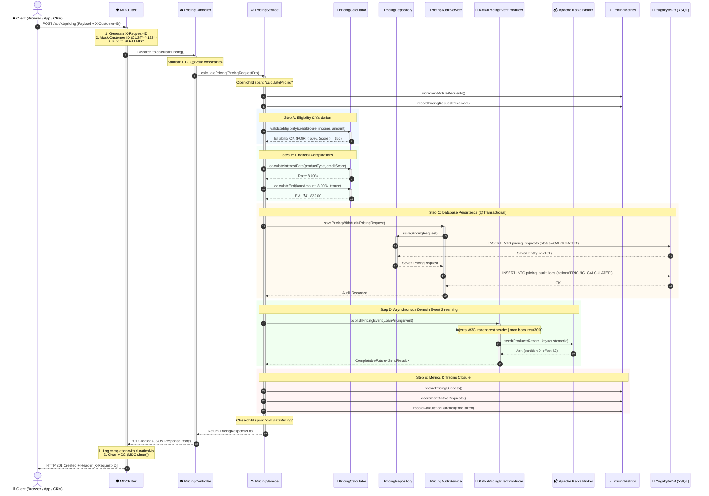
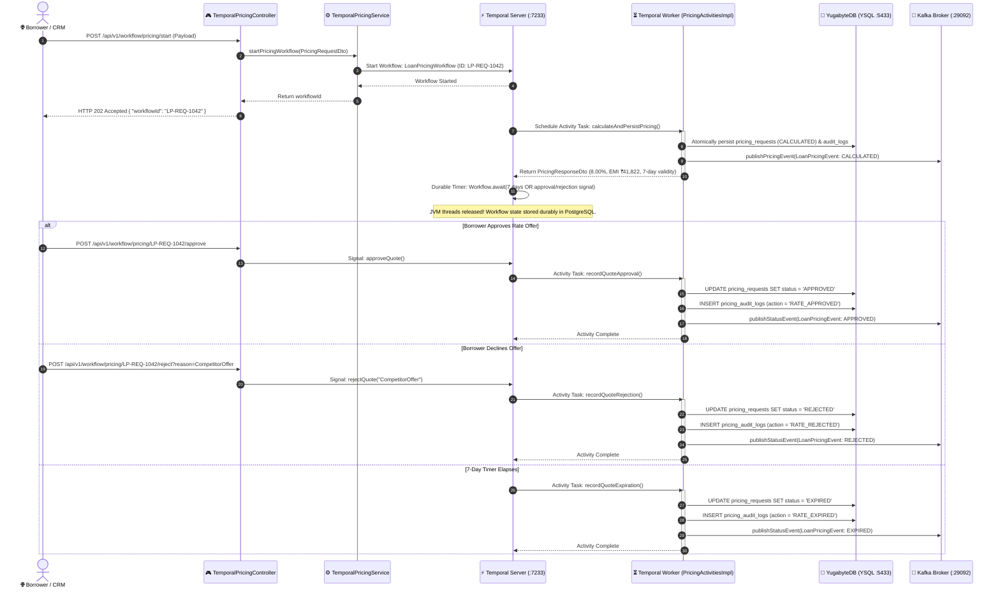
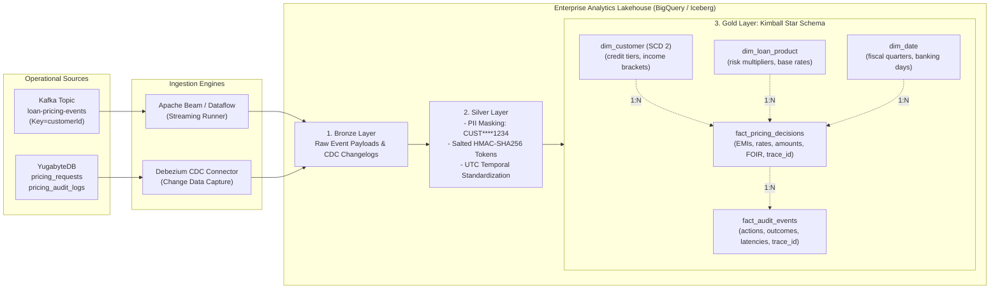
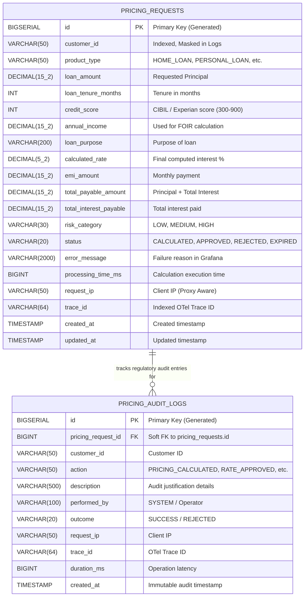

# 🏛️ ePricing Service — Architecture Diagrams (HLD & LLD)

> **Document Type:** System & Component Architecture Specification  
> **Status:** Current & Production Hardened (v1.0.0-SNAPSHOT)  
> **Database:** YugabyteDB 2.20 (Distributed SQL — YSQL, Port 5433)  
> **Workflow Engine:** Temporal Server 1.24.1 (Durable State Machines, Port 7233)  
> **Event Streaming:** Apache Kafka 3.8.0 KRaft Mode (Ports 9092 / 29092)  
> **Observability:** OpenTelemetry (Traces) + Prometheus (Metrics) + Loki (Logs) + Tempo (Trace Storage) + Grafana (UI)

---

## 1. High-Level Diagram (HLD) — Complete 5-Tier Platform Architecture

The **High-Level Diagram** illustrates the entire distributed deployment ecosystem: the ingress tier, the containerized microservice, the durable workflow tier, the distributed database and event streaming tier, and the full-stack observability platform.

```mermaid
flowchart TB
    %% ================= CLIENT TIER =================
    subgraph Tier1 [" 🌐 1. Client & Ingress Tier "]
        direction LR
        Browser["🖥️ Banking Web / CRM Portal\n(CRMNXT / React)"]
        MobileApp["📱 Mobile Banking App\n(Loan Origination)"]
        ShowcaseUI["✨ Interactive Showcase\n(showcase/index.html)"]
        TrafficGen["🤖 Traffic Generator\n(cURL Load Simulator)"]
    end

    %% ================= APPLICATION TIER =================
    subgraph Tier2 [" ⚙️ 2. Microservice Application Tier (Spring Boot 3.3.4 / Java 21) "]
        direction TB
        subgraph Ports [" Network Endpoints "]
            BizPort["Port 8080 : /api/v1/pricing\n& /api/v1/workflow/pricing\n(Business API)"]
            MgmtPort["Port 8089 (host) / 8081 (container)\n: /actuator/prometheus\n(Observability Port)"]
        end
        AppCore["epricing-service\n(Spring Boot Microservice Engine)"]
        TempWorker["Temporal Worker\n(PricingActivitiesImpl)"]
        KafkaProd["Kafka Producer\n(KafkaPricingEventProducer)"]
        LocalLogs["📁 /app/logs/*.log\n(JSON Structured Logs)"]

        AppCore --> TempWorker
        AppCore --> KafkaProd
        AppCore -.->|Writes logs| LocalLogs
    end

    %% ================= WORKFLOW ORCHESTRATION TIER =================
    subgraph Tier3 [" ⏳ 3. Durable Workflow Orchestration Tier "]
        TempServer["⚡ Temporal Server (:7233)\n(Durable State Machine Engine)"]
        TempUI["🖥️ Temporal Web UI (:8233)\n(Workflow Inspector)"]
        TempDB[("🐘 Temporal PostgreSQL (:5432)\nDatabase: temporal")]
        
        TempServer --- TempUI
        TempServer --> TempDB
    end

    %% ================= EVENT STREAMING & DATA TIER =================
    subgraph Tier4 [" 🗄️ 4. Event Streaming & Distributed Database Tier "]
        YugabyteDB[("🐘 YugabyteDB (YSQL :5433)\nDistributed SQL (PostgreSQL Wire-Compatible)\nDatabase: epricingdb\nTables: pricing_requests, pricing_audit_logs")]
        KafkaBroker["📨 Apache Kafka 3.8.0 (KRaft :9092/:29092)\nCluster ID / Node ID 1 (No ZooKeeper)\nTopic: loan-pricing-events (3 Partitions)"]
        Lakehouse[("🏛️ Analytics Lakehouse\n(BigQuery / Iceberg Star Schema)\nFacts: fact_pricing_decisions, fact_audit_events\nDims: dim_customer, dim_loan_product, dim_date")]

        KafkaBroker -.->|ETL/ELT Stream Ingestion| Lakehouse
        YugabyteDB -.->|CDC / Batch Ingestion| Lakehouse
    end

    %% ================= FULL-STACK OBSERVABILITY PLATFORM =================
    subgraph Tier5 [" 🔭 5. Full-Stack Observability Platform (LGTM + Prometheus) "]
        direction TB
        Promtail["🚚 Promtail (Log Tailer)"]
        OTelCol["🛰️ OpenTelemetry Collector (:4317/:4318)"]
        NodeExp["💻 Node Exporter (:9100)"]
        cAdvisor["🐳 cAdvisor (:8085)"]
        Prometheus["📈 Prometheus (:9090)"]
        Loki["📜 Grafana Loki (:3100)"]
        Tempo["🧭 Grafana Tempo (:3200)"]
        Alertmanager["🚨 Alertmanager (:9093)"]
        WebhookLog["🔔 Webhook Logger (:5001)"]
        Grafana["📊 Grafana Unified UI (:3000)\n(L1 Ops, L2 Complete, L3 Logs, L4 Infra)"]

        LocalLogs --> Promtail --> Loki
        OTelCol --> Tempo
        OTelCol --> Prometheus
        Prometheus --> Alertmanager --> WebhookLog
        Prometheus -.->|Scrapes| MgmtPort
        Prometheus -.->|Scrapes| NodeExp
        Prometheus -.->|Scrapes| cAdvisor
        Grafana --> Prometheus & Loki & Tempo & YugabyteDB
    end

    %% Flow Connections
    Browser & MobileApp & ShowcaseUI & TrafficGen --> BizPort --> AppCore
    AppCore -->|HikariCP YSQL :5433| YugabyteDB
    AppCore <-->|gRPC :7233| TempServer
    KafkaProd -->|Publish :29092| KafkaBroker
    AppCore -->|OTLP Traces :4318| OTelCol

    classDef client fill:#E1F5FE,stroke:#0288D1,stroke-width:2px,color:#01579B;
    classDef app fill:#E8F5E9,stroke:#2E7D32,stroke-width:2px,color:#1B5E20;
    classDef workflow fill:#FFFDE7,stroke:#FBC02D,stroke-width:2px,color:#F57F17;
    classDef data fill:#FFF3E0,stroke:#E65100,stroke-width:2px,color:#BF360C;
    classDef obs fill:#F3E5F5,stroke:#7B1FA2,stroke-width:2px,color:#4A148C;

    class Browser,MobileApp,ShowcaseUI,TrafficGen client;
    class AppCore,TempWorker,KafkaProd,LocalLogs,BizPort,MgmtPort app;
    class TempServer,TempUI,TempDB workflow;
    class YugabyteDB,KafkaBroker,Lakehouse data;
    class Promtail,OTelCol,NodeExp,cAdvisor,Prometheus,Loki,Tempo,Alertmanager,WebhookLog,Grafana obs;
```

---

## 2. Low-Level Diagram (LLD) — Component Architecture & Internals

The **Low-Level Component Diagram** details the internal modularization, interface abstractions, event serialization, and durable workflow wiring:

```mermaid
classDiagram
    direction TB

    %% ================= CONTROLLER TIER =================
    class PricingController {
        -PricingService pricingService
        +calculatePricing(PricingRequestDto) ResponseEntity
        +getPricingById(Long) ResponseEntity
        +getPricingHistory(String) ResponseEntity
    }

    class TemporalPricingController {
        -TemporalPricingService temporalPricingService
        +startWorkflow(PricingRequestDto) ResponseEntity
        +approveWorkflow(String) ResponseEntity
        +rejectWorkflow(String, String) ResponseEntity
        +getWorkflowStatus(String) ResponseEntity
        +getQuickWorkflowStatus(String) ResponseEntity
    }

    %% ================= WORKFLOW ORCHESTRATION =================
    class LoanPricingWorkflow {
        <<interface>>
        +processLoanPricing(PricingRequestDto, String, int) PricingWorkflowResult
        +approveQuote() void
        +rejectQuote(String) void
        +getStatus() String
        +getWorkflowResult() PricingWorkflowResult
    }

    class LoanPricingWorkflowImpl {
        -PricingActivities activities
        -String status
        -boolean approved
        -boolean rejected
        +processLoanPricing() PricingWorkflowResult
    }

    class PricingActivities {
        <<interface>>
        +calculateAndPersistPricing(PricingRequestDto, String) PricingResponseDto
        +recordQuoteApproval(String, String) void
        +recordQuoteRejection(String, String, String) void
        +recordQuoteExpiration(String, String) void
    }

    class PricingActivitiesImpl {
        -PricingService pricingService
        -PricingRepository pricingRepository
        -PricingAuditRepository auditRepository
        -PricingEventProducer pricingEventProducer
        +calculateAndPersistPricing() PricingResponseDto
        +recordQuoteApproval() void
        +recordQuoteRejection() void
        +recordQuoteExpiration() void
        -publishStatusEvent(PricingRequest, String) void
    }

    %% ================= BUSINESS SERVICE LAYER =================
    class PricingService {
        -PricingRepository pricingRepository
        -PricingCalculator pricingCalculator
        -PricingMetrics pricingMetrics
        -PricingAuditService auditService
        -StructuredLogger structuredLogger
        -Tracer tracer
        -PricingEventProducer pricingEventProducer
        +calculatePricing(PricingRequestDto, String) PricingResponseDto
    }

    class PricingAuditService {
        -PricingAuditRepository auditRepository
        +savePricingWithAudit(PricingRequest, String, String) PricingRequest
        +recordRejection(PricingRequestDto, String, String, String, String) void
    }

    %% ================= EVENT STREAMING LAYER =================
    class PricingEventProducer {
        <<interface>>
        +publishPricingEvent(LoanPricingEvent) CompletableFuture
        +isKafkaEnabled() boolean
        +getTopic() String
    }

    class KafkaPricingEventProducer {
        -KafkaOperations kafkaOperations
        -Tracer tracer
        -boolean kafkaEnabled
        -String topic
        +publishPricingEvent(LoanPricingEvent) CompletableFuture
    }

    class LoanPricingEvent {
        +Long requestId
        +String customerId
        +String productType
        +BigDecimal loanAmount
        +BigDecimal interestRate
        +BigDecimal emiAmount
        +Integer loanTenureMonths
        +BigDecimal totalPayableAmount
        +BigDecimal totalInterestPayable
        +String riskCategory
        +String status
        +LocalDateTime timestamp
        +String traceId
    }

    class KafkaProducerConfig {
        -KafkaProperties kafkaProperties
        +producerFactory() ProducerFactory
        +kafkaTemplate() KafkaTemplate
    }

    %% ================= RELATIONSHIPS =================
    PricingController --> PricingService : invokes
    TemporalPricingController --> LoanPricingWorkflow : starts & signals
    LoanPricingWorkflowImpl ..|> LoanPricingWorkflow : implements
    LoanPricingWorkflowImpl --> PricingActivities : invokes activities
    PricingActivitiesImpl ..|> PricingActivities : implements
    PricingActivitiesImpl --> PricingService : delegates calculation
    PricingActivitiesImpl --> PricingEventProducer : publishes state events
    PricingService --> PricingEventProducer : publishes CALCULATED event
    KafkaPricingEventProducer ..|> PricingEventProducer : implements
    KafkaPricingEventProducer --> KafkaProducerConfig : configured by
    KafkaPricingEventProducer ..> LoanPricingEvent : serializes & publishes
    PricingActivitiesImpl ..> LoanPricingEvent : constructs event
```

---

## 3. Low-Level Sequence Diagram — End-to-End Request & Event Lifecycle

---

## 3.1 Temporal Durable Workflow Sequence Diagram — 7-Day Rate Lock Data Flow

---

## 3.2 Analytics Lakehouse & Streaming Pipeline Data Flow Diagram

---

## 4. Database Schema (ERD) & Entity Architecture

---

## Summary of Key Design Highlights for Interviews & Presentations

| Aspect | Implementation Details |
|---|---|
| **Architectural Style** | 5-Tier Event-Driven Distributed Microservice with durable state machine orchestration. |
| **Durable Workflows** | Temporal Server orchestrating 7-day rate-lock quotes with asynchronous customer approval/rejection signals. |
| **Event Streaming** | Apache Kafka 3.8.0 in ZooKeeper-less KRaft mode, publishing `LoanPricingEvent` with fail-fast (3000ms) producer protection. |
| **Concurrency & Transactions** | `@Transactional` single-phase atomic commit; HikariCP connection pooling tuned for YugabyteDB distributed SQL. |
| **Distributed Tracing** | Full W3C `traceparent` context propagation across HTTP controllers, internal services, and Kafka producer records. |
| **Observability Pillars** | Correlated via `traceId` across **Prometheus** (Metrics), **Loki** (Logs), **Tempo** (Traces), and **Grafana** (Unified UI). |
| **Banking Compliance** | Synchronous immutable audit logging, PII masking across all log tiers, and least-privilege `grafana_reader` database role. |
