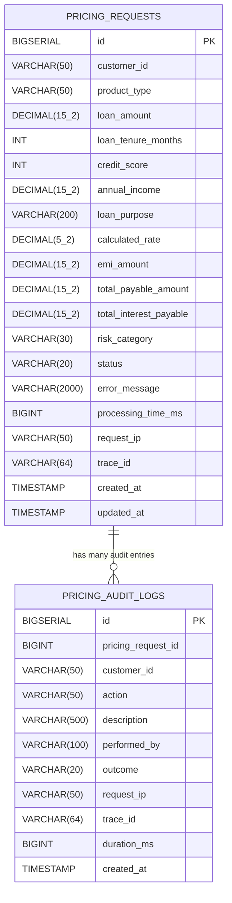

# Database Design & Migration Architecture

**Database:** YugabyteDB (Distributed SQL — YSQL, Port 5433) / PostgreSQL 16+ | **Driver:** Yugabyte Smart Driver (`jdbc-yugabytedb`)  
**Migrations:** Enterprise Sequential Migration Runner (`DatabaseMigrationInitializer` executing V1..V6)  
**ORM:** Spring Data JPA + Hibernate (Dialect: `PostgreSQLDialect`, `ddl-auto: validate`)  
**Analytical Lakehouse Extension:** [`docs/mapping-manifesto.md`](../mapping-manifesto.md)

---

## 1. Entity Relationship Diagram



---

## 2. Table: pricing_requests

**Primary transactional storage** for all loan pricing calculations and rate locks.

```sql
CREATE TABLE IF NOT EXISTS pricing_requests (
    id                      BIGSERIAL      PRIMARY KEY,
    customer_id             VARCHAR(50)    NOT NULL,
    product_type            VARCHAR(50)    NOT NULL,
    loan_amount             DECIMAL(15,2)  NOT NULL,
    loan_tenure_months      INTEGER        NOT NULL,
    credit_score            INTEGER,
    annual_income           DECIMAL(15,2),
    loan_purpose            VARCHAR(200),
    calculated_rate         DECIMAL(5,2),   -- e.g., 8.50%
    emi_amount              DECIMAL(15,2),
    total_payable_amount    DECIMAL(15,2),
    total_interest_payable  DECIMAL(15,2),
    risk_category           VARCHAR(30),    -- LOW, LOW_MEDIUM, MEDIUM, HIGH
    status                  VARCHAR(20)    NOT NULL DEFAULT 'PENDING',
    error_message           VARCHAR(2000),  -- Added in V5 for fail-fast error triage
    processing_time_ms      BIGINT,
    request_ip              VARCHAR(50),    -- IPv6-safe
    trace_id                VARCHAR(64),
    created_at              TIMESTAMP WITHOUT TIME ZONE NOT NULL DEFAULT CURRENT_TIMESTAMP,
    updated_at              TIMESTAMP WITHOUT TIME ZONE
);
```

### Indexes (`V3__create_indexes.sql`)

```sql
CREATE INDEX IF NOT EXISTS idx_pricing_requests_customer_id ON pricing_requests(customer_id);
CREATE INDEX IF NOT EXISTS idx_pricing_requests_trace_id    ON pricing_requests(trace_id);
CREATE INDEX IF NOT EXISTS idx_pricing_requests_status      ON pricing_requests(status);
CREATE INDEX IF NOT EXISTS idx_pricing_requests_created_at  ON pricing_requests(created_at);
```

| Index Name | Supports Query | Operational Impact |
|---|---|---|
| `idx_pricing_requests_customer_id` | `findByCustomerId()` | Customer history lookup for CRM portals |
| `idx_pricing_requests_trace_id` | `findByTraceId()` | OpenTelemetry / Tempo incident triage by trace ID |
| `idx_pricing_requests_status` | `countByStatus()` | Pipeline health checks & rate-lock status monitoring |
| `idx_pricing_requests_created_at` | `findTop10ByOrderByCreatedAtDesc` | High-frequency ops dashboard time-window filtering |

---

## 3. Table: pricing_audit_logs

**Append-only immutable audit trail** satisfying RBI regulatory compliance guidelines.

```sql
CREATE TABLE IF NOT EXISTS pricing_audit_logs (
    id                  BIGSERIAL      PRIMARY KEY,
    pricing_request_id  BIGINT,        -- Soft FK to pricing_requests.id
    customer_id         VARCHAR(50),   -- Denormalized for query performance
    action              VARCHAR(50),   -- PRICING_CALCULATED, RATE_APPROVED, RATE_REJECTED, RATE_EXPIRED
    description         VARCHAR(500),
    performed_by        VARCHAR(100),
    outcome             VARCHAR(20),   -- SUCCESS, FAILURE, REJECTED
    request_ip          VARCHAR(50),
    trace_id            VARCHAR(64),
    duration_ms         BIGINT,
    created_at          TIMESTAMP WITHOUT TIME ZONE NOT NULL DEFAULT CURRENT_TIMESTAMP
);
```

> **Soft Foreign Key Rationale:** `pricing_request_id` is intentionally maintained as an unconstrained column rather than a hard foreign key. In financial systems, audit logs must be immutable and permanently retained for at least 7 years, even if transient pricing requests are purged or archived.

---

## 4. Migration Architecture (`DatabaseMigrationInitializer`)

To support distributed SQL (YugabyteDB) alongside standard PostgreSQL and H2 without table lock contention, migrations are managed sequentially by `DatabaseMigrationInitializer` with automated state recording in `schema_history`.

```
src/main/resources/db/migration/
├── V1__create_pricing_requests_table.sql
├── V2__create_pricing_audit_logs_table.sql
├── V3__create_indexes.sql
├── V4__seed_initial_data.sql
├── V5__add_error_message_to_pricing_requests.sql
└── V6__create_grafana_reader_role.sql
```

### Migration History & Scope

| Version | Script Name | Scope & Purpose |
|---|---|---|
| **V1** | `V1__create_pricing_requests_table.sql` | Provisions core `pricing_requests` table with decimal monetary types. |
| **V2** | `V2__create_pricing_audit_logs_table.sql` | Provisions append-only `pricing_audit_logs` compliance table. |
| **V3** | `V3__create_indexes.sql` | Creates B-tree indexes for `customer_id`, `trace_id`, `status`, and `created_at`. |
| **V4** | `V4__seed_initial_data.sql` | Seeds realistic retail banking loan requests and audit records across product types. |
| **V5** | `V5__add_error_message_to_pricing_requests.sql` | Adds `error_message VARCHAR(2000)` column to display failure reasons in Grafana. |
| **V6** | `V6__create_grafana_reader_role.sql` | Least-privilege security hardening: grants read-only access to `grafana_reader`. |

---

## 5. Security Hardening: Least-Privilege `grafana_reader` Role (V6)

In compliance with banking security standards, Grafana does not connect to YugabyteDB using the superuser `yugabyte`. Instead, migration **V6** establishes a dedicated, read-only role:

```sql
GRANT CONNECT ON DATABASE epricingdb TO grafana_reader;
GRANT USAGE ON SCHEMA public TO grafana_reader;
GRANT SELECT ON ALL TABLES IN SCHEMA public TO grafana_reader;
ALTER DEFAULT PRIVILEGES IN SCHEMA public GRANT SELECT ON TABLES TO grafana_reader;
```

This prevents accidental DDL modifications or write statements from visualization panels.

---

## 6. Analytical Lakehouse Extension (Kimball Star Schema)

While YugabyteDB handles high-concurrency OLTP loan calculations, long-term analytics, cohort delinquency modeling, and risk audits are offloaded to an **Analytical Star Schema Lakehouse** (BigQuery / Apache Iceberg):

- **OLTP Source**: `pricing_requests` and `pricing_audit_logs` + Kafka topic `loan-pricing-events`.
- **Target Lakehouse**:
  - `dim_customer` (SCD Type 2 with PII tokenization)
  - `dim_loan_product`
  - `dim_date`
  - `fact_pricing_decisions` (Grain: 1 row per calculation)
  - `fact_audit_events` (Grain: 1 row per lifecycle state transition)

*For complete analytical mappings, data deduplication rules, and schema DDL, refer to the **[Analytics Star-Schema Mapping Manifesto](../mapping-manifesto.md)**.*

---

## 7. Cross-References

- [PricingRequest.md](../entities/PricingRequest.md) — JPA entity mapping
- [PricingAuditLog.md](../entities/PricingAuditLog.md) — Audit entity mapping
- [mapping-manifesto.md](../mapping-manifesto.md) — Lakehouse dimensional model specification
- [KafkaKRaftBroker.md](../messaging/KafkaKRaftBroker.md) — Event streaming infrastructure
- [Security.md](../security/Security.md) — Security controls & database credential management
