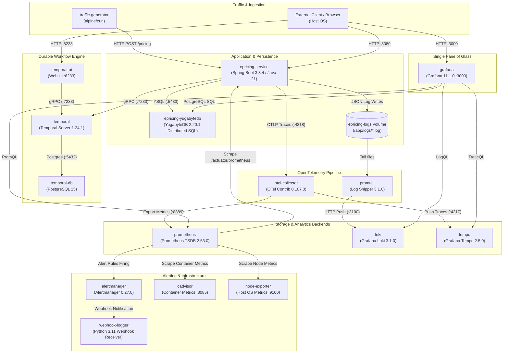

# ePricing Platform — Complete Docker Containers Study Guide
### Deep-Dive Analysis of Every Container in the Observability & Banking Stack

> **Who this is for:** Anyone studying or operating the ePricing infrastructure who wants to understand
> every single Docker container: why it exists, what image it runs, what ports it uses, how it stores data,
> how it communicates with other containers, and how to debug it when things fail.
>
> **Stack Summary:** 16 containers running on a custom bridge network (`epricing-network`), orchestrated
> by Docker Compose with strict health checks, resource bounds, and automated telemetry pipelines.

---

## Table of Contents

1. [Container Topology & Network Architecture](#1-container-topology--network-architecture)
2. [Master Container Directory (Quick Reference)](#2-master-container-directory-quick-reference)
3. [Deep-Dive: The 16 Platform Containers](#3-deep-dive-the-16-platform-containers)
   - [01. epricing-yugabytedb (Distributed SQL Database)](#01-epricing-yugabytedb)
   - [02. epricing-service (Core Spring Boot Microservice)](#02-epricing-service)
   - [03. prometheus (Time-Series Metrics Database)](#03-prometheus)
   - [04. grafana (Unified Observability Dashboard)](#04-grafana)
   - [05. loki (Label-Indexed Log Aggregator)](#05-loki)
   - [06. promtail (Log Shipper Agent)](#06-promtail)
   - [07. tempo (Distributed Tracing Backend)](#07-tempo)
   - [08. otel-collector (OpenTelemetry Telemetry Router)](#08-otel-collector)
   - [09. traffic-generator (Automated Traffic & Chaos Simulator)](#09-traffic-generator)
   - [10. cadvisor (Container Metrics Exporter)](#10-cadvisor)
   - [11. node-exporter (Host Hardware & OS Exporter)](#11-node-exporter)
   - [12. alertmanager (Alert Routing & Deduplication Engine)](#12-alertmanager)
   - [13. webhook-logger (Local Alert Notification Receiver)](#13-webhook-logger)
   - [14. temporal-db (Temporal PostgreSQL Persistence)](#14-temporal-db)
   - [15. temporal (Durable Workflow Engine)](#15-temporal)
   - [16. temporal-ui (Workflow Web Console)](#16-temporal-ui)
4. [Storage & Volume Persistence Matrix](#4-storage--volume-persistence-matrix)
5. [Port Map & Conflict Prevention Strategy](#5-port-map--conflict-prevention-strategy)
6. [Startup Order & Health Dependency Graph](#6-startup-order--health-dependency-graph)
7. [Operational Troubleshooting & Cheatsheet](#7-operational-troubleshooting--cheatsheet)

---

## 1. Container Topology & Network Architecture

All 16 containers attach to a user-defined bridge network named `epricing-network` (Subnet: `172.20.0.0/16`).



---

## 2. Master Container Directory (Quick Reference)

| # | Container Name | Docker Image | Host Port(s) | Category | Memory Limit |
|---|---|---|---|---|---|
| 01 | `epricing-yugabytedb` | `yugabytedb/yugabyte:2.20.1.0-b97` | `5433, 7000, 9000, 15433` | Database | Host default |
| 02 | `epricing-service` | `epricing-service:latest` (Custom) | `8080, 8089` | Application | 1024 MB |
| 03 | `prometheus` | `prom/prometheus:v2.53.0` | `9090` | Observability | Host default |
| 04 | `grafana` | `grafana/grafana:11.1.0` | `3000` | Visualization | Host default |
| 05 | `loki` | `grafana/loki:3.1.0` | `3100` | Observability | Host default |
| 06 | `promtail` | `grafana/promtail:3.1.0` | None (Internal) | Agent | Host default |
| 07 | `tempo` | `grafana/tempo:2.5.0` | `3200` | Observability | Host default |
| 08 | `otel-collector` | `otel/opentelemetry-collector-contrib:0.107.0` | `4317, 4318, 8888, 8889` | Pipeline | Host default |
| 09 | `traffic-generator` | `alpine/curl:latest` | None (Internal) | Simulator | Host default |
| 10 | `cadvisor` | `gcr.io/cadvisor/cadvisor:v0.49.1` | `8085` | Exporter | Host default |
| 11 | `node-exporter` | `prom/node-exporter:v1.8.1` | `9100` | Exporter | Host default |
| 12 | `alertmanager` | `prom/alertmanager:v0.27.0` | `9093` | Alerting | Host default |
| 13 | `webhook-logger` | `python:3.11-alpine` | `5001` | Alerting | Host default |
| 14 | `temporal-db` | `postgres:15-alpine` | `5432` | Workflow DB | Host default |
| 15 | `temporal` | `temporalio/auto-setup:1.24.1` | `7233` | Workflow Engine | Host default |
| 16 | `temporal-ui` | `temporalio/ui:2.26.0` | `8233` | Workflow UI | Host default |

---

## 3. Deep-Dive: The 16 Platform Containers

---

### 01. `epricing-yugabytedb`

#### 1. Overview & Image
- **Image:** `yugabytedb/yugabyte:2.20.1.0-b97`
- **Container Name:** `epricing-yugabytedb`
- **Static IP on Network:** `172.20.100.10`

#### 2. Why This Container Exists (Banking Context)
In modern banking, relational databases cannot be single-node bottlenecks. If an Oracle or MySQL server loses power, lending halts. **YugabyteDB** is a distributed SQL database that provides synchronous multi-node replication, high write concurrency, and strict ACID transaction semantics while remaining 100% wire-compatible with PostgreSQL.

#### 3. Ports & Network Interfaces
| Port | Interface | Purpose |
|---|---|---|
| `5433` | YSQL API | PostgreSQL wire protocol. Spring Boot & Grafana connect here. |
| `7000` | Master UI | Yugabyte Master leader election and tablet distribution console. |
| `9000` | TServer UI | Tablet Server disk, tablet, and Raft consensus health UI. |
| `15433` | yugabyted Web UI | Single-node daemon orchestration dashboard. |

#### 4. Volumes & Persistence
- `yugabyte-data` mounted at `/var/lib/yugabyte`.
- Stores tablet metadata, Raft consensus logs (WAL), and RocksDB SST files on disk. Survives container destruction.

#### 5. Startup Command & Database Initialization
```bash
bin/yugabyted start --advertise_address=172.20.100.10 --base_dir=/var/lib/yugabyte --ui=false && \
sleep 10 && \
bin/ysqlsh -h 172.20.100.10 -p 5433 -U yugabyte -c 'CREATE DATABASE epricingdb;' || true && \
tail -f /dev/null
```
*Creates the database `epricingdb` automatically if it does not already exist.*

#### 6. Health Check
```yaml
test: ["CMD-SHELL", "bin/yugabyted status --base_dir=/var/lib/yugabyte"]
interval: 10s
timeout: 5s
retries: 10
start_period: 30s
```
*Spring Boot waits for this healthcheck to report `healthy` before booting.*

#### 7. How to Inspect & Query Live
```powershell
# Connect directly to YSQL shell inside container
docker exec -it epricing-yugabytedb bin/ysqlsh -U yugabyte -d epricingdb

# Run diagnostic query
SELECT count(*), status FROM pricing_requests GROUP BY status;
```

---

### 02. `epricing-service`

#### 1. Overview & Image
- **Image:** Built locally via `Dockerfile` (Multi-stage build based on `eclipse-temurin:21-jre-alpine`)
- **Container Name:** `epricing-service`
- **Security:** Runs as non-root user `epricing` (UID/GID 1000).

#### 2. Why This Container Exists
This is the core business engine. It calculates risk-adjusted loan quotes, performs income and credit eligibility validation, writes immutable audit entries, records OpenTelemetry trace spans, and executes Temporal workflow activities.

#### 3. Ports & Network Interfaces
| Port | Exposed As | Purpose |
|---|---|---|
| `8080` | `8080:8080` | Customer-facing REST API (`/api/v1/pricing`). |
| `8081` | `8089:8081` | Internal Management / Actuator (`/actuator/prometheus`, `/actuator/health`). Mapped to host `8089` to prevent conflicts with local services. |

#### 4. Volumes & Mounts
- `epricing-logs` mounted to `/app/logs` (Read-Write).
- Stores `epricing-service.log` formatted as structured Logstash JSON.

#### 5. Key Environment Variables
```yaml
SPRING_PROFILES_ACTIVE: docker
OTEL_EXPORTER_OTLP_ENDPOINT: http://otel-collector:4318
SPRING_DATASOURCE_URL: jdbc:yugabytedb://yugabytedb:5433/epricingdb?load-balance=true&sslmode=disable
SPRING_DATASOURCE_USERNAME: yugabyte
SPRING_DATASOURCE_PASSWORD: yugabyte
SPRING_JPA_HIBERNATE_DDL_AUTO: validate
TEMPORAL_TARGET: temporal:7233
LOGGING_FILE_PATH: /app/logs
```

#### 6. Resource Limits
```yaml
deploy:
  resources:
    limits:
      memory: 1024M
      cpus: '2.0'
    reservations:
      memory: 512M
```
*Prevents JVM heap spikes from destabilizing the host OS. Uses `-XX:+UseContainerSupport`.*

#### 7. Health Check
```yaml
test: ["CMD", "wget", "--quiet", "--tries=1", "--spider", "http://127.0.0.1:8081/actuator/health"]
interval: 30s
start_period: 90s
```

#### 8. How to Inspect Live
```powershell
# View application logs
docker logs epricing-service -f --tail 100

# Inspect thread or memory status inside container
docker exec -it epricing-service jcmd 1 VM.version
```

---

### 03. `prometheus`

#### 1. Overview & Image
- **Image:** `prom/prometheus:v2.53.0`
- **Container Name:** `prometheus`
- **Port:** `9090:9090` (Prometheus Web UI and HTTP API)

#### 2. Why This Container Exists
Acts as the central time-series metrics vault. Instead of applications pushing metrics, Prometheus **pulls** (scrapes) raw numeric metrics from endpoints every 15 seconds, evaluates alerting rules, and stores data in a compressed local Time-Series Database (TSDB).

#### 3. Mounted Files & Storage
- `./prometheus.yml` mounted read-only to `/etc/prometheus/prometheus.yml:ro`.
- `./prometheus/alerts` mounted read-only to `/etc/prometheus/alerts:ro`.
- `prometheus-data` named volume mounted to `/prometheus` (30-day retention).

#### 4. Startup Flags Explained
```yaml
command:
  - '--config.file=/etc/prometheus/prometheus.yml'
  - '--storage.tsdb.path=/prometheus'
  - '--storage.tsdb.retention.time=30d'             # Retain 30 days of metrics
  - '--web.enable-lifecycle'                       # Allows hot-reload via POST /-/reload
  - '--web.enable-remote-write-receiver'           # Allows OTel collector push
```

#### 5. What Targets It Scrapes
1. `epricing-service:8081/actuator/prometheus` (Business & JVM metrics)
2. `cadvisor:8080/metrics` (Container CPU/RAM)
3. `node-exporter:9100/metrics` (Host metrics)
4. `otel-collector:8889/metrics` (Pipeline metrics)

#### 6. How to Inspect Live
- Web UI: Open `http://localhost:9090`
- Query targets status: `http://localhost:9090/targets`
- Check active alert rules: `http://localhost:9090/alerts`

---

### 04. `grafana`

#### 1. Overview & Image
- **Image:** `grafana/grafana:11.1.0`
- **Container Name:** `grafana`
- **Port:** `3000:3000`

#### 2. Why This Container Exists
The visual operations console ("Single Pane of Glass"). Grafana does not store metrics or logs; it translates user dashboard queries into PromQL, LogQL, TraceQL, or SQL and renders charts.

#### 3. Auto-Provisioning Configuration
Grafana starts completely pre-configured without requiring manual clicks:
- `./grafana/provisioning/datasources` → registers Prometheus (`:9090`), Loki (`:3100`), Tempo (`:3200`), and YugabyteDB (`:5433`).
- `./grafana/provisioning/dashboards` → registers dashboard provider.
- `./grafana/dashboards` → loads the 4 pre-built dashboards (L1, L2, L3, L4).

#### 4. Key Environment Variables
```yaml
GF_SECURITY_ADMIN_USER: admin
GF_SECURITY_ADMIN_PASSWORD: Bank@grafana123
GF_USERS_DEFAULT_THEME: dark
GF_FEATURE_TOGGLES_ENABLE: "traceToMetrics"
GF_DASHBOARDS_DEFAULT_HOME_DASHBOARD_PATH: "/var/lib/grafana/dashboards/epricing-complete-dashboard.json"
```

#### 5. How to Inspect Live
- Open `http://localhost:3000` (User: `admin`, Pass: `Bank@grafana123`).
- Health endpoint: `http://localhost:3000/api/health`.

---

### 05. `loki`

#### 1. Overview & Image
- **Image:** `grafana/loki:3.1.0`
- **Container Name:** `loki`
- **Port:** `3100:3100` (HTTP Ingestion & Query API)

#### 2. Why This Container Exists
Stores and indexes logs. Unlike traditional search engines (like Elasticsearch) that build inverted text indexes for every word, Loki **indexes only metadata labels** (`application`, `level`, `environment`). The log body is compressed into chunks. This makes Loki 10x cheaper to run.

#### 3. Volumes & Storage
- `./loki-config.yml` mounted read-only to `/etc/loki/local-config.yaml:ro`.
- `loki-data` mounted to `/loki` (stores TSDB index tables and chunk blocks).

#### 4. How to Inspect Live
```powershell
# Query Loki ready status
curl -s http://localhost:3100/ready

# Check current log labels indexed
curl -s http://localhost:3100/loki/api/v1/labels
```

---

### 06. `promtail`

#### 1. Overview & Image
- **Image:** `grafana/promtail:3.1.0`
- **Container Name:** `promtail`
- **Ports:** None exposed to host (Internal client).

#### 2. Why This Container Exists
Acts as the log collection agent. It reads the shared volume `/app/logs` written by `epricing-service`, parses the JSON lines, extracts labels (`level`, `traceId`, `customerId`), and streams them over HTTP to Loki on `http://loki:3100/loki/api/v1/push`.

#### 3. Volumes & Mounts
- `epricing-logs` mounted to `/var/log/epricing:ro` (Read-only for security).
- `promtail-positions` mounted to `/data`. Saves the exact byte-offset of files so Promtail never duplicates logs upon container restarts.
- `./promtail-config.yml` mounted to `/etc/promtail/config.yml:ro`.

#### 4. How to Inspect Live
```powershell
# View Promtail processing logs
docker logs promtail -f --tail 50
```

---

### 07. `tempo`

#### 1. Overview & Image
- **Image:** `grafana/tempo:2.5.0`
- **Container Name:** `tempo`
- **Port:** `3200:3200` (Grafana Trace Query API)

#### 2. Why This Container Exists
High-scale, cost-effective distributed tracing storage. Stores the trace spans emitted by the Spring Boot microservice (e.g. `calculatePricing` → `validateEligibility` → `persistPricingRequest`). Enables developers to see the exact execution waterfall of every millisecond of a loan request.

#### 3. Volumes & Mounts
- `./tempo-config.yml` mounted to `/etc/tempo/tempo.yml:ro`.
- `tempo-data` mounted to `/var/tempo`.

#### 4. Health Check
```yaml
test: ["CMD", "wget", "--quiet", "--tries=1", "--spider", "http://localhost:3200/ready"]
interval: 30s
```

---

### 08. `otel-collector`

#### 1. Overview & Image
- **Image:** `otel/opentelemetry-collector-contrib:0.107.0`
- **Container Name:** `otel-collector`

#### 2. Why This Container Exists (The Telemetry Swiss Army Knife)
Without a collector, your application code would need multiple vendor SDKs (Jaeger SDK, Prometheus push SDK, Datadog SDK). The **OTel Collector** decouples the application from backends:
1. Receives OpenTelemetry Protocol (OTLP) data on gRPC (`:4317`) and HTTP (`:4318`).
2. Batches and applies memory-limiter protections.
3. Exports traces directly into **Tempo** and exposes metrics for **Prometheus**.

#### 3. Ports & Network Interfaces
| Port | Purpose |
|---|---|
| `4317` | OTLP gRPC receiver |
| `4318` | OTLP HTTP receiver (used by Spring Boot `application.yml`) |
| `8888` | Collector internal health & operational metrics |
| `8889` | Prometheus metrics exporter port |

#### 4. Mounted Config
- `./otel-collector-config.yml` mounted read-only to `/etc/otelcol-contrib/config.yaml:ro`.

---

### 09. `traffic-generator`

#### 1. Overview & Image
- **Image:** `alpine/curl:latest`
- **Container Name:** `traffic-generator`
- **Ports:** None.

#### 2. Why This Container Exists
In local development, an empty dashboard is useless. This container runs an infinite shell loop that acts as a simulated banking customer:
1. Every 6 seconds: Sends a loan pricing POST request rotating through `HOME_LOAN`, `AUTO_LOAN`, `PERSONAL_LOAN`, and `EDUCATION_LOAN`.
2. Every ~90 seconds: Calls `/api/v1/metrics-demo/simulate-slow` to create latency waves.
3. Every ~150 seconds: Calls `/api/v1/metrics-demo/simulate-error` to trigger 5XX error spikes and verify that alerts and dashboards fire.

#### 3. How to Inspect Live
```powershell
# Watch simulated traffic generation
docker logs traffic-generator -f --tail 20
```

---

### 10. `cadvisor`

#### 1. Overview & Image
- **Image:** `gcr.io/cadvisor/cadvisor:v0.49.1`
- **Container Name:** `cadvisor`
- **Port:** `8085:8080` (Mapped to host 8085 to avoid conflicts).

#### 2. Why This Container Exists
Google's **cAdvisor** (Container Advisor) inspects the host's Linux cgroups to measure live CPU percentages, RAM working sets, network socket throughput, and disk IO for every individual Docker container. Prometheus scrapes it to power the **L4 Container Dashboard**.

#### 3. Volumes (Host OS Inspection Mounts)
```yaml
volumes:
  - /:/rootfs:ro
  - /var/run:/var/run:ro
  - /sys:/sys:ro
  - /var/lib/docker/:/var/lib/docker:ro
  - /dev/disk/:/dev/disk:ro
```
*Mounted read-only to allow cAdvisor to read Docker daemon metrics safely.*

---

### 11. `node-exporter`

#### 1. Overview & Image
- **Image:** `prom/node-exporter:v1.8.1`
- **Container Name:** `node-exporter`
- **Port:** `9100:9100`

#### 2. Why This Container Exists
While cAdvisor monitors containers, **Node Exporter** monitors the bare-metal or virtual machine host itself (kernel load average, disk space remaining, memory pressure, network card saturation).

#### 3. Startup Command
```yaml
command:
  - '--path.procfs=/host/proc'
  - '--path.sysfs=/host/sys'
  - '--path.rootfs=/host/root'
```

---

### 12. `alertmanager`

#### 1. Overview & Image
- **Image:** `prom/alertmanager:v0.27.0`
- **Container Name:** `alertmanager`
- **Port:** `9093:9093`

#### 2. Why This Container Exists
Prometheus evaluates alert thresholds (`P95 > 2s`, `5XX > 5%`), but does **not** send notifications. Prometheus pushes firing alerts to **Alertmanager**, which handles:
- **Deduplication:** Prevents repeated notifications.
- **Grouping:** Groups 10 related container errors into a single notification digest.
- **Silencing:** Allows engineers to mute alerts during maintenance windows.
- **Routing:** Directs critical alerts to PagerDuty/Slack and low-priority alerts to logs.

#### 3. Mounted Config & Persistence
- `./alertmanager.yml` mounted to `/etc/alertmanager/alertmanager.yml:ro`.
- `alertmanager-data` mounted to `/alertmanager` (persists active silences).

---

### 13. `webhook-logger`

#### 1. Overview & Image
- **Image:** `python:3.11-alpine`
- **Container Name:** `webhook-logger`
- **Port:** `5001:5001`

#### 2. Why This Container Exists
In local development, you do not have enterprise PagerDuty or corporate Slack webhooks set up. This lightweight Python server receives the alert JSON payloads sent by Alertmanager on port `5001` and prints clean, colorized terminal alerts for immediate verification.

#### 3. How to Watch Alerts Live
```powershell
docker logs webhook-logger -f
```

---

### 14. `temporal-db`

#### 1. Overview & Image
- **Image:** `postgres:15-alpine`
- **Container Name:** `temporal-db`
- **Port:** `5432:5432`

#### 2. Why This Container Exists
Temporal Server requires a persistent relational schema to store the state of every running workflow, history events, timer queues, and execution task queues. This dedicated PostgreSQL 15 instance holds the Temporal state.

#### 3. Volumes & Storage
- `temporal-pg-data` mounted to `/var/lib/postgresql/data`.

#### 4. Health Check
```yaml
test: ["CMD-SHELL", "pg_isready -U temporal -d temporal"]
interval: 5s
timeout: 5s
retries: 5
```

---

### 15. `temporal`

#### 1. Overview & Image
- **Image:** `temporalio/auto-setup:1.24.1`
- **Container Name:** `temporal`
- **Port:** `7233:7233` (Temporal gRPC endpoint)

#### 2. Why This Container Exists
The core **Temporal Workflow Engine**. It orchestrates long-running state machines without keeping threads alive in Java memory. It manages the **7-day loan quote rate lock**, timers, and asynchronous signals (`approveQuote`, `rejectQuote`). If the Spring Boot app restarts, this container tracks exactly which timer step was active.

#### 3. Auto-Setup Behavior
The `temporalio/auto-setup` wrapper automatically runs PostgreSQL database schema migrations against `temporal-db:5432` on startup before launching the engine.

---

### 16. `temporal-ui`

#### 1. Overview & Image
- **Image:** `temporalio/ui:2.26.0`
- **Container Name:** `temporal-ui`
- **Port:** `8233:8080` (Mapped to host 8233)

#### 2. Why This Container Exists
The management web console for Temporal. It allows developers and operations teams to inspect active workflows, view step-by-step history event JSON, manually send test signals to workflows, and debug stuck state machines.

#### 3. How to Access
- Open in browser: `http://localhost:8233`

---

## 4. Storage & Volume Persistence Matrix

| Volume Name | Mounted Path Inside Container | Host Lifespan | Stored Contents |
|---|---|---|---|
| `yugabyte-data` | `/var/lib/yugabyte` | Survives restarts | YugabyteDB distributed tablet files, logs, and database tables |
| `epricing-logs` | `/app/logs` & `/var/log/epricing` | Shared runtime | Active JSON log files shared between `epricing-service` and `promtail` |
| `prometheus-data`| `/prometheus` | 30 days retention | Time-series TSDB metric chunks |
| `grafana-data` | `/var/lib/grafana` | Survives restarts | Custom dashboards, preferences, user accounts |
| `loki-data` | `/loki` | Survives restarts | Compressed log chunks and TSDB label indexes |
| `promtail-positions`| `/data` | Survives restarts | File offset markers preventing duplicate log streaming |
| `tempo-data` | `/var/tempo` | Survives restarts | Distributed trace parquet blocks and bloom filters |
| `alertmanager-data`| `/alertmanager` | 120 hours retention | Active alert silences and notification state |
| `temporal-pg-data` | `/var/lib/postgresql/data` | Survives restarts | PostgreSQL data files for Temporal workflow persistence |

---

## 5. Port Map & Conflict Prevention Strategy

| Port | Service | Direction | Why This Specific Port? |
|---|---|---|---|
| `3000` | Grafana | Inbound | Standard Grafana Web UI |
| `3100` | Loki | Internal/External | LogQL query & push endpoint |
| `3200` | Tempo | Internal/External | TraceQL query endpoint |
| `4317` | OTel Collector | Inbound | Standard OTLP gRPC endpoint |
| `4318` | OTel Collector | Inbound | Standard OTLP HTTP endpoint |
| `5001` | Webhook Logger | Inbound | Custom alert receiver script |
| `5432` | temporal-db | Inbound | PostgreSQL standard port |
| `5433` | YugabyteDB | Inbound | YSQL PostgreSQL-compatible API port |
| `7000` | YugabyteDB | Inbound | Yugabyte Master Admin UI |
| `7233` | Temporal Server | Inbound | Temporal gRPC client connection |
| `8080` | epricing-service | Inbound | Public banking REST API |
| `8085` | cAdvisor | Inbound | **Changed from 8082** to avoid local Dapr conflicts |
| `8089` | epricing Actuator | Inbound | **Changed from 8081** to avoid local banking/Dapr port conflicts |
| `8233` | Temporal UI | Inbound | **Changed from 8080** to avoid conflicts with customer API |
| `9000` | YugabyteDB | Inbound | Yugabyte TServer Admin UI |
| `9090` | Prometheus | Inbound | Prometheus Query UI & Scraper |
| `9093` | Alertmanager | Inbound | Alertmanager UI & API |
| `9100` | Node Exporter | Inbound | OS Hardware metrics |
| `15433` | YugabyteDB | Inbound | yugabyted Administration Dashboard |

---

## 6. Startup Order & Health Dependency Graph

Docker Compose does not start containers randomly; it enforces a strict health-based dependency sequence:

```
Step 1: Base Persistence
        ├── temporal-db starts → waits for pg_isready healthcheck
        └── yugabytedb starts  → waits for yugabyted status healthcheck

Step 2: Workflow & Telemetry Infrastructure
        ├── temporal starts (depends on temporal-db: service_healthy)
        ├── tempo starts
        ├── loki starts
        └── otel-collector starts (depends on tempo: service_started)

Step 3: Core Application & Routing
        ├── epricing-service starts (depends on yugabytedb: service_healthy AND otel-collector: service_started)
        ├── promtail starts (depends on loki: service_started)
        └── temporal-ui starts (depends on temporal: service_started)

Step 4: Monitoring, Exporters & Traffic Simulation
        ├── prometheus starts
        ├── cadvisor & node-exporter start
        ├── alertmanager starts (depends on prometheus: service_started)
        ├── grafana starts (depends on prometheus & tempo: service_started)
        └── traffic-generator starts (depends on epricing-service: service_started)
```

---

## 7. Operational Troubleshooting & Cheatsheet

### 1. View Live Resource Consumption Across All 16 Containers
```powershell
docker stats --format "table {{.Name}}\t{{.CPUPerc}}\t{{.MemUsage}}\t{{.NetIO}}"
```

### 2. Verify Overall Platform Health
```powershell
docker-compose ps
```
*Look for `(healthy)` next to `epricing-yugabytedb`, `temporal-db`, `epricing-service`, and `alertmanager`.*

### 3. Check Database Connectivity from Inside Application
```powershell
docker exec -it epricing-service wget -qO- http://127.0.0.1:8081/actuator/health
```

### 4. Restart a Single Container Without Bringing Down the Stack
```powershell
# Example: Restart Promtail after editing configuration
docker-compose restart promtail
```

### 5. Inspect Prometheus Scrape Targets Status via CLI
```powershell
curl -s http://localhost:9090/api/v1/targets | jq .data.activeTargets[].discoveredLabels
```

### 6. Completely Reset State (Delete All Volumes & Clean Rebuild)
```powershell
# CAUTION: Wipes all database history and metric graphs
docker-compose down -v
docker-compose up --build -d
```

---

*Document created: November 2026 | Project: epricing-service | Branch: main*  
*Related documentation: [`docker-compose.yml`](../../docker-compose.yml), [`docs/docker/DockerCompose.md`](./DockerCompose.md), [`docs/STUDY_GUIDE.md`](../STUDY_GUIDE.md).*
