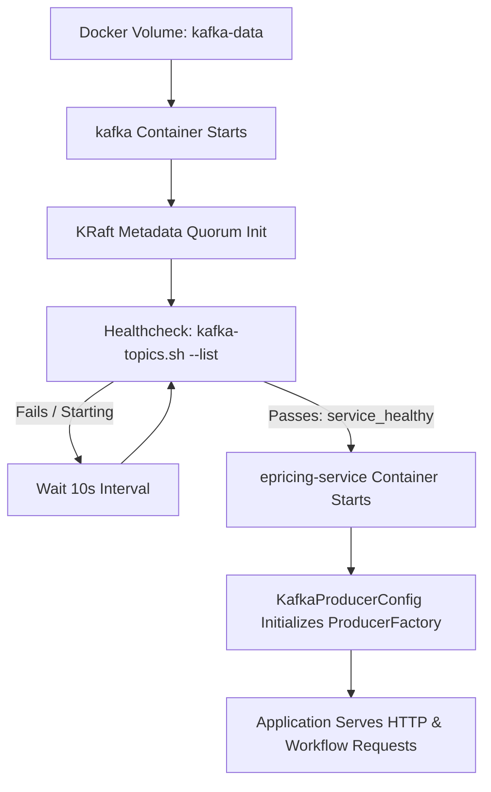

# Apache Kafka 3.8.0 KRaft Broker Architecture & Operations

## 1. Overview & Architectural Rationale

The `epricing-service` platform integrates **Apache Kafka 3.8.0** running in **KRaft mode (Kafka Raft Metadata Mode)**. KRaft replaces the legacy external ZooKeeper ensemble with an event-driven consensus protocol built directly inside Kafka itself, utilizing a Raft-based metadata quorum.

```
┌─────────────────────────────────────────────────────────────────────────────┐
│                       APACHE KAFKA 3.8.0 (KRAFT MODE)                       │
│                                                                             │
│   Node ID: 1                                                                │
│   Roles: broker, controller                                                 │
│   Quorum Voters: 1@kafka:9093                                               │
│                                                                             │
│   ┌───────────────────────────┐         ┌───────────────────────────────┐   │
│   │     CONTROLLER ROLE       │         │          BROKER ROLE          │   │
│   │   Metadata Quorum Voter   │◄───────►│  Log Segments & Partitions    │   │
│   │   Port: 9093 (Internal)   │         │  Topic: loan-pricing-events   │   │
│   └───────────────────────────┘         └───────────────────────────────┘   │
│                 ▲                                       ▲                   │
└─────────────────┼───────────────────────────────────────┼───────────────────┘
                  │                                       │
     Raft Consensus Metadata                Client Traffic / Events
                  │                                       │
                  │                   ┌───────────────────┴───────────────────┐
                  │                   │                                       │
         Internal Cluster       Docker Bridge (29092)               Host Port (9092)
            Management           epricing-service                 External Dev / CLI
```

### Key Advantages of KRaft Mode for Banking Workloads
1. **Zero ZooKeeper Overhead**: Eliminates an entire distributed state synchronization tier, avoiding split-brain metadata synchronization lag and dual-system operational complexity.
2. **Deterministic Metadata Log**: Cluster metadata, partition leaders, and ACLs are stored as an internal Kafka topic (`@metadata`), ensuring atomic and instantaneous metadata propagation.
3. **Rapid Startup & Recovery**: Node recovery takes seconds instead of minutes because broker state does not require a complete ZooKeeper tree scan upon boot.
4. **Enhanced Partition Scalability**: Allows millions of partitions per cluster with sub-millisecond controller failover times.

---

## 2. Docker Compose Configuration & Topology

In `docker-compose.yml`, Kafka is orchestrated as **SERVICE 15** (`epricing-kafka`), attached to the shared bridge network `epricing-network` (subnet `172.20.0.0/16`).

```yaml
  # ═══════════════════════════════════════════════════════════════════════
  # SERVICE 15: Apache Kafka (KRaft mode — event streaming broker)
  # ═══════════════════════════════════════════════════════════════════════
  kafka:
    image: apache/kafka:3.8.0
    container_name: epricing-kafka
    ports:
      - "9092:9092"
    environment:
      # KRaft cluster configuration (no ZooKeeper required)
      KAFKA_NODE_ID: 1
      KAFKA_PROCESS_ROLES: broker,controller
      KAFKA_LISTENERS: PLAINTEXT://:29092,PLAINTEXT_HOST://:9092,CONTROLLER://:9093
      KAFKA_ADVERTISED_LISTENERS: PLAINTEXT://kafka:29092,PLAINTEXT_HOST://localhost:9092
      KAFKA_CONTROLLER_LISTENER_NAMES: CONTROLLER
      KAFKA_LISTENER_SECURITY_PROTOCOL_MAP: PLAINTEXT:PLAINTEXT,PLAINTEXT_HOST:PLAINTEXT,CONTROLLER:PLAINTEXT
      KAFKA_CONTROLLER_QUORUM_VOTERS: 1@kafka:9093
      KAFKA_OFFSETS_TOPIC_REPLICATION_FACTOR: 1
      KAFKA_TRANSACTION_STATE_LOG_REPLICATION_FACTOR: 1
      KAFKA_TRANSACTION_STATE_LOG_MIN_ISR: 1
      KAFKA_GROUP_INITIAL_REBALANCE_DELAY_MS: 0
      KAFKA_NUM_PARTITIONS: 3
      KAFKA_AUTO_CREATE_TOPICS_ENABLE: "true"
      KAFKA_LOG_DIRS: /var/lib/kafka/data
    volumes:
      - kafka-data:/var/lib/kafka/data
    networks:
      epricing-network:
        aliases:
          - kafka
    restart: unless-stopped
    healthcheck:
      test: ["CMD-SHELL", "/opt/kafka/bin/kafka-topics.sh --bootstrap-server localhost:9092 --list || exit 1"]
      interval: 10s
      timeout: 5s
      retries: 5
      start_period: 20s
```

### Detailed Parameter Matrix

| Configuration Key | Value | Purpose & Architectural Impact |
|-------------------|-------|--------------------------------|
| `KAFKA_NODE_ID` | `1` | Unique numerical identifier for this node within the KRaft cluster quorum. |
| `KAFKA_PROCESS_ROLES` | `broker,controller` | Combined mode: this node acts as both a message broker (serving client data) and a controller (participating in Raft metadata consensus). |
| `KAFKA_CONTROLLER_QUORUM_VOTERS` | `1@kafka:9093` | Defines the Raft voter quorum. Node `1` listens on internal port `9093` for controller consensus messages. |
| `KAFKA_LISTENERS` | `PLAINTEXT://:29092, PLAINTEXT_HOST://:9092, CONTROLLER://:9093` | Bind sockets: internal Docker communication on `29092`, host-forwarded traffic on `9092`, and controller metadata on `9093`. |
| `KAFKA_ADVERTISED_LISTENERS` | `PLAINTEXT://kafka:29092, PLAINTEXT_HOST://localhost:9092` | Endpoints published to clients. Containerized apps connect to `kafka:29092`; host processes (like integration tests or CLI tools) connect to `localhost:9092`. |
| `KAFKA_NUM_PARTITIONS` | `3` | Default partition count for newly auto-created topics, enabling parallel consumer group processing across 3 partition workers. |
| `KAFKA_AUTO_CREATE_TOPICS_ENABLE` | `"true"` | Enables seamless topic provisioning on first event emission in developer and containerized environments. |
| `KAFKA_LOG_DIRS` | `/var/lib/kafka/data` | On-disk storage path mapped to the Docker volume `kafka-data` for data durability across container restarts. |

---

## 3. Healthcheck & Orchestration Dependency Graph

In `docker-compose.yml`, `epricing-service` must not start until Kafka has completed KRaft consensus initialization and is ready to accept socket connections.



### Healthcheck Command
```bash
/opt/kafka/bin/kafka-topics.sh --bootstrap-server localhost:9092 --list || exit 1
```
- **Interval**: 10 seconds
- **Timeout**: 5 seconds
- **Retries**: 5 attempts
- **Start Period**: 20 seconds warm-up window for JVM boot and KRaft formatting.

---

## 4. Operational Runbook & CLI Verification

Engineers can interact with the running broker container (`epricing-kafka`) using the native Apache Kafka shell scripts bundled in `/opt/kafka/bin/`.

### 4.1 Verify Broker Health & Active Topics
```bash
# List all topics from the host (via port 9092)
docker exec -it epricing-kafka /opt/kafka/bin/kafka-topics.sh \
  --bootstrap-server localhost:9092 \
  --list

# Describe the loan-pricing-events topic partitions and ISR (In-Sync Replicas)
docker exec -it epricing-kafka /opt/kafka/bin/kafka-topics.sh \
  --bootstrap-server localhost:9092 \
  --describe \
  --topic loan-pricing-events
```

Expected output:
```text
Topic: loan-pricing-events	TopicId: 4L62HzdITSaveQyBVT4-yA	PartitionCount: 3	ReplicationFactor: 1	Configs: segment.bytes=1073741824
	Topic: loan-pricing-events	Partition: 0	Leader: 1	Replicas: 1	Isr: 1
	Topic: loan-pricing-events	Partition: 1	Leader: 1	Replicas: 1	Isr: 1
	Topic: loan-pricing-events	Partition: 2	Leader: 1	Replicas: 1	Isr: 1
```

### 4.2 Live Event Tailing (Console Consumer)
To inspect published `LoanPricingEvent` JSON payloads in real time:

```bash
docker exec -it epricing-kafka /opt/kafka/bin/kafka-console-consumer.sh \
  --bootstrap-server localhost:9092 \
  --topic loan-pricing-events \
  --from-beginning \
  --property print.key=true \
  --property print.timestamp=true
```

Sample output:
```text
CreateTime:1731999000000	CUST001234	{"request_id":1042,"customer_id":"CUST001234","product_type":"HOME_LOAN","loan_amount":5000000.00,"interest_rate":8.00,"emi_amount":41822.00,"loan_tenure_months":240,"total_payable_amount":10037280.00,"total_interest_payable":5037280.00,"risk_category":"LOW_MEDIUM","status":"CALCULATED","timestamp":"2026-11-19T10:30:00.000","trace_id":"4bf92f3577b34da6a3ce929d0e0e4736"}
```

### 4.3 Consumer Group Lag Inspection
```bash
docker exec -it epricing-kafka /opt/kafka/bin/kafka-consumer-groups.sh \
  --bootstrap-server localhost:9092 \
  --describe \
  --group analytics-ingestion-group
```

---

## 5. Storage Persistence & Docker Volume Lifecycle

Kafka stores both topic partition log segments and the KRaft metadata state inside `/var/lib/kafka/data`, which is mounted to the named volume `kafka-data`.

- **Preserving Data Across Container Restarts**: `docker-compose down` followed by `docker-compose up -d` preserves all published events and topic offsets.
- **Wiping Data for Clean State**:
  ```bash
  docker-compose down -v  # Destroys kafka-data and all persistent volumes
  ```

---

## 6. Multi-Node Production Roadmap

While the local development and containerized stack runs a single-node combined broker/controller, production banking environments scale to a dedicated quorum:

1. **Dedicated Controllers**: Separate 3 dedicated Controller nodes (`KAFKA_PROCESS_ROLES: controller`, Node IDs 1, 2, 3) from N worker Broker nodes (`KAFKA_PROCESS_ROLES: broker`).
2. **Replication Factor**: Set `default.replication.factor: 3` and `min.insync.replicas: 2` with `acks: all` to ensure zero message loss across rack failures.
3. **mTLS & SASL/SCRAM**: Enable mutual TLS for broker-to-broker replication and SASL_SSL with SCRAM-SHA-512 authentication for application clients.
