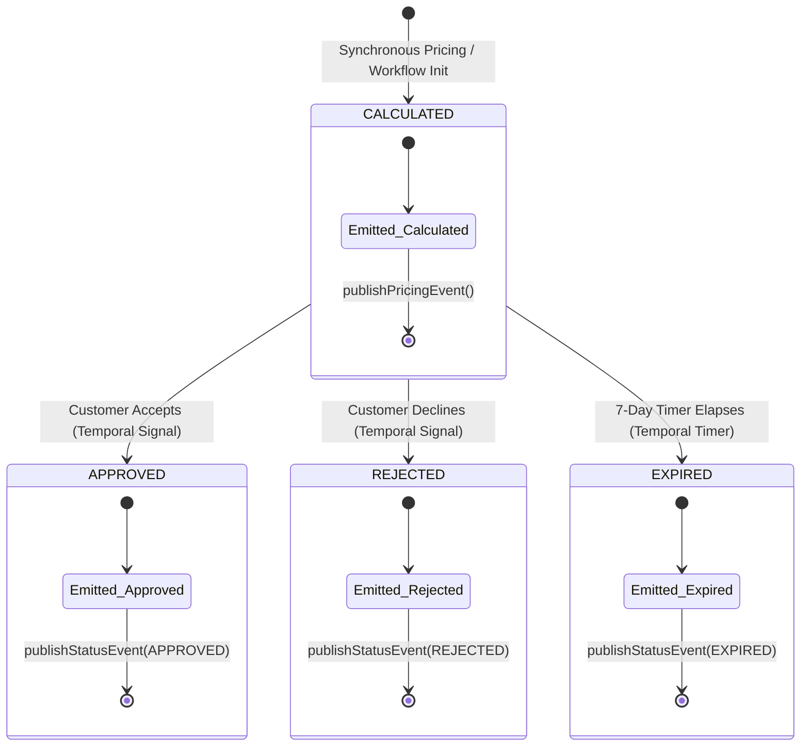

# LoanPricingEvent Streaming Specification & Consumer Contract

## 1. Overview & Purpose

The `LoanPricingEvent` is the canonical domain event emitted by `epricing-service` whenever a loan pricing decision is calculated or undergoes a lifecycle state transition. Published to the Apache Kafka topic `loan-pricing-events`, this event enables event-driven downstream workflows across banking domains, including:

1. **Analytical Lakehouse Ingestion**: Streaming ingestion into BigQuery / Apache Iceberg dimensional star-schemas (`fact_pricing_decisions`, `fact_audit_events`).
2. **Customer Notifications**: Real-time SMS, Email, and Push notification services for loan quotes and rate-lock updates.
3. **Credit Risk & Audit Systems**: Immutable streaming audit trail for enterprise regulatory compliance.
4. **CRM & Loan Origination Platforms**: Real-time pipeline status updates (e.g., Salesforce, CRMNXT).

---

## 2. Event Payload Schema

The JSON payload uses snake_case keys as standard while providing dual camelCase and snake_case aliases via Jackson annotations for backwards and forwards compatibility.

### 2.1 Complete JSON Schema Sample

```json
{
  "request_id": 1042,
  "customer_id": "CUST001234",
  "product_type": "HOME_LOAN",
  "loan_amount": 5000000.00,
  "interest_rate": 8.00,
  "emi_amount": 41822.00,
  "loan_tenure_months": 240,
  "total_payable_amount": 10037280.00,
  "total_interest_payable": 5037280.00,
  "risk_category": "LOW_MEDIUM",
  "status": "CALCULATED",
  "timestamp": "2026-11-19T10:30:00.000",
  "trace_id": "4bf92f3577b34da6a3ce929d0e0e4736"
}
```

### 2.2 Field Definitions & Attribute Specification

| JSON Key | Java Type | Nullable | Description & Domain Rules | Example |
|----------|-----------|:--------:|----------------------------|---------|
| `request_id` | `Long` | No | Primary key ID of the pricing calculation in OLTP storage (`pricing_requests.id`). | `1042` |
| `customer_id` | `String` | No | Banking customer identifier used as the Kafka message partition key. | `"CUST001234"` |
| `product_type` | `String` | No | Loan product code: `HOME_LOAN`, `PERSONAL_LOAN`, `AUTO_LOAN`, `EDUCATION_LOAN`. | `"HOME_LOAN"` |
| `loan_amount` | `BigDecimal` | No | Principal loan amount in INR (scaled to 2 decimal places). | `5000000.00` |
| `interest_rate` | `BigDecimal` | No | Annual percentage interest rate (p.a.) computed after risk margin adjustments. | `8.00` |
| `emi_amount` | `BigDecimal` | No | Equated Monthly Installment in INR calculated via reducing balance amortization. | `41822.00` |
| `loan_tenure_months` | `Integer` | No | Loan tenure duration expressed in months. | `240` |
| `total_payable_amount` | `BigDecimal` | No | Total sum payable over loan lifetime (Principal + Total Interest). | `10037280.00` |
| `total_interest_payable` | `BigDecimal` | No | Total interest payable over the loan term. | `5037280.00` |
| `risk_category` | `String` | No | Risk classification: `LOW`, `LOW_MEDIUM`, `MEDIUM`, `HIGH`, or `REJECTED`. | `"LOW_MEDIUM"` |
| `status` | `String` | No | Lifecycle state: `CALCULATED`, `APPROVED`, `REJECTED`, or `EXPIRED`. | `"CALCULATED"` |
| `timestamp` | `LocalDateTime` | No | Timestamp of event emission formatted in ISO-8601 (`yyyy-MM-dd'T'HH:mm:ss.SSS`). | `"2026-11-19T10:30:00.000"` |
| `trace_id` | `String` | Yes | W3C OpenTelemetry trace ID (32 hex characters) for distributed trace correlation. | `"4bf92f3577b34da6a3ce929d0e0e4736"` |

---

## 3. Jackson Mapping & Cross-Language Serialization

The Java class `com.bank.epricing.event.LoanPricingEvent` is annotated with Jackson annotations to support flexible deserialization:

```java
@JsonProperty("interest_rate")
@JsonAlias({"interestRate", "interest_rate_pa", "interestRatePA"})
private BigDecimal interestRate;

@JsonProperty("timestamp")
@JsonAlias({"createdAt", "calculatedAt"})
@JsonFormat(shape = JsonFormat.Shape.STRING, pattern = "yyyy-MM-dd'T'HH:mm:ss.SSS")
private LocalDateTime timestamp;
```

### Type Headers Suppressed for Interoperability
In `application.yml` and `KafkaProducerConfig.java`, Spring Kafka's default `__TypeId__` header injection is explicitly disabled:

```yaml
spring:
  kafka:
    producer:
      properties:
        spring.json.add.type.headers: false
```

**Why this matters**: Disabling Spring type headers guarantees that downstream microservices authored in Python, Go, Node.js, or BigQuery Dataflow can parse the raw JSON payload without raising deserialization exceptions regarding missing Java classpath symbols.

---

## 4. OpenTelemetry W3C Distributed Trace Propagation

`KafkaPricingEventProducer` injects W3C Trace Context into Kafka `ProducerRecord` headers, ensuring end-to-end distributed tracing visibility across asynchronous boundaries.

```
┌─────────────────────────┐          ┌──────────────────────────────────────────────┐
│  epricing-service       │          │  Kafka Record Headers                        │
│  Active Trace ID:       ├─────────►│  Header Key: "traceparent"                   │
│  4bf92f3577b34da6a3ce...│          │  Value: "00-4bf92f3577b34da6...-01"         │
└─────────────────────────┘          └──────────────────────┬───────────────────────┘
                                                            │
                                                            ▼
                                             ┌─────────────────────────────┐
                                             │ Downstream Consumer         │
                                             │ (e.g. Analytics / Lakehouse)│
                                             │ Extracts Trace Parent       │
                                             └─────────────────────────────┘
```

### Header Structure
```text
traceparent: 00-4bf92f3577b34da6a3ce929d0e0e4736-00f067aa0ba902b7-01
              │  └──────────────┬───────────────┘ └───────┬──────┘ └─┬┘
           Version          Trace ID                  Span ID      Flags
```

Downstream consumers extract this header using OpenTelemetry propagators (`W3CTraceContextPropagator`), allowing Grafana Tempo to render unified trace spans linking HTTP requests to asynchronous Kafka processing.

---

## 5. Event Emission Lifecycle & Call Sites

Events are emitted at four distinct lifecycle milestones:



### 1. Synchronous Calculation (`PricingService.java`)
- **Trigger**: Calculation completes and passes underwriting eligibility.
- **Status**: `CALCULATED`
- **Call site**: `PricingService.java:312` calls `pricingEventProducer.publishPricingEvent(...)`.

### 2. Customer Approval (`PricingActivitiesImpl.java`)
- **Trigger**: Customer signals acceptance of quoted rate lock.
- **Status**: `APPROVED`
- **Call site**: `PricingActivitiesImpl.recordQuoteApproval(...)` calls internal `publishStatusEvent(savedRequest, "APPROVED")`.

### 3. Customer Rejection (`PricingActivitiesImpl.java`)
- **Trigger**: Customer signals rejection with reason code.
- **Status**: `REJECTED`
- **Call site**: `PricingActivitiesImpl.recordQuoteRejection(...)` calls internal `publishStatusEvent(savedRequest, "REJECTED")`.

### 4. Rate-Lock Expiration (`PricingActivitiesImpl.java`)
- **Trigger**: 7-day rate-lock timer expires without customer response.
- **Status**: `EXPIRED`
- **Call site**: `PricingActivitiesImpl.recordQuoteExpiration(...)` calls internal `publishStatusEvent(savedRequest, "EXPIRED")`.

---

## 6. Partitioning Strategy & Ordering Guarantees

Every event published to `loan-pricing-events` uses `customerId` as the Kafka message record key:

```java
ProducerRecord<String, Object> record = new ProducerRecord<>(
    topic,
    event.getCustomerId(), // Message Partition Key
    event
);
```

### Architectural Guarantees:
1. **Per-Customer Strict Ordering**: Kafka guarantees that all records with the same partition key land in the same topic partition. Therefore, a customer's `CALCULATED` event is guaranteed to be processed prior to any subsequent `APPROVED`, `REJECTED`, or `EXPIRED` event.
2. **Horizontal Consumer Scalability**: With 3 topic partitions (`KAFKA_NUM_PARTITIONS: 3`), up to 3 consumer group instances can process distinct customer streams concurrently without race conditions.

---

## 7. Downstream Consumer Contract & Guidelines

Consumers subscribing to `loan-pricing-events` must implement the following architectural best practices:

1. **Idempotent Processing**: Due to network retries (`retries: 3`), consumers may receive duplicate events under network partition scenarios. Consumers must deduplicate using `request_id` + `status` as a composite unique key.
2. **Schema Evolution Handling**: Consumers must configure JSON deserializers to ignore unknown properties (`DeserializationFeature.FAIL_ON_UNKNOWN_PROPERTIES = false`), enabling backwards-compatible schema expansion.
3. **Trace Context Continuation**: Consumers should extract the W3C `traceparent` header to parent their local processing span to the origin HTTP transaction trace.
4. **Lakehouse Star-Schema Mapping**: For field-level mapping to Kimball dimensional models (`fact_pricing_decisions` and `fact_audit_events`), refer to [Analytics Star-Schema Mapping Manifesto](../mapping-manifesto.md).
