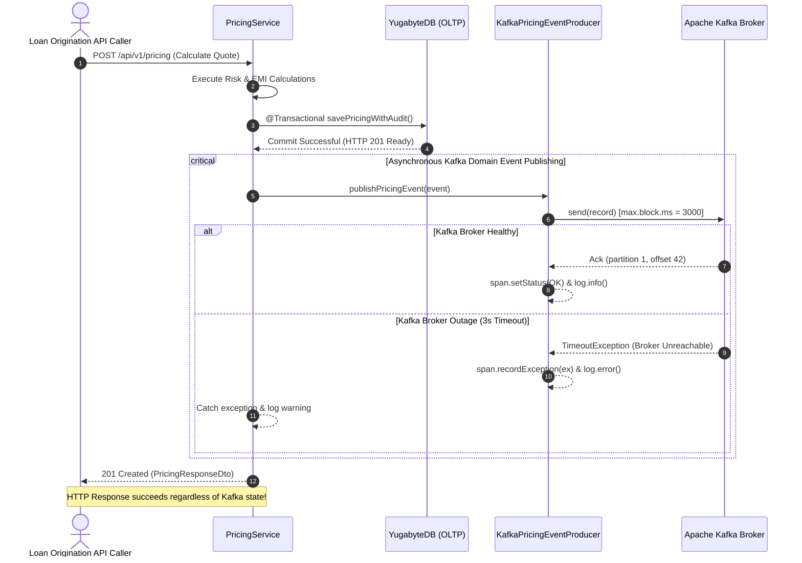

# Kafka Producer Fail-Fast Resilience & Error Decoupling

## 1. The Catastrophic Failure Mode: Synchronous Thread Pool Exhaustion

In microservice architectures, synchronous event publishing across distributed brokers poses a severe reliability hazard. When an event streaming broker becomes degraded, partitioned, or unavailable, default producer settings can rapidly trigger cascading service failure.

```
┌─────────────────────────────────────────────────────────────────────────────┐
│                 THE THREAD STARVATION TRAP (DEFAULT KAFKA)                  │
│                                                                             │
│   Incoming Client HTTP Requests (e.g. 200 concurrent borrowers)             │
│                               │                                             │
│                               ▼                                             │
│   ┌─────────────────────────────────────────────────────────────────────┐   │
│   │ Tomcat HTTP Worker Thread Pool (max-threads: 200)                   │   │
│   │ [Thread 1] [Thread 2] [Thread 3] ... [Thread 200]                   │   │
│   └──────────────────────────────────┬──────────────────────────────────┘   │
│                                      │                                      │
│                                      ▼                                      │
│   ┌─────────────────────────────────────────────────────────────────────┐   │
│   │ Kafka Producer with default max.block.ms = 60,000ms                 │   │
│   │ Broker unreachable -> Each thread BLOCKS for 60 SECONDS!            │   │
│   └──────────────────────────────────┬──────────────────────────────────┘   │
│                                      │                                      │
│   ❌ RESULT: Within 500ms, all 200 Tomcat threads are frozen.               │
│   ❌ Healthchecks (/actuator/health) timeout -> Orchestrator kills pods.    │
│   ❌ Entire microservice crashes even though DB and Pricing Engine work!    │
└─────────────────────────────────────────────────────────────────────────────┘
```

By default, the Apache Kafka Java client configures `max.block.ms: 60000` (60 seconds). If Kafka metadata retrieval or memory buffer allocation fails, each HTTP thread calling the producer blocks synchronously for up to 60 seconds, rapidly exhausting Tomcat's worker threads and creating an availability outage.

---

## 2. The Fail-Fast Mitigation: `max.block.ms: 3000`

`epricing-service` protects thread pool availability by enforcing a strict **3000ms (3-second) fail-fast timeout** across configuration layers.

### Configuration Enforcement
In `src/main/resources/application.yml`:
```yaml
spring:
  kafka:
    producer:
      acks: all
      retries: 3
      properties:
        enable.idempotence: true
        spring.json.add.type.headers: false
        max.block.ms: ${KAFKA_PRODUCER_MAX_BLOCK_MS:3000}
```

In `KafkaProducerConfig.java`:
```java
@Bean
public ProducerFactory<String, Object> producerFactory() {
    Map<String, Object> configProps = kafkaProperties.buildProducerProperties(null);
    configProps.putIfAbsent(ProducerConfig.ENABLE_IDEMPOTENCE_CONFIG, true);
    configProps.putIfAbsent(ProducerConfig.MAX_BLOCK_MS_CONFIG, 3000);
    // ...
    return new DefaultKafkaProducerFactory<>(configProps);
}
```

### Operational Behavior During Outage
When the Kafka cluster is down or partitioned:
1. `kafkaOperations.send(record)` attempts metadata discovery.
2. If metadata is not returned within **3,000 milliseconds**, the call throws a `TimeoutException` immediately.
3. The calling thread is liberated back to the Tomcat worker pool 20x faster than default settings, preventing connection pool exhaustion and keeping HTTP health checks responsive.

---

## 3. Producer Idempotency & Delivery Guarantees

To prevent message loss and duplicate events during intermittent network partitions, the producer enforces Kafka's idempotent publishing protocol:

```text
Producer Parameters:
  acks = "all"                 (Waits for full In-Sync Replica quorum commit)
  retries = 3                  (Automated transient retry attempts)
  enable.idempotence = true    (Enforces sequence numbering and PID deduplication)
```

### Architectural Guarantees:
- **Exactly-Once Transport to Broker**: With `enable.idempotence: true`, Kafka assigns a Producer ID (`PID`) and sequence number to each message. If a transient network glitch causes a retry, the broker identifies the duplicate sequence number and discards it before appending to the commit log.
- **In-Sync Durability**: `acks: all` ensures that an event is not acknowledged until all active in-sync replicas have committed the message to disk.

---

## 4. Decoupled Transaction Error Handling

In `epricing-service`, customer loan origination must never fail simply because downstream analytical event publishing encountered an issue. Therefore, database transactions and Kafka event publishing are cleanly **decoupled**.



### Code Implementation (`PricingService.java`)
```java
// 1. Transactional DB commit completes first
PricingRequest saved = auditService.savePricingWithAudit(pricingRequest, clientIp, correlationId);
PricingResponseDto responseDto = mapToResponseDto(saved);

// 2. Kafka publish is decoupled in a non-blocking try-catch block
if (pricingEventProducer != null && pricingEventProducer.isKafkaEnabled()) {
    try {
        LoanPricingEvent event = buildPricingEvent(saved, activeSpan);
        pricingEventProducer.publishPricingEvent(event);
    } catch (Exception ex) {
        // Log warning and record metric; DO NOT abort customer transaction
        structuredLogger.warn("kafka_publish_failed", "Failed to dispatch loan pricing event to Kafka: " + ex.getMessage());
        pricingMetrics.incrementPricingFailedCounter("KAFKA_PUBLISH_ERROR");
    }
}

return responseDto; // Always succeeds with 201 Created
```

---

## 5. Distributed Tracing & OpenTelemetry Error Correlation

When an error occurs during publishing, `KafkaPricingEventProducer` captures the exception directly onto the active OpenTelemetry span:

```java
future.whenComplete((result, ex) -> {
    try {
        if (ex != null) {
            if (activeSpan != null) {
                activeSpan.setStatus(StatusCode.ERROR, ex.getMessage());
                activeSpan.recordException(ex);
            }
            log.error("Failed to publish loan pricing event to Kafka | topic={} | requestId={} | error={}",
                    topic, event.getRequestId(), ex.getMessage(), ex);
        } else {
            if (activeSpan != null) {
                activeSpan.setStatus(StatusCode.OK);
            }
            // ...
        }
    } finally {
        if (activeSpan != null) {
            activeSpan.end();
        }
    }
});
```

In Grafana Tempo, the trace span `kafka.publish.loan-pricing-events` displays with status `ERROR`, including the stack trace, while the parent HTTP span finishes cleanly, enabling SREs to triage messaging latency or outages instantly.

---

## 6. The Dual-Write Hazard & Future Outbox Recommendation

While the decoupled try-catch pattern ensures high availability for the HTTP caller, it creates a **Dual-Write Consistency Gap**: if Kafka is unavailable during the calculation, the database record is saved but the Kafka event is permanently lost.

As identified in the **Architectural Audit** ([`docs/architectural-audit.md`](../architectural-audit.md) § ORC-01) and **Production Readiness Audit** ([`docs/PRODUCTION_READINESS_AUDIT.md`](../PRODUCTION_READINESS_AUDIT.md)), the enterprise remediation for zero-data-loss event streaming is the **Transactional Outbox Pattern**:

```
┌─────────────────────────────────────────────────────────────────────────────┐
│                       TRANSACTIONAL OUTBOX PATTERN                          │
│                                                                             │
│   Spring Boot Service                                                       │
│   ┌─────────────────────────────────────────────────────────────────────┐   │
│   │ Single DB Transaction (ACID Atomic Commit)                          │   │
│   │   1. INSERT INTO pricing_requests (...)                             │   │
│   │   2. INSERT INTO outbox_events (id, topic, payload, created_at)     │   │
│   └──────────────────────────────────┬──────────────────────────────────┘   │
│                                      │                                      │
│                                      ▼                                      │
│   ┌─────────────────────────────────────────────────────────────────────┐   │
│   │ YugabyteDB / PostgreSQL WAL Log                                     │   │
│   └──────────────────────────────────┬──────────────────────────────────┘   │
│                                      │                                      │
│                                      ▼                                      │
│   ┌─────────────────────────────────────────────────────────────────────┐   │
│   │ Debezium / Kafka Connect CDC Relay                                  │   │
│   │   Reads outbox_events WAL -> Streams to loan-pricing-events topic    │   │
│   └──────────────────────────────────┬──────────────────────────────────┘   │
│                                      │                                      │
│                                      ▼                                      │
│                        Apache Kafka KRaft Broker                            │
│                        (100% Guaranteed Delivery)                           │
└─────────────────────────────────────────────────────────────────────────────┘
```

With Transactional Outbox, the domain event is committed into an `outbox_events` table within the exact same database transaction as `pricing_requests`. A background change-data-capture (CDC) relay (e.g., Debezium) streams events to Kafka with zero loss, achieving full dual-write resilience.
