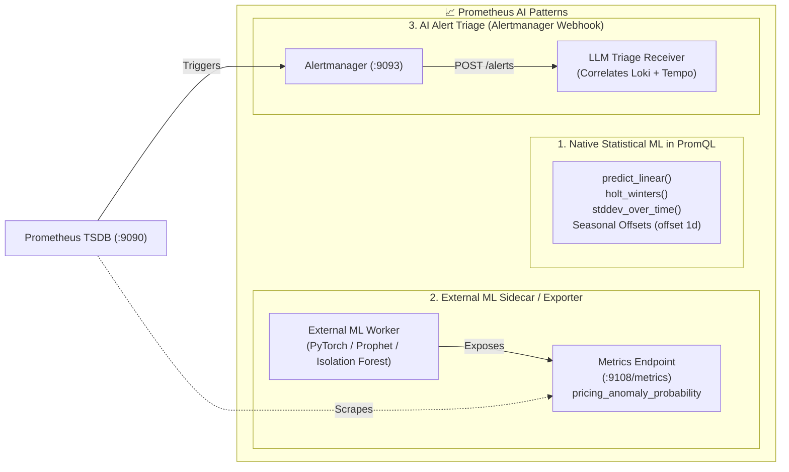
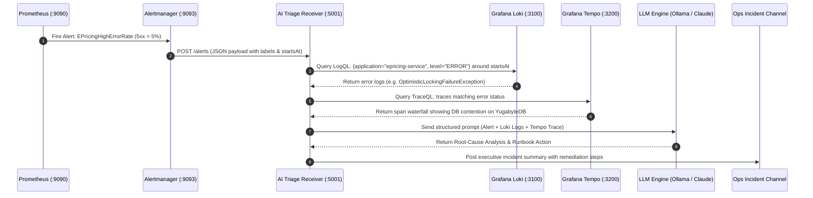
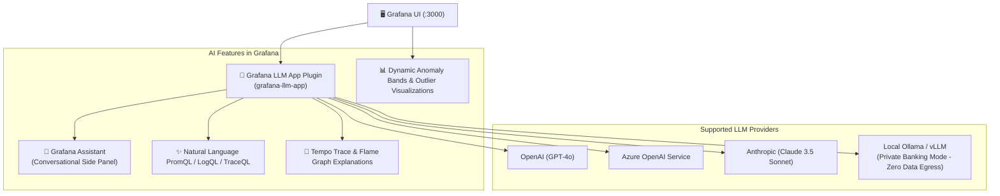

# Using AI and Machine Learning in Prometheus and Grafana

> **Target Architecture:** Bank ePricing Service Observability Stack  
> **Components:** Prometheus v2.53.0 | Grafana v11.1.0 | Grafana Loki v3.1.0 | Grafana Tempo v2.5.0 | Alertmanager v0.27.0 | Apache Kafka v3.8.0  
> **Scope:** Technical Feasibility, Native Engine Capabilities, Extension Architectures, and Banking Production Guidelines  

---

## 1. Executive Summary

**Yes, you can use AI and Machine Learning in both Prometheus and Grafana**, but they serve fundamentally different architectural roles in the observability pipeline:

| Capability / Dimension | Prometheus | Grafana |
| :--- | :--- | :--- |
| **Native AI/ML Core** | ❌ **No**. Prometheus is intentionally a lightweight, deterministic time-series database (TSDB) in Go without an embedded ML runtime. | ⚠️ **Partial**. Grafana Cloud/Enterprise has native **Grafana ML**; open-source Grafana uses the **Grafana LLM App Plugin** (`grafana-llm-app`). |
| **Mathematical / Statistical Forecasting** | ✅ **Yes (Native)**. Built-in PromQL functions: `predict_linear()`, `holt_winters()`, `stddev_over_time()` (Z-scores), and seasonal offsets (`offset 1d`, `offset 7d`). | ✅ **Yes**. Visual regression models, anomaly bands, dynamic confidence intervals, and outlier panels. |
| **Generative AI / Natural Language** | ❌ **External only**. Requires an external LLM agent or PromQL copilot. | ✅ **Yes (via Plugin)**. Grafana Assistant, natural language to PromQL/LogQL/TraceQL, panel summarization, and Tempo trace explanations. |
| **AIOps & Incident Triage** | ⚠️ **Via Alertmanager Webhooks**. Prometheus sends raw alert JSON; an AI webhook receiver correlates logs and traces. | ✅ **Yes**. Grafana Incident & Sift correlates metric anomalies with Loki error logs and Tempo traces. |
| **Model Ingestion Pattern** | **Pull-Expose**: External ML workers expose anomaly scores via `/metrics` for Prometheus to scrape. | **Plugin / Data Source**: Connects directly to OpenAI, Anthropic, Azure OpenAI, or local LLMs (Ollama/vLLM). |
| **Production Alerting Role** | **Deterministic Ground Truth**: Must fire deterministic alerts (P0/P1) without probabilistic false negatives. | **Advisory & Visual Investigation**: Accelerates mean-time-to-detect (MTTD) and mean-time-to-resolve (MTTR). |

---

## 2. Using AI with Prometheus

Prometheus is engineered for **ultra-high reliability, minimal CPU/memory overhead, and deterministic evaluation**. It deliberately omits heavyweight neural-network runtimes. However, AI/ML is integrated with Prometheus through three distinct architectural patterns:



---

### Pattern 1: Native Statistical ML in PromQL (No External AI Needed)

PromQL provides built-in statistical regression and variance functions that achieve predictive anomaly detection natively within the database engine:

#### A. Linear Trend Forecasting (`predict_linear`)
Projects metric values $t$ seconds into the future using ordinary least squares linear regression over a sliding range vector.

- **Bank ePricing Use Case:** Alerting before JVM Old Generation memory or database connection pools are fully exhausted.
- **Java 21 G1 GC Architecture Rule:** In Java 21 G1 GC, Eden and Survivor spaces report `jvm_memory_max_bytes = -1` (dynamically sized). An unaggregated rule matching `area="heap"` will compare Eden space against `-1` and trigger false alerts continuously!
- **Diurnal Traffic Trap:** In banking applications, traffic ramps up steeply between 9:00 AM and 11:00 AM. Pure linear extrapolation of 1-hour heap growth will project infinite memory exhaustion by afternoon. Therefore, **always pair `predict_linear` with a baseline utilization floor**:

```yaml
# Correct Java 21 Old-Gen Linear Prediction with Utilization Floor:
- alert: EPricingJVMOldGenOOMPredicted
  expr: |
    (
      predict_linear(jvm_memory_used_bytes{job="epricing-service", area="heap", id=~".*Old.*|.*Tenured.*"}[1h], 4 * 3600)
      >
      jvm_memory_max_bytes{job="epricing-service", area="heap", id=~".*Old.*|.*Tenured.*"}
    )
    and
    (
      jvm_memory_used_bytes{job="epricing-service", area="heap", id=~".*Old.*|.*Tenured.*"}
      /
      jvm_memory_max_bytes{job="epricing-service", area="heap", id=~".*Old.*|.*Tenured.*"} > 0.65
    )
  for: 15m
  labels:
    severity: warning
    team: epricing
  annotations:
    summary: "JVM Tenured Heap exhaustion predicted within 4 hours"
    description: "Old Gen heap on {{ $labels.instance }} is currently above 65% and linearly trending to 100% capacity within 4 hours. Check for memory leaks."
```

#### B. Dynamic Z-Score Anomaly Detection
Detects sudden traffic surges or silent calculation drop-offs by measuring standard deviations from the rolling average:

$$\text{Z-Score} = \frac{x_t - \mu_{\text{rolling}}}{\sigma_{\text{rolling}}}$$

```promql
# Alert if current request rate deviates by > 3 standard deviations from the 1-hour rolling mean:
(
  rate(pricing_requests_total{type="all"}[5m]) 
  - avg_over_time(rate(pricing_requests_total{type="all"}[5m])[1h])
) 
/ stddev_over_time(rate(pricing_requests_total{type="all"}[5m])[1h]) > 3
```

#### C. Day-over-Day Seasonal Comparisons (`offset`)
For cyclical banking workloads where traffic matches weekly or daily patterns, compare current throughput with historical baselines:

```promql
# Alert if loan calculation volume drops by more than 50% compared to the exact same time yesterday:
(
  rate(pricing_requests_total{type="all"}[5m] offset 1d)
  - rate(pricing_requests_total{type="all"}[5m])
)
/ rate(pricing_requests_total{type="all"}[5m] offset 1d) > 0.50
```

#### D. Holt-Winters Exponential Smoothing (`holt_winters`)
Calculates smoothed trend forecasts for metrics with recurring cycles. In PromQL, indexing a range on a function call requires subquery syntax (`[range:resolution]`):

```promql
# Smoothed forecast using 0.2 trend factor and 0.1 seasonal factor over 4-hour window at 1-minute resolution:
holt_winters(rate(pricing_requests_total[5m])[4h:1m], 0.2, 0.1)
```

---

### Pattern 2: External ML Exporter (Sidecar Anomaly Detector)

When advanced deep learning (Autoencoders, LSTMs) or unsupervised anomaly detection (Scikit-learn Isolation Forests, Facebook Prophet) is required:

1. **Architecture:** A lightweight Python container runs alongside `epricing-service` in `docker-compose.yml`.
2. **Data Pull:** It queries historical metric series from Prometheus via `GET /api/v1/query_range`.
3. **Inference:** The model calculates an anomaly probability score ($0.00$ to $1.00$).
4. **Scrape Export:** It exposes standard Prometheus gauges via the official `prometheus_client` on port `9108`:

```python
# Minimal Python ML Sidecar Pattern (anomaly_exporter.py)
import time
import requests
import numpy as np
from sklearn.ensemble import IsolationForest
from prometheus_client import start_http_server, Gauge

ANOMALY_GAUGE = Gauge(
    'pricing_calculation_anomaly_probability',
    'Isolation Forest anomaly probability score for ePricing calculations',
    ['service', 'model']
)

def evaluate_model():
    # 1. Fetch last 2 hours of rate metrics from Prometheus HTTP API
    resp = requests.get('http://prometheus:9090/api/v1/query_range', params={
        'query': 'rate(pricing_calculation_duration_seconds_count[5m])',
        'start': time.time() - 7200,
        'end': time.time(),
        'step': '15s'
    }).json()
    
    values = [float(v[1]) for v in resp['data']['result'][0]['values']]
    X = np.array(values).reshape(-1, 1)
    
    # 2. Fit Isolation Forest
    clf = IsolationForest(contamination=0.01, random_state=42)
    clf.fit(X)
    
    # 3. Score current observation (-1 is outlier, 1 is inlier)
    current_val = np.array([[values[-1]]])
    score = clf.decision_function(current_val)[0]
    # Map decision function to 0.0 - 1.0 probability
    prob = float(1.0 / (1.0 + np.exp(score * 10)))
    
    ANOMALY_GAUGE.labels(service='epricing-service', model='isolation_forest').set(prob)

if __name__ == '__main__':
    start_http_server(9108)
    while True:
        try:
            evaluate_model()
        except Exception as e:
            pass
        time.sleep(15)
```

5. **Prometheus Scrape Configuration:**
   ```yaml
     - job_name: 'pricing-ai-anomaly-detector'
       scrape_interval: 15s
       static_configs:
         - targets: ['pricing-ml-sidecar:9108']
   ```
6. **Deterministic Alert on ML Metric:**
   ```yaml
   - alert: EPricingLoanCalculationAnomalyDetected
     expr: pricing_calculation_anomaly_probability{service="epricing-service"} > 0.85
     for: 5m
     labels:
       severity: warning
       team: epricing
   ```

---

### Pattern 3: Alertmanager AI Incident Triage (LLM Receiver)

In this project, Alertmanager routes alerts to `webhook-logger:5001`. In production, this webhook can be an **AIOps Triage Agent** (such as HolmesGPT, Keep, or an internal LLM agent):



#### Sample AI Triage Output Delivered to Engineering:
> 🤖 **ePricing AIOps Incident Diagnosis**
> - **Alert:** `EPricingHighErrorRate` (Severity: `CRITICAL`)
> - **Primary Symptom:** 14.2% HTTP 500 error spike starting at 10:42:15 UTC.
> - **Log Correlation (Loki):** 48 instances of `OptimisticLockingFailureException: Row was updated or deleted by another transaction` on `pricing_requests` table.
> - **Trace Correlation (Tempo):** Trace `4bf92f3577b34da6a3ce929d0e0e4736` shows 3 concurrent `approveQuote` workflow signals modifying version `1` simultaneously.
> - **Root Cause:** Concurrent rate-lock approval signals without retry backoff.
> - **Recommended Remediation:** Trigger Spring Data JPA retry policy or inspect Kafka consumer concurrency on partition key `customerId`.

---

## 3. Using AI in Grafana

Grafana provides first-class support for AI, LLMs, and Machine Learning through native enterprise capabilities and official plugins:



### Feature 1: Grafana LLM App Plugin (`grafana-llm-app`)

The official `grafana-llm-app` plugin integrates LLMs directly into Grafana's core workflow:

1. **Natural Language Query Generation (Explore Mode):**
   - Engineers can formulate queries in plain English:
     * *"Show me the 95th percentile latency of loan pricing calculations grouped by product code"*
     * Translated PromQL:
       ```promql
       histogram_quantile(0.95, sum(rate(pricing_calculation_duration_seconds_bucket[5m])) by (le, productCode))
       ```
     * *"Find all database connection timeout errors in epricing logs"*
     * Translated LogQL:
       ```logql
       {application="epricing-service"} |= "ConnectionTimeoutException"
       ```

2. **Distributed Trace Explanation (Tempo Integration):**
   - In Grafana Tempo, clicking **"Explain this trace"** on a slow request parses the span hierarchy, calculates time spent across database calls vs. Kafka dispatch, and highlights the root bottleneck.

3. **Dashboard & Panel Auto-Summarization:**
   - Automatically summarizes complex dashboards during shift handoffs, detailing whether error rates or latencies are trending up or down.

---

### Feature 2: Grafana Machine Learning (Grafana ML)

Available in Grafana Cloud and Enterprise:
- **Dynamic Anomaly Confidence Bands:** Continuously trains on metric time series to calculate upper and lower normal expected bounds. Avoids alert fatigue from static thresholds.
- **Outlier Detection:** In multi-node deployments, algorithms (DBSCAN / MAD) flag if one container instance has abnormal GC pause times compared to the cluster.

---

## 4. Hands-On Docker Compose Setup for This Repository

To test or enable AI in the local `epricing-service` observability stack:

### Step 1: Configurable Plugin Installation in `docker-compose.yml`

In `docker-compose.yml`, the `grafana` service supports plugin installation via environment variable:

```yaml
  grafana:
    image: grafana/grafana:11.1.0
    container_name: grafana
    environment:
      GF_SECURITY_ADMIN_USER: admin
      GF_SECURITY_ADMIN_PASSWORD: Bank@grafana123
      GF_FEATURE_TOGGLES_ENABLE: "traceToMetrics"
      # Enable LLM plugin:
      GF_INSTALL_PLUGINS: "${GF_INSTALL_PLUGINS:-}"
```

To start Grafana with the AI plugin enabled:
```powershell
$env:GF_INSTALL_PLUGINS="grafana-llm-app" ; docker compose up -d grafana
```

### Step 2: Private On-Premises LLM via Ollama Profile

For banking compliance where cloud LLM API keys cannot be used, run a local LLM via the Docker Compose `ai` profile:

```powershell
# Start local Ollama container alongside observability stack:
docker compose --profile ai up -d ollama

# Pull open-source model into the local container:
docker exec -it epricing-ollama ollama run llama3:8b
```

### Step 3: Configure Grafana LLM App UI

1. Open Grafana: `http://localhost:3000` (`admin` / `Bank@grafana123`).
2. Navigate to **Administration → Plugins → Grafana LLM App**.
3. Configure the provider:
   - **For Private Banking Mode (Zero Egress):**
     * Provider: `OpenAI Compatible`
     * URL: `http://ollama:11434/v1`
     * Model: `llama3:8b`
   - **For Enterprise Cloud:**
     * Provider: `Azure OpenAI` or `OpenAI` with corporate API key.

---

## 5. Architectural Standards for Banking Environments

When deploying AI into banking observability stacks:

1. **Determinism for P0/P1 Incident Alerts:**
   - **Rule:** Never use probabilistic AI models as the sole trigger for critical alerts (`EPricingServiceDown`, `YugabyteDBConnectionDown`, `KafkaBrokerUnreachable`).
   - Critical alerts must remain deterministic threshold rules evaluated in Prometheus. AI models should be restricted to **advisory triage, correlation, and anomaly scoring**.
2. **Data Privacy and PII Hygiene:**
   - Even though `epricing-service` sanitizes logs via `StructuredLogger.maskCustomerId()`, trace attributes or raw error stack traces may contain account metadata.
   - For strict banking compliance (RBI, GDPR, PCI-DSS), use **local LLMs (Ollama)** running within the corporate VPC to guarantee that financial telemetry never leaves the security perimeter.
3. **Auditability of AI Insights:**
   - Store all AI-generated triage summaries in persistent incident tickets or database audit logs (`pricing_audit_logs`) so regulators can verify how incidents were assessed and resolved.

---

## 6. Summary Decision Matrix

| Observability Need | Recommended Approach | Engine |
| :--- | :--- | :--- |
| Early warning for JVM heap or disk exhaustion | Linear regression with threshold floor (`predict_linear()`) | Prometheus PromQL |
| Sudden surge or drop in loan calculations | Dynamic Z-Score (`stddev_over_time`) | Prometheus PromQL |
| Cyclical loan volume drop detection | Day-over-day offset comparison (`offset 1d`) | Prometheus PromQL |
| Natural language query generation & PromQL assistance | Grafana LLM App Plugin (`grafana-llm-app`) | Grafana + Ollama / OpenAI |
| Root cause explanation of slow distributed traces | Tempo "Explain this trace" | Grafana + Tempo + LLM |
| Automated alert root cause correlation (Logs + Traces) | Alertmanager Webhook to LLM Triage Agent | Alertmanager + Loki + Tempo + LLM |
| Unsupervised multi-metric anomaly detection | Python ML Sidecar (`IsolationForest`) exporting to `/metrics` | Python + Prometheus Scrape |
