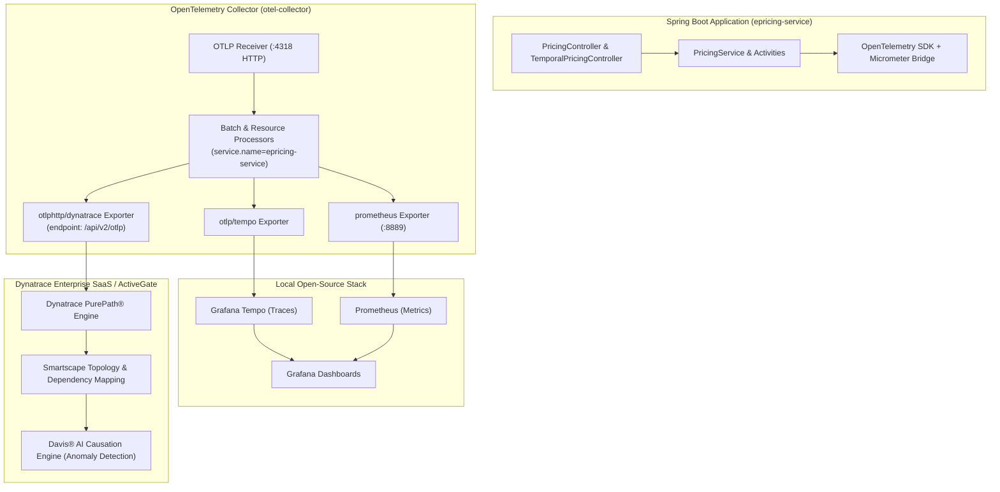

# Dynatrace — Enterprise APM & AI Observability Integration

**Configuration File:** [`otel-collector-config.yml`](file:///c:/Users/Sonux/Desktop/epricing-service/otel-collector-config.yml)  
**Application Config:** [`application.yml`](file:///c:/Users/Sonux/Desktop/epricing-service/src/main/resources/application.yml)  
**Protocol:** OpenTelemetry Protocol (OTLP / HTTP)  
**Dynatrace Ingest API:** `/api/v2/otlp`

---

## 1. Overview & Architecture

Dynatrace provides full-stack Application Performance Monitoring (APM), distributed transaction tracing (**PurePath®**), and automatic root-cause analysis powered by its **Davis® AI engine**.

Rather than requiring proprietary Dynatrace agent bytecode injection (OneAgent) into the Java application container, `epricing-service` integrates with Dynatrace using **vendor-neutral OpenTelemetry (OTLP)**.



---

## 2. How Telemetry Flows to Dynatrace

### Step 1: OpenTelemetry Trace Generation in Spring Boot
When a client requests a pricing calculation (either directly via `POST /pricing` or through a Temporal workflow activity):
1. Micrometer Tracing and the OpenTelemetry SDK capture the HTTP request, assigning a unique W3C **Trace ID** (`traceparent`).
2. Custom spans in [`PricingService.java`](file:///c:/Users/Sonux/Desktop/epricing-service/src/main/java/com/bank/epricing/service/PricingService.java) (`pricing-calculation`, `credit-score-validation`) attach banking-specific business attributes (e.g., `loan.amount_bracket`, `product.type`, `customer.credit_tier`).
3. Telemetry is flushed asynchronously over HTTP to `http://otel-collector:4318`.

### Step 2: Collector Ingestion & Processing
The `otel-collector` container:
1. Receives OTLP packets on port `4318`.
2. Applies the `batch` processor (buffering up to 1,000 spans or 5 seconds) to minimize network overhead.
3. Applies the `resource` processor to stamp environment tags:
   - `service.name`: `epricing-service`
   - `service.namespace`: `Bank`
   - `service.environment`: `docker-local` / `production`

### Step 3: Dual-Export to Dynatrace & Grafana
The Collector branches the telemetry stream simultaneously:
- **Local stack**: Pushes to Grafana Tempo and Prometheus for developer inspection.
- **Dynatrace**: Pushes over HTTPS to Dynatrace's OTLP ingest endpoint via `otlphttp/dynatrace`.

---

## 3. OpenTelemetry Collector Dynatrace Exporter

In [`otel-collector-config.yml`](file:///c:/Users/Sonux/Desktop/epricing-service/otel-collector-config.yml):

```yaml
exporters:
  otlphttp/dynatrace:
    endpoint: "${env:DYNATRACE_ENV_URL}/api/v2/otlp"
    headers:
      Authorization: "Api-Token ${env:DYNATRACE_API_TOKEN}"
```

In the pipeline definition:

```yaml
service:
  pipelines:
    traces:
      receivers: [otlp]
      processors: [memory_limiter, batch, resource]
      exporters: [otlp/tempo, otlphttp/dynatrace, debug]

    metrics:
      receivers: [otlp]
      processors: [memory_limiter, batch, resource]
      exporters: [prometheus, otlphttp/dynatrace, debug]
```

---

## 4. Key Dynatrace Capabilities Enabled

### A. PurePath® Distributed Tracing
- Dynatrace ingests OTLP spans and reconstructs complete call trees.
- Span attributes recorded in Java (like `error=true`, `loan.product_type`) appear directly in the PurePath waterfall view.
- Trace IDs generated by Spring Boot match Dynatrace trace IDs, allowing seamless correlation between application logs and Dynatrace PurePaths.

### B. Davis® AI Root-Cause Analysis
- **Automatic Baselines**: Davis learns normal response times, throughput, and error rates for every endpoint.
- **Problem Detection**: If database latency increases or credit check failures spike, Davis groups related alerts into a single **Problem Ticket**.
- **Deterministic Root Cause**: Davis traverses the dependency graph (Service → Process → Container → Node) to pinpoint the exact root cause (e.g. YugabyteDB connection pool saturation) rather than sending alert storms.

### C. Smartscape Topology Mapping
- Automatically discovers dependencies between `epricing-service`, `temporal-worker`, PostgreSQL / YugabyteDB, and external clients.

---

## 5. Configuration & Environment Variables

To connect `epricing-service` to your Dynatrace tenant:

1. **Obtain API Token**:
   - In Dynatrace UI, navigate to **Manage** → **Access tokens** → **Generate new token**.
   - Select scopes:
     - `openTelemetryTrace.ingest` (Ingest OpenTelemetry traces)
     - `metrics.ingest` (Ingest metrics)

2. **Set Environment Variables**:
   In your `.env` file or shell environment:
   ```bash
   # Your Dynatrace SaaS environment URL or ActiveGate URL
   DYNATRACE_ENV_URL=https://{your-environment-id}.live.dynatrace.com

   # API Token generated with ingest scopes
   DYNATRACE_API_TOKEN=dt0c01.SAMPLE_TOKEN_VALUE

   # Enable Dynatrace integration flag
   DYNATRACE_ENABLED=true
   ```

3. **Verify Connection**:
   Start the stack:
   ```bash
   docker-compose up -d otel-collector epricing-service
   ```
   Check collector logs:
   ```bash
   docker logs otel-collector -f
   ```
   The collector will show outbound export requests to `${DYNATRACE_ENV_URL}/api/v2/otlp/v1/traces` returning HTTP 200/202 Success.
