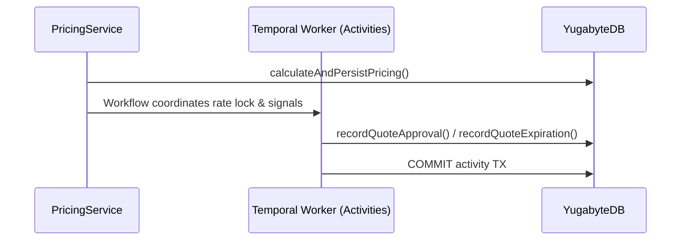

# PricingAuditService

**Package:** `com.bank.epricing.service`  
**File:** [`PricingAuditService.java`](file:///c:/Users/Sonux/Desktop/epricing-service/src/main/java/com/bank/epricing/service/PricingAuditService.java)  
**Stereotype:** `@Service`

---

## Purpose

`PricingAuditService` writes **immutable audit log entries** for every pricing operation. It is decoupled from the main request path in two ways:

1. **Durable Temporal Activities** — Workflow-driven audit events (rate lock approvals, rejections, expirations) are executed via Temporal Activities (`PricingActivitiesImpl`), ensuring retries and durability without holding JVM threads.
2. **Independent transaction** — uses `@Transactional(propagation = REQUIRES_NEW)` so technical failure records are persisted even if the main business transaction rolls back.

---

## Design Principles

### Why Temporal Activities Over In-JVM `@Async`?

In standard Spring Boot, `@Async` thread pools write audit logs in background JVM threads. However:
- If the server restarts or crashes, queued in-memory audit logs are permanently lost.
- Sizing thread pools is error-prone and can exhaust memory during load spikes.

With **Temporal Activities**:
- Audit events are dispatched to Temporal task queues and executed durably.
- If the worker crashes, Temporal restarts the activity on another worker or when the service recovers.
- Retries with exponential backoff are automatic.

### Why `REQUIRES_NEW`?

Scenario: A pricing calculation fails due to an unexpected technical exception and the main transaction rolls back. A record of the failure **must still exist** so that support engineers and Grafana dashboards can inspect the error.

`REQUIRES_NEW` suspends the calling thread's transaction (if any) and opens a brand-new, independent transaction. This guarantee ensures audit and failure records are always written, even when the main business transaction fails.



---

## Technical Failure Recording

```java
@Transactional(propagation = Propagation.REQUIRES_NEW)
public void recordTechnicalFailure(PricingRequestDto requestDto, String errorMessage,
                                   String requestIp, String traceId) {
    // Persists ERROR status record in isolated transaction
}
```

- `@Transactional(propagation = REQUIRES_NEW)` — always opens a new DB transaction.
- Saves the error message directly so L1 support can diagnose failures without logging into the database.
|---|---|---|
| `corePoolSize` | 5 | Always-on threads ready to accept audit tasks |
| `maxPoolSize` | 20 | Max threads under heavy burst (I/O-bound) |
| `queueCapacity` | 100 | Queue depth before spawning new threads |
| `threadNamePrefix` | `epricing-async-` | Named threads — appear in thread dumps |
| `waitForTasksToCompleteOnShutdown` | `true` | Graceful shutdown — no lost audit logs |
| `awaitTerminationSeconds` | 30 | Max wait on app shutdown |

Threads appear in JVM thread dumps as `epricing-async-1`, `epricing-async-2`, etc. This makes identifying audit-writing threads trivial during incident investigation.

---

## Audit Log Content

The calling code in `PricingService` builds the `PricingAuditLog` entity before calling `logAsync`. Typical audit entry:

| Field | Example |
|---|---|
| `pricingRequestId` | `101` |
| `customerId` | `CUST001234` |
| `action` | `PRICING_CALCULATED` |
| `description` | `Interest rate 8.50% p.a. calculated for HOME_LOAN of ₹5000000` |
| `performedBy` | `system:pricing-engine` |
| `outcome` | `SUCCESS` |
| `traceId` | `abc123def456` |
| `requestIp` | `192.168.1.1` |
| `durationMs` | `142` |

---

## Audit Repository

`PricingAuditService` depends on `PricingAuditRepository`. See [PricingAuditRepository.md](../repositories/PricingAuditRepository.md) for query details.

---

## Error Handling in Async Context

Since `logAsync` runs on a separate thread, exceptions are **not propagated** back to the HTTP response. Spring's `@Async` infrastructure wraps the future; any uncaught exception is logged by Spring's default `AsyncUncaughtExceptionHandler`. In production, you would configure a custom `AsyncUncaughtExceptionHandler` to:

1. Alert the on-call team (critical: audit failure in banking = compliance risk).
2. Retry the write (idempotent due to unique trace IDs).

---

## Cross-References

- [PricingService.md](./PricingService.md) — how `logAsync` is invoked
- [PricingAuditRepository.md](../repositories/PricingAuditRepository.md) — persistence queries
- [PricingAuditLog.md](../entities/PricingAuditLog.md) — entity schema
- [WebConfig.md](../configuration/WebConfig.md) — thread pool configuration
- [AuditTrail.md](../features/AuditTrail.md) — feature documentation
