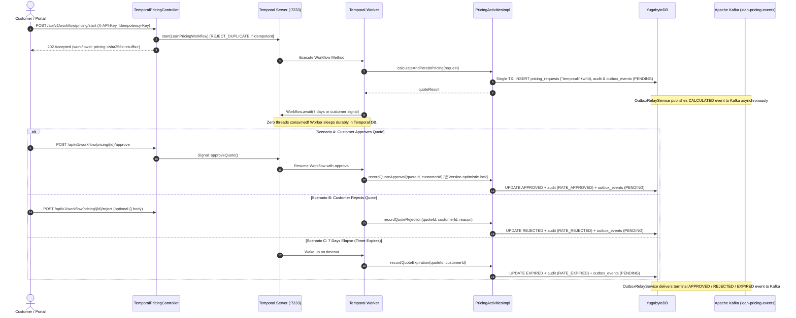

# Temporal Durable Workflow Orchestration

**Package:** `com.bank.epricing.temporal`  
**Configuration File:** [`TemporalConfig.java`](../../src/main/java/com/bank/epricing/temporal/config/TemporalConfig.java)  
**Workflow Interface:** [`LoanPricingWorkflow.java`](../../src/main/java/com/bank/epricing/temporal/workflow/LoanPricingWorkflow.java)  
**Activities Interface:** [`PricingActivities.java`](../../src/main/java/com/bank/epricing/temporal/activity/PricingActivities.java)  
**Temporal Web UI:** `http://localhost:8233`  
**Temporal gRPC Server:** `localhost:7233`  
**Downstream Event Streaming:** [`LoanPricingEventStreaming.md`](../messaging/LoanPricingEventStreaming.md)

---

## 1. Overview & Business Value

In retail banking, loan pricing is not just a single calculation — it involves a **multi-day customer lifecycle**:
1. **Quote Generation**: The system evaluates eligibility, computes the interest rate and EMI, and quotes an offer.
2. **Rate Lock Guarantee**: The bank guarantees the quoted interest rate for a specific duration (e.g. 7 days).
3. **Customer Decision**: The customer reviews the offer and either accepts (approves) or rejects it.
4. **Auto-Expiration**: If the 7-day validity window elapses without a customer decision, the quote automatically expires.

Historically, microservices attempted to manage this with database polling cron jobs, message queues, and in-JVM `@Async` thread pools. This led to:
- **Thread Exhaustion**: Long-running threads held in memory.
- **Lost Quotes**: Server restarts or crashes during a rate lock caused in-flight applications to disappear.
- **Race Conditions**: Parallel approvals or status checks collided in the database.

**Temporal** solves this by treating workflows as **durable, deterministic state machines**.

---

## 2. Architecture & Lifecycle Sequence



---

## 3. Transactional Outbox & Kafka Domain Event Integration on State Transitions

State transitions inside `PricingActivitiesImpl` enqueue `LoanPricingEvent` records into YugabyteDB `outbox_events` (`OutboxService.enqueue`) inside the same `@Transactional` activity boundary (with a post-commit fallback via `TransactionSynchronizationManager.afterCommit()` only when outbox mode is explicitly disabled):

- **CALCULATED**: Enqueued atomically during `calculateAndPersistPricing()` using deterministic deduplication key `"temporal:" + workflowId` so activity retries never create duplicate quotes.
- **APPROVED / REJECTED / EXPIRED**: Enqueued atomically inside optimistic-locked (`@Version`) terminal transition methods (`recordQuoteApproval`, `recordQuoteRejection`, `recordQuoteExpiration`) — with `TERMINAL_STATUSES` idempotency guards preventing duplicate state updates on late signals.

```java
private void emitStatusEvent(PricingRequest saved, String status) {
    if (outboxService != null && outboxService.isEnabled()) {
        outboxService.enqueue("PRICING_REQUEST", saved.getId(), buildStatusEvent(saved, status));
    } else if (pricingEventProducer != null) {
        publishStatusEvent(saved, status);
    }
}
```

*For the full end-to-end visual flow and outbox DLQ recovery sequence, see [`docs/ARCHITECTURE_DATA_FLOW.md`](../ARCHITECTURE_DATA_FLOW.md).*

---

## 4. PII Data Masking Across Workflow Layers

To comply with banking data privacy regulations (RBI / GDPR), all log statements across Temporal controllers, activities, and workflows strictly sanitize customer identifiers using `StructuredLogger.maskCustomerId()`:

1. **Temporal Controller (`TemporalPricingController.java`)**:
   ```java
   log.info("Starting durable loan pricing workflow for customer: {}",
           StructuredLogger.maskCustomerId(requestDto.getCustomerId()));
   ```
2. **Workflow Implementation (`LoanPricingWorkflowImpl.java`)**:
   ```java
   Workflow.getLogger(LoanPricingWorkflowImpl.class).info(
           "Starting loan pricing workflow for customer: {}",
           StructuredLogger.maskCustomerId(requestDto.getCustomerId()));
   ```
3. **Activities Implementation (`PricingActivitiesImpl.java`)**:
   ```java
   log.info("Recording quote approval for quoteId: {}, customer: {}",
           quoteId, StructuredLogger.maskCustomerId(customerId));
   ```

Raw customer identifiers (e.g. `CUST001234`) are never written to Loki logs in plaintext; they are transformed into masked tokens like `CUST****1234`.

---

## 5. Workflow Implementation & Determinism Rules

### Determinism Rules
Temporal workflow code (`LoanPricingWorkflowImpl`) must be **100% deterministic** to allow replay during worker failure recovery:
- Use `Workflow.currentTimeMillis()` or activity timestamps (never `System.currentTimeMillis()` or `LocalDateTime.now()` directly in workflow code).
- Use `Workflow.sleep()` or `Workflow.await()` instead of `Thread.sleep()`.
- Use `Workflow.newActivityStub(...)` to run database, network, and I/O operations inside Activities.

### Activity Retry Policies
Activities are configured with automatic exponential backoff and explicit non-retryable business exception filters:
```java
ActivityOptions options = ActivityOptions.newBuilder()
    .setStartToCloseTimeout(Duration.ofSeconds(30))
    .setRetryOptions(RetryOptions.newBuilder()
        .setInitialInterval(Duration.ofSeconds(1))
        .setBackoffCoefficient(2.0)
        .setMaximumInterval(Duration.ofSeconds(10))
        .setMaximumAttempts(5)
        .setDoNotRetry(
            PricingException.class.getName(),
            PricingException.InsufficientCreditScoreException.class.getName(),
            PricingException.LoanAmountExceedsEligibilityException.class.getName(),
            PricingException.FoirExceededException.class.getName(),
            PricingException.UnsupportedProductTypeException.class.getName()
        )
        .build())
    .build();
```

---

## 6. REST API Reference

All Temporal workflow endpoints are under `/api/v1/workflow/pricing`:

| Method | Endpoint | Description |
|---|---|---|
| `POST` | `/api/v1/workflow/pricing/start` | Starts a new `LoanPricingWorkflow` execution asynchronously. Returns HTTP 202 Accepted with `workflowId` and initial result. |
| `GET` | `/api/v1/workflow/pricing/{workflowId}` | Queries complete workflow state and full `PricingWorkflowResult` DTO. |
| `GET` | `/api/v1/workflow/pricing/{workflowId}/status` | Fast status query returning simple JSON `{ "workflowId": "...", "status": "..." }`. |
| `POST` | `/api/v1/workflow/pricing/{workflowId}/approve` | Dispatches approval signal to the running workflow. Returns updated workflow state. |
| `POST` | `/api/v1/workflow/pricing/{workflowId}/reject` | Dispatches rejection signal with optional `{ "reason": "..." }` JSON body (empty/`{}` defaults safely to `"Customer rejected offer"`). |

---

## 7. Local Inspection & Verification

When running the stack with Docker:
1. Open the **Temporal Web UI** at **`http://localhost:8233`**.
2. Select namespace `default`.
3. View running workflows, execution history, timers, input payloads, and activity retries in real time.
